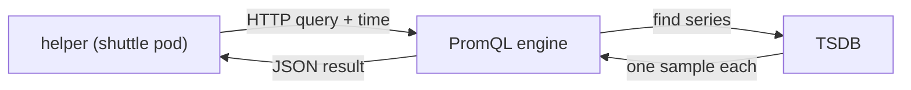

# The Series Model: Samples, Names And Labels

A query language is only as exact as the data it selects. In PromQL, the thing you select is a time series, and one wrong assumption about what a series is leads to results that look right and are not. This part shows what Prometheus stores, how a metric name and a set of labels identify one series, and how to read one line of output.

## One query, end to end

Start with the shortest useful query. It is a metric name and nothing else:

<!-- astrona:playground:renew -->

```sh
kubectl -n starfleet exec deploy/shuttle -- python /tools/pq.py 'up'
```

You should see:

```text
up{instance="bridge-0:8080", job="bridge"} 1
up{instance="bridge-1:8080", job="bridge"} 1
up{instance="probe-0:9100", job="probe"} 1
up{instance="shuttle-0:8080", job="shuttle"} 1
```

Four components took part. The helper in the `shuttle` pod sent one HTTP request to the Prometheus API, `/api/v1/query`, with the expression and the evaluation time 1767229200. The PromQL engine inside the Prometheus server parsed the expression and decided which series it needs. The time series database (TSDB), which is the storage inside the same server, found those series and returned one sample for each. The helper printed the result as text.



The diagram shows that the helper never reads data itself: the Prometheus server selects and evaluates, and the helper only formats the answer.

The result has four lines, and the data has five targets. The fifth, `probe-1`, has no recent sample at this time, so it is not in the result. The next sections define the words needed to explain this exactly.

## Samples and series

A **sample** is one measured value with the time of the measurement. A **time series** is the list of all samples of one measured thing, ordered by time. In this data, the series for `up` of `bridge-0` has 241 samples: one value every 15 seconds for one hour. Each sample is a 64-bit floating point number plus a millisecond timestamp.

An **instant vector** is the result of a selector at one point in time: for every matching series, the one sample that is valid at that time. The four lines above are an instant vector with four elements. Each element keeps the labels of its series and carries one value. The timestamp belongs to the evaluation, not to the series, so the helper does not print it.

## What identifies a series

A series is identified by its **metric name** and its **label set**. A label is a key and a value, both strings. The metric name describes what is measured, for example `queue_depth` or `http_requests_total`. Labels describe where and how it was measured. Two series with the same name and different labels are two different series. Run a metric that has three series:

```sh
kubectl -n starfleet exec deploy/shuttle -- python /tools/pq.py 'queue_depth'
```

You should see:

```text
queue_depth{instance="bridge-0:8080", job="bridge"} 30
queue_depth{instance="bridge-1:8080", job="bridge"} 25
queue_depth{instance="shuttle-0:8080", job="shuttle"} 280
```

There is one metric name and three label sets. The numbers 30, 25 and 280 come from the generated data: `bridge-0` follows a triangle wave between 10 and 30, `bridge-1` holds 25 after its restart, and `shuttle-0` grows by 2 at every step. You can read these results as: "three queues, one per target, and this is the depth of each right now".

The metric name is stored as a label, too. Its key is `__name__`. The selector `up` is a short form of `{__name__="up"}`. Labels whose key starts with two underscores are reserved for internal use by Prometheus. The helper prints `__name__` in front of the braces and prints the other labels inside them, sorted by key.

The labels `job` and `instance` have a special role. In a normal Prometheus installation, the scrape process attaches them to every sample it collects: `job` names the group of targets from the scrape configuration, and `instance` names the single endpoint, as host and port. The dataset here has the same labels, so selectors behave as they do on a real server. The other labels come from the application that exposes the metric. `method` and `status` in `http_requests_total` are examples.

## Same name, more labels

A metric can carry labels that other metrics do not have. Select the request counter of one job:

```sh
kubectl -n starfleet exec deploy/shuttle -- python /tools/pq.py 'http_requests_total{job="shuttle"}'
```

You should see:

```text
http_requests_total{instance="shuttle-0:8080", job="shuttle", method="GET", status="200"} 64400
http_requests_total{instance="shuttle-0:8080", job="shuttle", method="GET", status="500"} 4400
```

The two series differ only in the label `status`. A series exists for every distinct combination of label values that the application reported, so the label set decides how many series a metric has. The full `http_requests_total` has ten series in this data: four for `bridge-0`, four for `bridge-1` and two for `shuttle-0`. The values are counters, which only increase while a process runs. The counter of `shuttle-0` for `GET` and status 200 is 64400 because it started at 50000 and grew by 60 at each of the 240 steps.

Label names must match `[a-zA-Z_][a-zA-Z0-9_]*`. Metric names may also contain a colon: `[a-zA-Z_:][a-zA-Z0-9_:]*`. Label values can be any text, including an empty string. A label with an empty value is treated as if the label did not exist, a fact that matters for the matchers.

## Counting the population

Every selection answers a question about a population of series, so it is useful to ask how large the population is. The `count` aggregation returns the number of elements of an instant vector:

```sh
kubectl -n starfleet exec deploy/shuttle -- python /tools/pq.py 'count(up)'
```

You should see:

```text
{} 4
```

The result has no labels, because `count` merges all elements into one, so the helper prints an empty pair of braces. The value 4 is the number of series, not the sum of their values. Four series have a sample valid at 1767229200, and all of them have the value 1.

Missing series are not an error. A selector that matches nothing returns an empty vector. Compare the `temperature_celsius` metric, which has two series in the data:

```sh
kubectl -n starfleet exec deploy/shuttle -- python /tools/pq.py 'temperature_celsius'
```

You should see:

```text
temperature_celsius{instance="probe-0:9100", job="probe", sensor="cpu"} 44
```

Only `probe-0` appears. `probe-1` has a `temperature_celsius` series in storage, but its last sample is at 1767228600, which is 600 seconds before the evaluation time. An instant vector selector only accepts samples from the last five minutes before the evaluation time, so the series is silently left out. This rule is the lookback delta, and its default length is five minutes. Remember the consequence: a selector returns the series that have a recent sample, not every series that ever existed.

## Information metrics and constant values

Some series hold no measurement. They only carry labels. `build_info` has the value 1 and puts the software version into a label:

```sh
kubectl -n starfleet exec deploy/shuttle -- python /tools/pq.py 'build_info'
```

You should see:

```text
build_info{instance="bridge-0:8080", job="bridge", version="1.4.2"} 1
build_info{instance="bridge-1:8080", job="bridge", version="1.5.0"} 1
build_info{instance="shuttle-0:8080", job="shuttle", version="2.0.1"} 1
```

The label `version` changes when a target is upgraded. Prometheus then creates a new series for the new value, and the old series stops receiving samples. The same happens to every label: a new label value means a new series. The number of distinct series is called the cardinality of a metric. Labels with many distinct values, such as user names or request identifiers, create huge numbers of series and make the server slow and expensive. Labels should have a small, bounded set of values.

## What you now know

A series is a named list of timestamped numbers, and the metric name together with the label set identifies it. A selector returns an instant vector: one value per matching series that has a recent sample. The helper prints the name, the sorted labels and the value, and `count` tells you how many series a selector returned. You saw that two series of one metric can differ in a single label, that a series without a recent sample is left out without an error, and that new label values create new series.

The open question is how to choose among the series of one metric, for example only the `bridge` job, or everything except `shuttle-0`. Label matchers answer that question.

## Common pitfalls

> [!WARNING]
> - Do not read `count(up)` as a sum of the values. `count` returns the number of series. A series with the value 0 is counted too.
> - Do not assume that a missing line means an error or that the target was never there. A series without a sample in the last five minutes before the evaluation time is not returned.
> - Do not put values with unlimited variety into labels, such as an identifier of every request. Each distinct value creates a new series.
> - The helper sorts the output lines as text. The order is not the order of the series in storage and carries no meaning.
