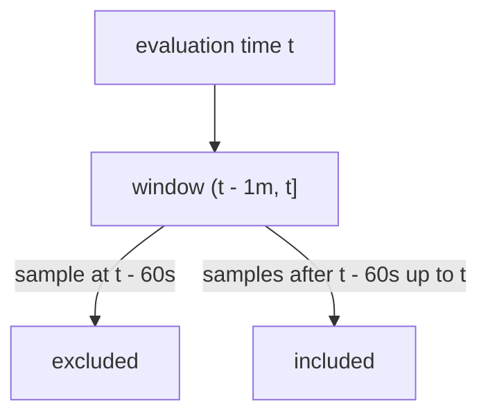

# Expression Types, Range Selectors And Counting

Every PromQL expression has a type, and the type decides where you can use it. A function that expects one type rejects another with an error, and a graph can only draw some types. This part names the four types, shows the range selector that produces a range vector, explains its duration units, and then uses `count` and `count by` to read a result and verify its population.

## Four types

PromQL has four expression types:

- **Instant vector**: a set of series with one sample each, all valid at the same evaluation time. A selector such as `up{job="probe"}` returns one.
- **Range vector**: a set of series with a list of samples each, taken from a time range that ends at the evaluation time.
- **Scalar**: one plain floating point number, without labels.
- **String**: a text value. It is rarely used and exists for some function arguments.

Run one expression of each type that does not need a series. First a scalar, from arithmetic, and the scalar returned by the function `time()`, which is the evaluation time in seconds:

<!-- astrona:playground:renew -->

```sh
kubectl -n starfleet exec deploy/shuttle -- python /tools/pq.py '2 * 3'
kubectl -n starfleet exec deploy/shuttle -- python /tools/pq.py 'time()'
```

You should see:

```text
scalar 6
scalar 1767229200
```

The second result is the default evaluation time of the helper. Now a string literal:

```sh
kubectl -n starfleet exec deploy/shuttle -- python /tools/pq.py '"hello"'
```

You should see:

```text
string hello
```

An instant vector has the labels of its series, and a scalar has none. That difference decides how the helper prints each type: a vector element as `name{labels} value`, a scalar as `scalar value`, a string as `string text`.

## The range selector

A range vector selector adds a duration in square brackets after the selector. The duration says how far back from the evaluation time to collect samples. Select the last minute of one counter:

```sh
kubectl -n starfleet exec deploy/shuttle -- python /tools/pq.py 'http_requests_total{job="shuttle", status="500"}[1m]'
```

You should see:

```text
http_requests_total{instance="shuttle-0:8080", job="shuttle", method="GET", status="500"}
  1767229155 4355
  1767229170 4370
  1767229185 4385
  1767229200 4400
```

The Prometheus server evaluated the query at 1767229200, collected the samples of the one matching series inside the range and returned all of them. The helper printed the series line and then one `timestamp value` line per sample. The values come from the data: this counter starts at 800 and grows by 15 at every step.

The range has four samples although one minute holds four intervals of 15 seconds and 60 seconds back is exactly 1767229140, where a fifth sample exists. The reason is the boundary rule: a range selector is **left-open and right-closed**. It includes samples with a timestamp greater than the evaluation time minus the duration, and up to and including the evaluation time. The sample at exactly 1767229140 is excluded. Prometheus 3 uses this rule. Earlier versions included the left boundary too, so a `[5m]` selector could return six samples with 60 second spacing. Now it always returns the same number of evenly spaced samples.



The diagram shows that the left edge of the window is open and the right edge is closed, so a one minute range at a 15 second sample spacing holds four samples.

## Duration units

A duration is an integer followed by a unit. The units are `ms` (milliseconds), `s`, `m`, `h`, `d` (24 hours), `w` (7 days) and `y` (365 days). You may combine units by writing them one after the other, from the largest to the smallest, and each unit once. `1h30m` is 5400 seconds, and `90m` is the same range. `30m1h` and `1m1m` are not valid. The following two queries select the same samples:

```sh
kubectl -n starfleet exec deploy/shuttle -- python /tools/pq.py 'queue_depth{job="shuttle"}[30s]'
kubectl -n starfleet exec deploy/shuttle -- python /tools/pq.py 'queue_depth{job="shuttle"}[30000ms]'
```

You should see the same output twice:

```text
queue_depth{instance="shuttle-0:8080", job="shuttle"}
  1767229185 278
  1767229200 280
```

Two samples fall into a 30 second window with a 15 second spacing: the one at 1767229185 and the one at 1767229200. The sample at 1767229170 lies exactly on the left edge and is excluded. If a window is shorter than the spacing of the samples, the result can have one sample or none. With `[10s]` the series has one sample, because only the sample at the evaluation time falls inside.

## Types decide what you can do

Aggregations such as `sum` and `count` work on instant vectors, and the `rate` family of functions takes a range vector. If you pass the wrong type, Prometheus returns an error and the helper prints it. This query passes a range vector to `count`:

```sh
kubectl -n starfleet exec deploy/shuttle -- python /tools/pq.py 'count(up[1m])'
```

The helper prints a line that starts with `error bad_data`. The message says that the aggregation expects an instant vector and received a range vector. The same rule applies to the API: an instant query may return any type, but a range query can only return an instant vector or a scalar, so a bare range selector cannot be graphed.

## Counting a result

The `count` aggregation returns the number of elements of an instant vector, and `count by (label)` returns one count for each distinct value of that label. Counting is the best way to check a selector, because it shows the size of the population without printing every series. Count the whole `up` metric and then split it by job:

```sh
kubectl -n starfleet exec deploy/shuttle -- python /tools/pq.py 'count(up)'
kubectl -n starfleet exec deploy/shuttle -- python /tools/pq.py 'count by (job) (up)'
```

You should see:

```text
{} 4
{job="bridge"} 2
{job="probe"} 1
{job="shuttle"} 1
```

The first query prints one line with no labels. The second query keeps only the label `job`, and the helper prints one line per job. The `probe` job counts one series, `probe-0`, because `probe-1` has no recent sample. The group `by (job)` can also be written after the parentheses: `count(up) by (job)` is the same query.

Use the counts to prove that matchers split a population correctly. The `http_requests_total` metric has ten series. Count the series with and without status 500:

```sh
kubectl -n starfleet exec deploy/shuttle -- python /tools/pq.py 'count(http_requests_total{status="500"})'
kubectl -n starfleet exec deploy/shuttle -- python /tools/pq.py 'count(http_requests_total{status!="500"})'
kubectl -n starfleet exec deploy/shuttle -- python /tools/pq.py 'count by (instance) (http_requests_total)'
```

You should see:

```text
{} 5
{} 5
{instance="bridge-0:8080"} 4
{instance="bridge-1:8080"} 4
{instance="shuttle-0:8080"} 2
```

The two counts add up to ten, the size of the metric, so the matchers `=` and `!=` split the population with no overlap and no gap. The per-instance counts add up to ten as well. When your counts do not add up, a matcher is wrong or a series has no recent sample.

A selector that matches nothing makes `count` return nothing, not zero:

```sh
kubectl -n starfleet exec deploy/shuttle -- python /tools/pq.py 'count(up{job="nothing"})'
```

You should see:

```text
(empty result)
```

An aggregation of an empty vector is an empty vector, because there is no element to carry a value. In an alert expression, this means that "no series" and "count is zero" are different cases.

## What you now know

PromQL has four types: instant vector, range vector, scalar and string. A selector gives an instant vector, a selector with a duration in square brackets gives a range vector, and the range is left-open and right-closed. Durations use the units `ms`, `s`, `m`, `h`, `d`, `w` and `y`, which you can combine from the largest unit to the smallest. `count` and `count by` return the number of series, and you use them to prove that a selector picked the population you meant.

The open question is time. Every example so far used the same evaluation time, and one series was missing from it. The time rules decide which samples a selector can see.

## Common pitfalls

> [!WARNING]
> - Do not expect a range selector to include the sample exactly one duration ago. In Prometheus 3 the left edge is open, so `[1m]` over 15 second samples returns four samples, not five.
> - Do not pass a range vector to `sum` or `count`, and do not run a range query on a bare range selector. Both are type errors.
> - `count` of a selection that matches nothing returns an empty result, not 0. Treat the two cases separately when you write checks.
> - Units must go from largest to smallest and each unit may appear once. `1h30m` is valid, `30m1h` is not.
