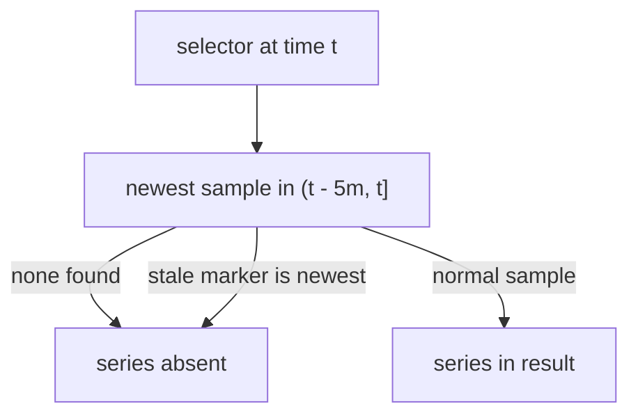

# Lookback Delta And Staleness

Samples arrive at discrete times, but an expression is evaluated at one exact time, and the two almost never coincide. Prometheus needs a rule that turns "what is the value at time t" into one stored sample, and a rule for when a series stops existing. This part explains both rules, the lookback delta and staleness, and uses them to explain two results that surprise learners: a query for the current time that returns nothing, and a target that disappears from the last minutes of the data.

## A query that returns nothing

Run the simplest query with `--now`. The option sends no evaluation time, so the Prometheus server uses its own clock:

<!-- astrona:playground:renew -->

```sh
kubectl -n starfleet exec deploy/shuttle -- python /tools/pq.py 'up' --now
```

You should see:

```text
(empty result)
```

The server did not fail. It evaluated `up` at the current time, looked for samples in the five minutes before that time and found none. The newest sample in the data is from 2026-01-01T01:00:00Z. Whenever you run this command later than five minutes after that moment, which is always, no series has a recent sample. The data has no scraping behind it, so nothing adds new samples. A live Prometheus server that scrapes its targets would return the current values here.

## The rule for instant vector selectors

An instant vector selector evaluated at time `t` returns, for each matching series, the newest sample with a timestamp in the range `(t - lookback_delta, t]`. The range is left-open: a sample exactly `lookback_delta` before `t` is not used. The default `lookback_delta` is 5 minutes. The server flag `--query.lookback-delta` changes it for all queries, and the API parameter `lookback_delta` changes it for one query. If a series has no sample in that range, the series is not part of the result.



The diagram shows the three outcomes: a series is returned with its newest sample in the window, or it is left out, either because the window holds no sample or because the newest sample is a stale marker.

The PromQL engine applies this rule on every evaluation, separately for each series. It does not interpolate and it never invents a value. The value you get can be up to 5 minutes old, and you cannot tell the age from the result alone.

## Why probe-1 disappears

The series of `probe-1` have their last sample at 1767228600, which is 00:50:00Z. Ask for `up` of that target at the time of its last sample:

```sh
kubectl -n starfleet exec deploy/shuttle -- python /tools/pq.py 'up{instance="probe-1:9100"}' --time 1767228600
```

You should see:

```text
up{instance="probe-1:9100", job="probe"} 1
```

Now move the evaluation time forward by 285 seconds, to the last second at which the rule still reaches the sample. The window is `(1767228585, 1767228885]`, and the sample at 1767228600 is inside it:

```sh
kubectl -n starfleet exec deploy/shuttle -- python /tools/pq.py 'up{instance="probe-1:9100"}' --time 1767228885
```

You should see the same line again:

```text
up{instance="probe-1:9100", job="probe"} 1
```

The value is 285 seconds old, and the query does not tell you. Move 15 seconds further, to exactly 300 seconds after the last sample:

```sh
kubectl -n starfleet exec deploy/shuttle -- python /tools/pq.py 'up{instance="probe-1:9100"}' --time 1767228900
```

You should see:

```text
(empty result)
```

The window is now `(1767228600, 1767228900]`. The sample at 1767228600 lies exactly on the open left edge and is excluded, so the series is absent. This is why the default time 1767229200 returns four series for `up`: `probe-1` has been silent for 600 seconds. At every later time the answer stays empty. Earlier times work normally. At 1767228700, 100 seconds after the last sample, both probe targets are present:

```sh
kubectl -n starfleet exec deploy/shuttle -- python /tools/pq.py 'up{job="probe"}' --time 1767228700
```

You should see:

```text
up{instance="probe-0:9100", job="probe"} 1
up{instance="probe-1:9100", job="probe"} 1
```

## Staleness

The lookback rule alone would keep a series visible for five minutes after its target is gone. Prometheus avoids that with staleness markers. When a scrape of a target no longer returns a series that it returned before, or the whole target disappears or a rule stops producing a series, the Prometheus server writes a special sample into storage: a **stale marker**. It is a floating point NaN (not a number) with a reserved bit pattern. When a selector finds a stale marker as the newest sample in the window, it treats the series as absent from that moment on, without waiting for the five minutes to pass.

The two mechanisms work together. Staleness makes a series disappear at the right time in a live system, and the lookback delta covers the cases where no marker exists. The backfilled data here has no markers, because the data block was generated and no scrape ever ran. The target `probe-1` therefore disappears only through the lookback rule, five minutes after its last sample. On a live server, removing a target usually makes its series disappear within one scrape interval, since the stale markers are written when the next scrape finds the target gone.

One more case: a target that fails a scrape still gets an `up` sample with the value 0, and the other series of that target get stale markers. In the data, `shuttle-0` reports `up` as 0 for ten minutes. A value of 0 is a real sample, and it is returned. Check a time inside that period:

```sh
kubectl -n starfleet exec deploy/shuttle -- python /tools/pq.py 'up{job="shuttle"}' --time 1767228300
```

You should see:

```text
up{instance="shuttle-0:8080", job="shuttle"} 0
```

The series is present with the value 0. Compare this with `probe-1`, which is absent. A series that exists with value 0 and a series that does not exist are different situations, and an expression that must detect both has to handle each one.

## What the lookback delta means for choosing a scrape interval

The 5 minute lookback is much longer than a typical scrape interval of 15 to 60 seconds. A series with samples every 15 seconds survives the loss of up to 19 samples before it disappears. If an application is scraped less often than every 5 minutes, its series flicker in and out of results, because the window sometimes holds no sample. The server flag `--query.lookback-delta` can be raised for such cases, but it affects every query and delays the point at which series without stale markers disappear.

## What you now know

An instant vector selector returns the newest sample in the window `(t - 5m, t]` for each series, and drops series that have no sample there. Staleness markers remove a series immediately when a scrape stops returning it. In the playground there are no markers, so `--now` returns nothing because the newest sample is far older than five minutes, and `probe-1` leaves the results five minutes after its last sample, at exactly 1767228900. A series with the value 0 is present, and a series without a sample is absent.

The open question is how to look at a different time than the one the query is evaluated at. Two modifiers, `offset` and `@`, do that for a single selector.

## Common pitfalls

> [!WARNING]
> - Do not read a returned value as the current value. It can be up to five minutes older than the evaluation time, and the output does not show its age.
> - Do not treat an empty result as proof that a target is down. A missing series and an `up` value of 0 are different cases. A series is also absent when it stops being scraped.
> - `--now` is only meaningful on a server that receives fresh samples. Against the fixed data of the playground it always returns an empty result for selectors.
> - The window is left-open. A sample exactly five minutes old is not used, so the series disappears at the sample time plus 300 seconds, not plus 301.
