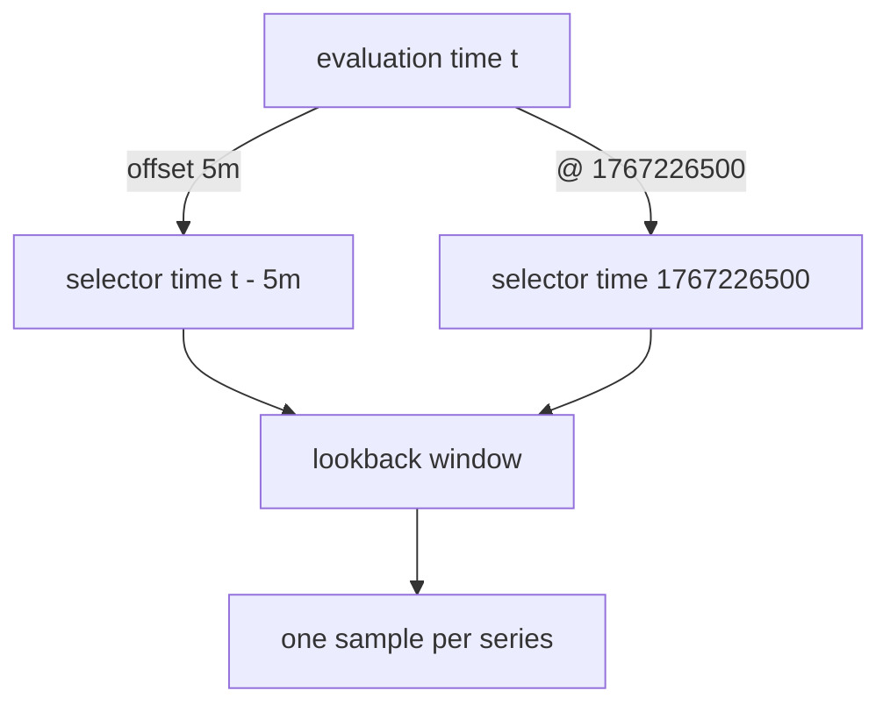

# The offset And @ Modifiers

Many questions compare two moments: the queue depth now against five minutes ago, or the state of a system exactly when a deployment started. The expression has one evaluation time, so PromQL gives each selector two modifiers that move it to another time. `offset` shifts a selector by a duration relative to the evaluation time. `@` fixes a selector to an absolute time. This part covers both, negative offsets, `@ start()` and `@ end()`, and the result of combining them.

## Look five minutes back

Start with the current value of one series. At the default evaluation time, the queue of `shuttle-0` is 280:

<!-- astrona:playground:renew -->

```sh
kubectl -n starfleet exec deploy/shuttle -- python /tools/pq.py 'queue_depth{job="shuttle"}'
```

You should see:

```text
queue_depth{instance="shuttle-0:8080", job="shuttle"} 280
```

Add `offset 5m` directly after the selector:

```sh
kubectl -n starfleet exec deploy/shuttle -- python /tools/pq.py 'queue_depth{job="shuttle"} offset 5m'
```

You should see:

```text
queue_depth{instance="shuttle-0:8080", job="shuttle"} 240
```

The PromQL engine evaluated this one selector at 1767229200 minus 300 seconds, which is 1767228900, and applied the normal lookback rule there. The queue grows by 2 at every 15 second step, so it grew by 40 in 300 seconds. The labels of the result are the same as before. The timestamp of the value is moved back to the evaluation time, so the value takes part in the rest of the expression as if it were current.



The diagram shows that both modifiers only change the time at which the selector looks up its samples. The lookback rule applies afterwards in the same way.

## Position and scope

The modifier must follow the selector immediately, inside any function or aggregation. It applies to that one selector and not to the whole expression. This query shifts the selector that is inside `sum`:

```sh
kubectl -n starfleet exec deploy/shuttle -- python /tools/pq.py 'sum(queue_depth offset 5m)'
```

You should see:

```text
{} 275
```

Five minutes earlier, at 1767228900, the three queues held 10, 25 and 240. The sum of those values is 275. Writing the modifier after the closing parenthesis, as in `sum(queue_depth) offset 5m`, is a parse error. An expression may use several offsets at once. This one subtracts the older value of the same series from the current one, which is the growth in five minutes:

```sh
kubectl -n starfleet exec deploy/shuttle -- python /tools/pq.py 'queue_depth{job="shuttle"} - queue_depth{job="shuttle"} offset 5m'
```

You should see:

```text
{instance="shuttle-0:8080", job="shuttle"} 40
```

The subtraction drops the metric name and matches the two sides by their labels. The result is 280 minus 240. For a range selector, the modifier follows the brackets: `queue_depth[5m] offset 1h` collects five minutes of samples ending one hour before the evaluation time.

Offsets too far back leave the data. The first sample is at 1767225600, one hour before the default time, so `offset 1h` reaches the first sample and `offset 2h` finds nothing:

```sh
kubectl -n starfleet exec deploy/shuttle -- python /tools/pq.py 'queue_depth{job="shuttle"} offset 2h'
```

You should see:

```text
(empty result)
```

## Negative offsets

A negative offset moves the selector forward in time. At the evaluation time 1767228000, the queue of `shuttle-0` is 120:

```sh
kubectl -n starfleet exec deploy/shuttle -- python /tools/pq.py 'queue_depth{job="shuttle"}' --time 1767228000
kubectl -n starfleet exec deploy/shuttle -- python /tools/pq.py 'queue_depth{job="shuttle"} offset -10m' --time 1767228000
```

You should see:

```text
queue_depth{instance="shuttle-0:8080", job="shuttle"} 120
queue_depth{instance="shuttle-0:8080", job="shuttle"} 200
```

The second query read the data at 1767228600, ten minutes after the evaluation time. This works because the storage already holds samples from that time. A negative offset is useful for tests and for replaying history. On a live server, the evaluation time is usually the present, so a forward shift looks at a time that has no samples yet and returns nothing. Prometheus 3 enables negative offsets by default.

## The @ modifier

The `@` modifier takes a Unix timestamp in seconds and pins the selector to it. The evaluation time stops mattering for that selector:

```sh
kubectl -n starfleet exec deploy/shuttle -- python /tools/pq.py 'queue_depth @ 1767226500'
```

You should see:

```text
queue_depth{instance="bridge-0:8080", job="bridge"} 10
queue_depth{instance="bridge-1:8080", job="bridge"} 5
queue_depth{instance="shuttle-0:8080", job="shuttle"} 0
```

These are the values at 1767226500 (00:15:00Z). Run the same expression with `--time 1767228000` and the output is identical, because `@` replaced the evaluation time for this selector. Use `@` to compare a series with one fixed reference moment, such as the start of an incident, while the rest of the expression follows a moving time.

The timestamp is a number of seconds and may have decimals. Two special forms refer to a range query: `@ start()` is the start time of the range and `@ end()` is its end time. They are the same for every step. In an instant query, both are the evaluation time. A range query evaluates the expression at several times: it starts at the first time, adds the step, and stops at the last time. The option `--range 1767228000 1767229200 600` means start 1767228000, end 1767229200 and a step of 600 seconds, so there are three evaluations. Read the plain selector next to the pinned one:

```sh
kubectl -n starfleet exec deploy/shuttle -- python /tools/pq.py 'queue_depth{job="shuttle"}' --range 1767228000 1767229200 600
kubectl -n starfleet exec deploy/shuttle -- python /tools/pq.py 'queue_depth{job="shuttle"} @ end()' --range 1767228000 1767229200 600
```

You should see:

```text
queue_depth{instance="shuttle-0:8080", job="shuttle"}
  1767228000 120
  1767228600 200
  1767229200 280
queue_depth{instance="shuttle-0:8080", job="shuttle"}
  1767228000 280
  1767228600 280
  1767229200 280
```

The plain selector follows the step times. The `@ end()` selector reads the value at 1767229200 at every step.

## Combining @ and offset

You can write both modifiers on one selector, in either order. The offset is always relative to the `@` time, never to the evaluation time. Pin to 1767228600, then look five minutes before that time:

```sh
kubectl -n starfleet exec deploy/shuttle -- python /tools/pq.py 'queue_depth{job="shuttle"} @ 1767228600 offset 5m'
```

You should see:

```text
queue_depth{instance="shuttle-0:8080", job="shuttle"} 160
```

The selector reads the data at 1767228300, where the value is 160. The expression `offset 5m @ 1767228600` gives the same result. A range selector takes both modifiers after the brackets. This query collects 30 seconds of samples that end at 1767228600:

```sh
kubectl -n starfleet exec deploy/shuttle -- python /tools/pq.py 'queue_depth{job="shuttle"}[30s] @ 1767228600'
```

You should see:

```text
queue_depth{instance="shuttle-0:8080", job="shuttle"}
  1767228585 198
  1767228600 200
```

The window is left-open, so the sample at 1767228570 is not included.

## What you now know

`offset d` moves one selector back by a duration, a negative duration moves it forward, and `@ timestamp` pins it to an absolute time. `@ start()` and `@ end()` pin it to the two ends of a range query. The modifiers sit directly after the selector, apply to that selector only, and can be combined: the offset counts from the `@` time. The lookback rule still decides which sample the shifted time returns.

The open question is how a range query uses a changing evaluation time to produce many values, and how the step relates to the window of a range selector.

## Common pitfalls

> [!WARNING]
> - Do not write the modifier after a function or an aggregation. `sum(x) offset 5m` is a parse error. Write `sum(x offset 5m)`.
> - Do not expect an offset to be relative to the evaluation time when `@` is present. The offset counts from the `@` time.
> - A shifted selector still uses the lookback rule. If the shifted time lies after the last sample of a series by 300 seconds or more, the series is absent.
> - `@` takes seconds, not milliseconds. A millisecond timestamp points far into the future and returns nothing.
