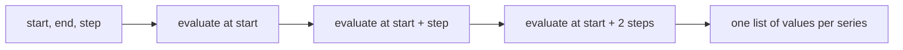

# Range Queries, Step And Window

A graph is not one value. It is a series of values, one for each point on the time axis, and Prometheus produces them with a range query. People often mix up two durations in a range query: the step, which is the distance between evaluations, and the window of a range selector, which is how far back one evaluation looks. This part explains how a range query works, shows how the step changes what you see, and ties together evaluation at a given time.

## Instant query and range query

The Prometheus HTTP API has two query endpoints. `/api/v1/query` is an **instant query**: it evaluates the expression once at one evaluation time and returns the result. `/api/v1/query_range` is a **range query**: it takes a start time, an end time and a step. It evaluates the expression as an independent instant query at the start time, at start plus step, at start plus two steps, and so on, up to and including the end time if the steps land on it. The values of each series from all evaluations are collected into a list. The helper uses the first endpoint by default and the second one with `--range`.

Run the same selector as a range query with a step of 300 seconds:

<!-- astrona:playground:renew -->

```sh
kubectl -n starfleet exec deploy/shuttle -- python /tools/pq.py 'queue_depth{job="shuttle"}' --range 1767228000 1767229200 300
```

You should see:

```text
queue_depth{instance="shuttle-0:8080", job="shuttle"}
  1767228000 120
  1767228300 160
  1767228600 200
  1767228900 240
  1767229200 280
```

There are five points: 1767228000, 1767228300, 1767228600, 1767228900 and 1767229200. At each one the PromQL engine ran the instant selection rule: take the newest sample in the lookback window. Every step time here is a multiple of 15 seconds, so each step finds a sample at exactly its time. The list is not tied to the sample times. The step times start at the start time you chose.



The diagram shows that a range query is a loop of instant evaluations, and that the output of each evaluation becomes one point of the result.

## Steps between samples

When a step time does not line up with the samples, the lookback rule chooses the newest sample at or before the step time. Use a step of 40 seconds, which is not a multiple of 15:

```sh
kubectl -n starfleet exec deploy/shuttle -- python /tools/pq.py 'queue_depth{job="shuttle"}' --range 1767228000 1767228100 40
```

You should see:

```text
queue_depth{instance="shuttle-0:8080", job="shuttle"}
  1767228000 120
  1767228040 124
  1767228080 130
```

The last step at 1767228120 is after the end time 1767228100, so the range query does not run it. At 1767228040, the newest sample is the one at 1767228030, with the value 124. At 1767228080 it is the one at 1767228075, with the value 130. The queue grows by 2 at every sample, and 1767228030 is the 62nd step after the point where the growth begins. Two points that you might expect, 1767228045 and 1767228060, are never visible, because no evaluation happens at those times. Each evaluation sees only one sample per series.

## A step that is too long hides events

Every step reads one moment, so anything that happens between two steps is invisible. The target `shuttle-0` reports `up` as 0 from 1767228000 to 1767228585. Look at it with a step of 300 seconds, then with a step of 1200 seconds that jumps over the failure:

```sh
kubectl -n starfleet exec deploy/shuttle -- python /tools/pq.py 'up{job="shuttle"}' --range 1767227700 1767228900 300
kubectl -n starfleet exec deploy/shuttle -- python /tools/pq.py 'up{job="shuttle"}' --range 1767226500 1767229200 1200
```

You should see:

```text
up{instance="shuttle-0:8080", job="shuttle"}
  1767227700 1
  1767228000 0
  1767228300 0
  1767228600 1
  1767228900 1
up{instance="shuttle-0:8080", job="shuttle"}
  1767226500 1
  1767227700 1
  1767228900 1
```

The first query shows the failure as two points with the value 0, at 1767228000 and 1767228300. The second query evaluates at 1767227700 and at 1767228900, and the failure lies between the two points. The result says that `shuttle-0` was up the whole time. Both outputs are correct for the question that was asked. A short step costs more work for the server, and the API limits one query to at most 11,000 points per series. A step must be small enough for the events that you need to see.

## Step is not window

The window is the duration in square brackets of a range selector. It belongs to one evaluation and sets how many samples that evaluation sees. The step belongs to the whole range query and sets how many evaluations there are. A range selector, such as `queue_depth[1m]`, is evaluated at every step, and each evaluation collects the samples in `(t - 1m, t]`. If the step is shorter than the window, consecutive evaluations share samples. If the step is longer, some samples are never part of any window.

A range selector without a function returns a range vector, and a range query accepts only an instant vector or a scalar. The API returns an error for this combination, and the helper prints it as a line that starts with `error`:

```sh
kubectl -n starfleet exec deploy/shuttle -- python /tools/pq.py 'queue_depth[1m]' --range 1767228000 1767229200 300
```

The error says that a range vector cannot be the result of a range query. Functions that consume a range vector and return an instant vector, such as `rate`, `increase` and `max_over_time`, make the combination valid. The window then says how much history each point is calculated from, and the step says how often a point is calculated. The two values are chosen independently: the usual advice is a window of at least a few scrape intervals and a step no longer than the window.

## Evaluation at a given time

An instant query always has an evaluation time. The helper sends 1767229200 unless you choose one with `--time`. The expression `time()` returns the evaluation time as a scalar, so it shows what time an expression sees:

```sh
kubectl -n starfleet exec deploy/shuttle -- python /tools/pq.py 'time()' --time 1767228000
```

You should see:

```text
scalar 1767228000
```

In a range query, `time()` returns the step time at each step. This makes it possible to calculate the age of a sample, a technique used with timestamp metrics. The same selector gives different results at different evaluation times, which means that a saved expression has no fixed answer until you also know the evaluation time. For the checks of the lab, the evaluation time of each question is stated in the task.

The evaluation time can also be left out. `--now` sends no `time` parameter, and the server uses its own clock. In the playground this returns an empty result for every selector, because the newest sample is far older than the five minute lookback window of the server clock time.

## What you now know

A range query runs an instant evaluation at start, start plus step and so on up to end, and returns one list of values per series. The step is the distance between evaluations. The window is the duration in the brackets of a range selector, and it belongs to one evaluation. A step between sample times uses the newest earlier sample, and a step that is longer than an event can hide it. `--time` selects the evaluation time of an instant query, and `time()` shows the evaluation time inside an expression.

You can now choose the time of every part of a query: the evaluation time, the step, the window and the position of each selector with `offset` and `@`.

## Common pitfalls

> [!WARNING]
> - Do not confuse step and window. The step is the spacing between evaluations of a range query, and the window is the size of the range selector inside one evaluation.
> - Do not read a flat graph as proof that nothing happened. An event shorter than the step can fall between two evaluations.
> - Do not send a bare range selector as a range query. Wrap it in a function that returns an instant vector.
> - A range query can fail with a limit error if start, end and step would produce more than 11,000 points per series. Increase the step or shorten the range.
