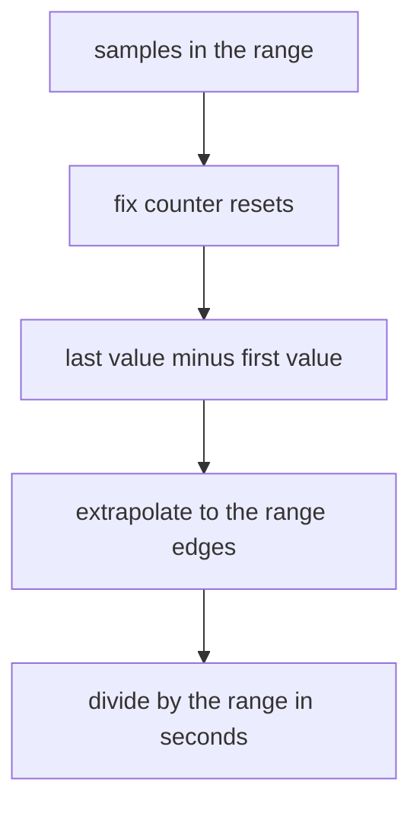

# Counters, rate() And Window Sizing

A web service handles requests all day. Its owner wants to know how many requests per second it handles now, and whether that number changed after a release. The service itself only keeps one number: the total count of requests since it started. This part shows how Prometheus turns that total into a speed with `rate()`, and how big the range inside the brackets must be so that the answer is correct.

## A counter is a total, not a speed

A **counter** is a metric whose value only increases while the process runs. By convention its name ends in `_total`. Prometheus scrapes the counter from the process every scrape interval (15 seconds in this dataset) and stores each value as a sample with a timestamp. In the playground the samples were generated from formulas, so no process is scraped, but the stored data has the same shape.

Look at the newest value of the counter `http_requests_total` for the successful GET requests:

<!-- astrona:playground:renew -->

```sh
kubectl -n starfleet exec deploy/shuttle -- python /tools/pq.py 'http_requests_total{method="GET",status="200"}'
```

You should see:

```text
http_requests_total{instance="bridge-0:8080", job="bridge", method="GET", status="200"} 136000
http_requests_total{instance="bridge-1:8080", job="bridge", method="GET", status="200"} 14400
http_requests_total{instance="shuttle-0:8080", job="shuttle", method="GET", status="200"} 64400
```

These numbers are totals. They do not say which instance is busier right now, because each instance started counting at a different moment and from a different base. To get a speed, you need the difference between two samples and the time between them. Run the same selector five minutes earlier, at Unix time 1767228900:

```sh
kubectl -n starfleet exec deploy/shuttle -- python /tools/pq.py 'http_requests_total{method="GET",status="200"}' --time 1767228900
```

You should see:

```text
http_requests_total{instance="bridge-0:8080", job="bridge", method="GET", status="200"} 133000
http_requests_total{instance="bridge-1:8080", job="bridge", method="GET", status="200"} 12000
http_requests_total{instance="shuttle-0:8080", job="shuttle", method="GET", status="200"} 63200
```

The instance `bridge-0:8080` grew from 133000 to 136000, which is 3000 requests in 300 seconds, or 10 requests per second. `bridge-1:8080` grew by 2400 (8 per second) and `shuttle-0:8080` by 1200 (4 per second). You just did by hand what `rate()` does for every series at once.

## The range selector

`rate()` does not take an instant vector. It takes a **range vector**: for every series, a list of the samples that lie inside a time range. You write the range in square brackets after the selector: `http_requests_total[5m]`. The range is measured backwards from the evaluation time `t`, and it is **left-open and right-closed**: it holds the samples with a timestamp greater than `t - 5m` and up to and including `t`. A sample that sits exactly on the left boundary is not part of the range.

You can count the samples that a range selects with `count_over_time()`, which returns the number of samples per series. Count them for one series with a 5 minute range:

```sh
kubectl -n starfleet exec deploy/shuttle -- python /tools/pq.py 'count_over_time(http_requests_total{instance="bridge-0:8080",method="GET",status="200"}[5m])'
```

You should see:

```text
{instance="bridge-0:8080", job="bridge", method="GET", status="200"} 20
```

The samples are 15 seconds apart, so 300 seconds hold 20 of them. The sample exactly 300 seconds before the evaluation time is excluded because of the left-open rule. The same selector with a range of `15s` counts one sample, with `30s` two samples and with `1m` four samples. The helper prints the same line shape in each case, with a different number at the end.

## What rate() calculates



The diagram shows the four steps that `rate()` runs for each series, in order.

`rate()` is the **per-second average rate of increase** over the range. It first takes the first and the last sample of the range and subtracts them. It then corrects for counter resets: when a value is lower than the one before it, the process restarted, and `rate()` treats the new value as growth from zero. After that it extrapolates: the first sample is usually a little after the left edge of the range and the last sample a little before the right edge, so `rate()` stretches the measured difference to cover the whole range. At the end it divides by the length of the range in seconds.

Work one case through before you run it. The 5 minute range at the default time holds 20 samples. The first is 285 seconds before the last, so the measured difference is 19 steps of 150 requests, which is 2850. The first sample is 15 seconds after the left edge, and 15 seconds is close to the normal gap, so Prometheus extrapolates to the edge and the result is 2850 stretched to 300 seconds, which is 3000. Divide by 300 and the rate is 10 requests per second. This agrees with the hand calculation above. Now run it:

```sh
kubectl -n starfleet exec deploy/shuttle -- python /tools/pq.py 'rate(http_requests_total{instance="bridge-0:8080",method="GET",status="200"}[5m])'
```

The result is one series with the name dropped. The value should be 10, possibly with extra digits at the end (such as `10.000000000000002`) because Prometheus works with floating point numbers. Compare it with your own output.

Prometheus only extrapolates to an edge when the gap to that edge is smaller than 1.1 times the average gap between samples. If a scrape failed and the first sample is much later than the edge, `rate()` extrapolates only half an average gap and not up to the edge. Prometheus also never extrapolates a counter below zero, because a counter cannot have been negative.

## Choosing the size of the range

The range must hold at least two samples, or `rate()` returns nothing for that series. Try a range of 15 seconds, which holds only one sample here:

```sh
kubectl -n starfleet exec deploy/shuttle -- python /tools/pq.py 'rate(http_requests_total{instance="bridge-0:8080",method="GET",status="200"}[15s])'
```

You should see:

```text
(empty result)
```

With a range of `30s` the result is back and the value is again close to 10, because the counter grows at a constant speed. In real systems a range of exactly two scrape intervals is too small: one failed or slow scrape leaves only one sample in the range, and the graph shows a gap. The usual rule is a range of at least four times the scrape interval. For a 15 second scrape interval that is 1 minute, and 5 minutes is the common choice.

A short range reacts fast but is noisy and can be empty. A long range is smooth but hides a short spike, because the spike is averaged over the full range, and it reacts late to a change. The range also decides which samples count, so a longer range can include a counter reset that a shorter one does not.

For the whole counter, with a 5 minute range, run:

```sh
kubectl -n starfleet exec deploy/shuttle -- python /tools/pq.py 'rate(http_requests_total[5m])'
```

From the dataset formulas you can predict every line. The values should be close to 10, 2, 0.4 and 0.2 for the four `bridge-0:8080` series (GET 200, POST 200, GET 500, POST 500), 8, 1, 0.2 and 0 for `bridge-1:8080`, and 4 and 1 for the two `shuttle-0:8080` series. The expected rate of each series is its increase per step divided by 15 seconds. Check each line against that table.

You now know that a counter holds a total, that `rate()` turns two or more samples in a left-open range into a per-second average, and that the range must hold enough samples. The open question is which of the three counter functions to use when you want a count and not a speed.

## Common pitfalls

> [!WARNING]
> - **Graphing a raw counter.** The line only rises and tells you nothing about speed. Wrap it in `rate()` first.
> - **A range of one or two scrape intervals.** One missed scrape leaves fewer than two samples and the series disappears from the result. Use at least four times the scrape interval.
> - **Counting the sample on the left edge.** In Prometheus 3 the range is left-open, so `[5m]` at a 15 second interval holds 20 samples and not 21.
> - **Expecting an exact whole number.** `rate()` extrapolates and uses floating point, so values such as `9.999999999999998` are normal. Round for display, not in the query.
> - **Using `rate()` on a gauge.** `rate()` assumes the value only goes up. A drop in a gauge is treated as a counter reset and gives a wrong result.
