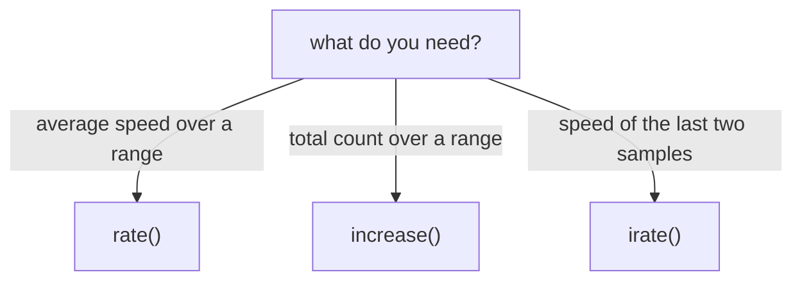

# increase(), irate() And What Each Function Returns

`rate()` gives a speed in events per second. Often a person asks a different question: how many errors happened in the last 10 minutes, or what is the speed right now and not the average of the last five minutes? PromQL has two more counter functions for these questions, `increase()` and `irate()`. They read the same range vector as `rate()`, but they return different things. This part runs all three on the same series so that you can see how they relate, and then gives a rule for choosing.

## increase() returns a count, not a speed

`increase()` returns how much a counter grew over the range. It is **syntactic sugar for `rate()` multiplied by the number of seconds in the range**: it uses the same reset correction and the same extrapolation, and it skips the final division by the range. The unit of `rate()` is "per second". The unit of `increase()` is "events in this range".

Predict the value first. The counter `http_requests_total` for the successful GET requests of `bridge-0:8080` grows by 150 per 15 second step, which is 10 per second. Over a range of 5 minutes (300 seconds) the increase is 10 multiplied by 300, which is 3000. Run it:

<!-- astrona:playground:renew -->

```sh
kubectl -n starfleet exec deploy/shuttle -- python /tools/pq.py 'increase(http_requests_total{instance="bridge-0:8080",method="GET",status="200"}[5m])'
```

The result is one series, without the metric name, with a value that should be 3000, possibly with trailing digits from floating point. You can check it by hand with the raw values of the counter at Unix time 1767229200 (136000) and 300 seconds earlier (133000): the difference is 3000. The subtraction uses the samples at the two ends. `increase()` uses the first and last sample inside the range and stretches the difference to the full range, so for a counter that grows evenly the two methods agree.

The range changes the answer, because `increase()` is a total over that range. With a range of `1m` the same series should give 600 (10 per second for 60 seconds). Run it, and compare:

```sh
kubectl -n starfleet exec deploy/shuttle -- python /tools/pq.py 'increase(http_requests_total{instance="bridge-0:8080",method="GET",status="200"}[1m])'
```

If you divide the 5 minute result by 300 and the 1 minute result by 60, both give the speed of 10 per second. The relation is `increase(x[R]) = rate(x[R]) * seconds in R`. You can prove it in one query by dividing:

```sh
kubectl -n starfleet exec deploy/shuttle -- python /tools/pq.py 'increase(http_requests_total{instance="bridge-0:8080",method="GET",status="200"}[5m]) / 300'
```

The line should show the same labels and a value close to 10, equal to the output of `rate()` for this series with the same range.

## Why increase() can show a fraction

The raw counter changes only by whole requests, yet `increase()` can return a value such as `18.947368421052634`. The reason is extrapolation. `increase()` does not report the difference of the samples it sees, it reports an estimate of the growth over the whole range. If the samples do not cover the whole range, or the counter was reset inside it, the estimate is no longer a whole number. Treat the result as an estimate and round it only when you show it.

Use `increase()` when a person wants a count: errors in the last 10 minutes, requests per hour, bytes sent in a day. The most common use is an alert on a total, as in the next command. It reads the 500 responses of every series over 10 minutes:

```sh
kubectl -n starfleet exec deploy/shuttle -- python /tools/pq.py 'increase(http_requests_total{status="500"}[10m])'
```

The five 500 series grow at 0.4, 0.2, 0.2, 0 and 1 requests per second. Over 600 seconds the values should be close to 240, 120, 120, 0 and 600. The series for `bridge-1:8080` with method POST has a constant value in the dataset (except for its restart), so its increase is 0.

## irate() looks at the last two samples

`irate()` is the **instant rate**. It ignores almost everything in the range. It takes the last two samples that are inside the range, subtracts them, and divides by the time between them. It does no extrapolation. The range only limits how far back Prometheus looks for those two samples: it must hold at least two.



The diagram shows the three questions and the function that answers each one.

For `bridge-0:8080` the last two samples differ by 150 and are 15 seconds apart, so `irate()` should return exactly 10 (150 divided by 15), apart from floating point. Run it with a range of 5 minutes and with a range of 1 hour:

```sh
kubectl -n starfleet exec deploy/shuttle -- python /tools/pq.py 'irate(http_requests_total{instance="bridge-0:8080",method="GET",status="200"}[5m])'
kubectl -n starfleet exec deploy/shuttle -- python /tools/pq.py 'irate(http_requests_total{instance="bridge-0:8080",method="GET",status="200"}[1h])'
```

Both commands should print the same line with a value of 10. The range size does not change the result, because only the last two samples count. That is different from `rate()`, where a larger range averages over more samples.

## Which function to use

In this dataset every counter grows evenly, so `rate()` and `irate()` agree. Real counters do not grow evenly. Suppose a service handles 10 requests per second for 4 minutes and 50 seconds, and then 200 requests per second for the last 10 seconds. A `rate()` over 5 minutes shows the average, about 16 per second, and the spike is almost hidden. An `irate()` shows about 200 per second, because the last two samples both lie inside the spike. A few seconds later, when the spike has ended, `irate()` shows 10 again, so a short spike between two evaluations is lost completely.

This makes the choice clear. Use `rate()` for alerts, recording rules and any graph that must look the same on every refresh, because it averages over every sample and one missed scrape does not change it much. Use `increase()` when the reader wants a count of events. Use `irate()` only for a graph with a short step that you zoom in on, to look at fast counters that change quickly. The documentation says `irate()` is for volatile, fast-moving counters, and that `rate()` should be used for alerts and for slow-moving counters.

## What the result looks like

Each function returns an instant vector with one value for every input series that has enough samples. The labels of the input series stay (`instance`, `job`, `method`, `status`), and the metric name `http_requests_total` is removed, because a speed or a count of requests is not the counter any more. A series with fewer than two samples in the range is left out of the result, and it does not appear with a value of 0. A series that exists but does not change, such as the `bridge-1:8080` POST 500 counter, appears with a value of 0.

Because the result keeps the labels, you can run the three functions on all series at once and compare the lines. Try `irate()` on the whole counter:

```sh
kubectl -n starfleet exec deploy/shuttle -- python /tools/pq.py 'irate(http_requests_total[5m])'
```

The ten lines should have the same values as `rate(http_requests_total[5m])` computed in the same way: 10, 2, 0.4 and 0.2 for `bridge-0:8080`, 8, 1, 0.2 and 0 for `bridge-1:8080`, and 4 and 1 for `shuttle-0:8080`. Both functions agree here only because the dataset is perfectly even.

All three functions drop the metric name, because the result is no longer the counter. All three correct counter resets and expect a counter. You now know what each one returns: `rate()` a per-second average, `increase()` a count over the range and `irate()` a per-second value of the last two samples. The open question is how each of them behaves when the counter restarts inside the range.

## Common pitfalls

> [!WARNING]
> - **Reading `increase()` as an exact count.** It is an extrapolated estimate and can be fractional. Compare it with `rate()` times the range, not with a hand count of requests.
> - **Alerting on `irate()`.** The value follows the last two samples, so an alert flaps on a single odd sample. Alert on `rate()` or `increase()`.
> - **Thinking the range changes `irate()`.** It only decides how far back to look for two samples. A very large range for `irate()` is wasteful, because Prometheus reads all samples in it.
> - **Comparing `increase()` of different ranges.** The value grows with the range. Divide by the seconds of the range, or use `rate()`, when you compare.
> - **Forgetting the unit.** `rate()` and `irate()` return events per second. `increase()` returns events in the range.
