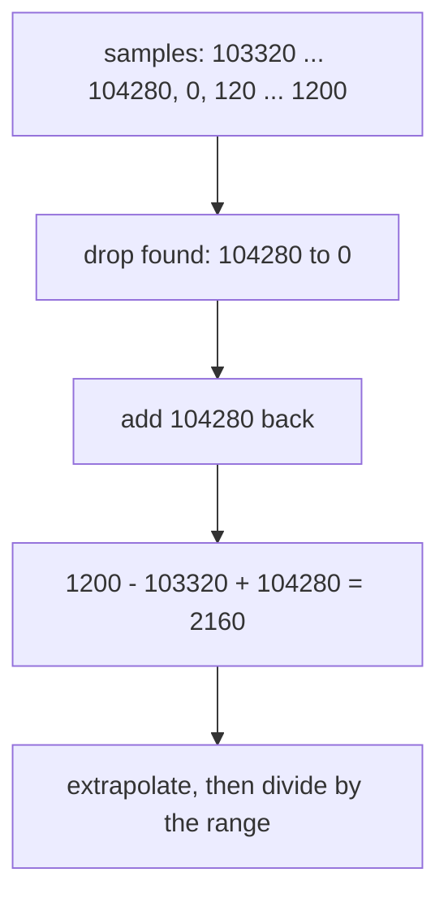

# Counter Resets And Aggregated Rates

Processes restart. A deployment rolls out a new version, a container runs out of memory, a node reboots. When the process starts again, its counters start again from 0, and the stored series suddenly contains a value that is lower than the one before it. A dashboard built on raw differences would show a huge negative speed at that moment. This part shows what the reset looks like in the data, how `rate()` and `increase()` repair it, and why you must take the rate of each series before you add the series together.

## A reset in the stored samples

In the dataset the instance `bridge-1:8080` restarts at Unix time 1767227400. At that moment all of its counters drop to 0 and then grow again from 0. Look at one of them, the successful GET requests, from 15 seconds before the restart to 15 seconds after it. A range query (`--range START END STEP`) prints one line for each step:

<!-- astrona:playground:renew -->

```sh
kubectl -n starfleet exec deploy/shuttle -- python /tools/pq.py 'http_requests_total{instance="bridge-1:8080",method="GET",status="200"}' --range 1767227385 1767227415 15
```

You should see:

```text
http_requests_total{instance="bridge-1:8080", job="bridge", method="GET", status="200"}
  1767227385 104280
  1767227400 0
  1767227415 120
```

The counter was at 104280, then it was 0 at the sample of the restart, then it was 120 one step later (the new process handled 120 requests in 15 seconds). The value 0 is lower than 104280, and that is the only sign of a restart that Prometheus stores. There is no event and no marker in the data.

## How rate() and increase() repair a reset

A counter must never decrease while a process lives. So Prometheus reads **every decrease between two consecutive samples as a counter reset**, and assumes that the counter went back to 0 and grew from there. It treats the value after the drop as growth since the restart, and it adds back the value before the drop, because that growth was real.

The arithmetic is: increase = last value - first value + the value just before each drop. Then the usual extrapolation and, for `rate()`, the division by the range follow.



The diagram shows the correction for a 5 minute range that ends at Unix time 1767227550. The sample numbers come from the dataset formulas.

Work the case through. At Unix time 1767227550 a 5 minute range holds 20 samples. The first is 103320, the sample before the restart is 104280, and the last is 1200. The corrected increase is 1200 - 103320 + 104280 = 2160. Those 20 samples cover 285 seconds, so the rate is 2160 divided by 285, which is about 7.58 requests per second. Run it:

```sh
kubectl -n starfleet exec deploy/shuttle -- python /tools/pq.py 'rate(http_requests_total{instance="bridge-1:8080",method="GET",status="200"}[5m])' --time 1767227550
```

The value should be close to 7.58. Compare it with your own output. The true speed of this counter is 8 per second, so the answer is a little low. The reason is that the sample at the restart is 0, so the growth between the last sample before the restart and the first sample after it is counted as 0. Prometheus cannot know how many requests the old process handled in its last seconds or the new one in its first seconds. One step of growth is lost for each reset in the range, and this is the best estimate possible from the samples.

For comparison, `delta()` subtracts the first value from the last value and has no reset logic. It is meant for gauges. On the same counter and range it gives:

```sh
kubectl -n starfleet exec deploy/shuttle -- python /tools/pq.py 'delta(http_requests_total{instance="bridge-1:8080",method="GET",status="200"}[5m])' --time 1767227550
```

The value should be a large negative number, about -107000: the last value (1200) minus the first value (103320), stretched from 285 to 300 seconds. `rate()` and `increase()` read the drop as a reset. `delta()` reads it as a real decrease.

## irate() and the reset

`irate()` only has two samples to look at. If the last sample is lower than the one before it, `irate()` treats this as a reset too, and uses the last value as the increase. At the evaluation time 1767227400 the last two samples are 104280 and 0, so the instant rate is 0 divided by 15, which is 0. One step later, at 1767227415, the last two samples are 0 and 120, and the instant rate is 120 divided by 15, which is 8 per second. The graph of `irate()` shows a dip to 0 for one step at a restart.

## Aggregate after the rate

A service runs as many instances, and a person usually wants the total speed for the job, or the speed per status code. You do that with `sum`. The order of the two functions matters. The rule is: **take `rate()` of each series first, then aggregate**: `sum(rate(x[5m]))`.

Test it on the window that holds the restart. The correct answer for the whole `bridge` job at Unix time 1767227550 is the sum of the per-series rates:

```sh
kubectl -n starfleet exec deploy/shuttle -- python /tools/pq.py 'sum(rate(http_requests_total{job="bridge"}[5m]))' --time 1767227550
```

The value should be about 21.3. The steady-state total without a restart is 21.8, and the shortfall comes from the one step of growth that each reset of a `bridge-1:8080` series loses. Now try the wrong order. `rate()` needs a range vector, so `rate(sum(...))` is a syntax error. To write it you need a subquery, `[5m:15s]`, which evaluates the inner expression every 15 seconds and builds a range vector from the results:

```sh
kubectl -n starfleet exec deploy/shuttle -- python /tools/pq.py 'rate(sum(http_requests_total{job="bridge"})[5m:15s])' --time 1767227550
```

The value should be about 523 requests per second, about 25 times too high. The reason is that `sum()` adds the counters of all instances into one series. At the restart that series does not fall to 0, because `bridge-0:8080` is still counting. It falls from 264763 to about 143000. `rate()` sees a drop, assumes a reset to zero, and adds back the full value before the drop. The restart of one instance becomes the "growth" of a whole job. `rate()` on each series sees a drop only in the series that really restarted, to 0, and adds back a small, correct amount.

The same rule holds for `increase()` and `irate()`.

## Choosing the labels: by and without

`sum` has two ways to say which labels survive. `sum by (job) (...)` keeps only the labels you list and drops all others. `sum without (instance, method) (...)` removes only the labels you list and keeps all others. Both give the same result if you list the same set of kept labels, and they differ when a series carries more labels than you expect. Use `by` when you know exactly the dimensions you want. Use `without` to remove a label you do not care about, such as `instance`, and keep the rest.

Run both, at the default time:

```sh
kubectl -n starfleet exec deploy/shuttle -- python /tools/pq.py 'sum by (job) (rate(http_requests_total[5m]))'
kubectl -n starfleet exec deploy/shuttle -- python /tools/pq.py 'sum without (instance, method) (rate(http_requests_total[5m]))'
```

The first command should give two lines: `{job="bridge"}` near 21.8 and `{job="shuttle"}` near 5. The second should give four lines with the labels `job` and `status`: bridge 200 near 21, bridge 500 near 0.8, shuttle 200 near 4 and shuttle 500 near 1. At this time the range holds no restart, so the numbers equal the sum of the dataset formulas.

You now know that Prometheus reads a drop as a reset and adds back the value before it, that `rate()` and `increase()` lose one step of growth per reset, that `irate()` dips to 0, and that the rate must come before the sum. What is still open is gauges, which can fall for real, and need other functions.

## Common pitfalls

> [!WARNING]
> - **Writing `rate(sum(...)[5m:15s])`.** A restart of one instance looks like a reset of the whole total and gives a huge wrong rate. Always write `sum(rate(...[5m]))`.
> - **Using `delta()` on a counter.** A restart shows as a large negative change. Use `increase()` for counters.
> - **Expecting the rate across a restart to be exact.** Each reset loses about one step of growth, so the value is a little low. Accept this, or use a longer range so the loss is a smaller share.
> - **Dropping the labels you need to tell instances apart.** `sum by (job)` merges `bridge-0:8080` and `bridge-1:8080`. Keep `instance` when you must see which one is slow.
> - **Reading a dip of `irate()` as an outage.** The one step where the last two samples include the reset shows 0, although the service is running.
