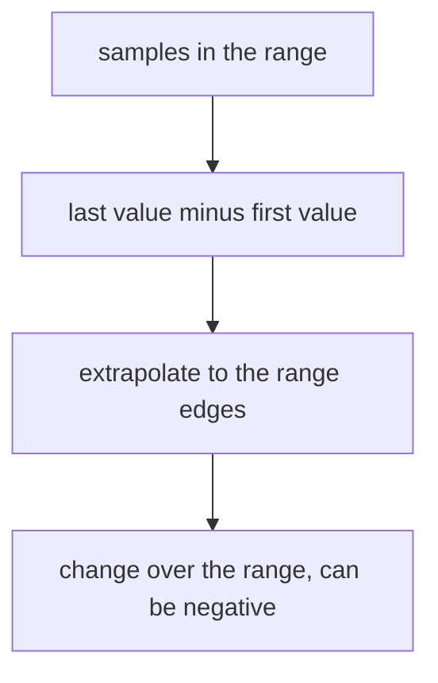

# delta(), idelta() And When A Gauge Is Not A Counter

A queue in front of a worker fills up and drains again. Its depth is a number that moves in both directions, and nobody wants to know "how many items entered the queue since the process started". People want to know whether the queue is growing and by how much. That is a question about a **gauge**, a metric that can go up and down. This part shows how to measure the change of a gauge with `delta()` and `idelta()`, and why the counter function `rate()` gives a wrong answer for the same data.

## Counter or gauge

A counter only grows, except at a restart. A gauge goes up and down with the state of the system. You can decide from the behaviour of the value: if a drop means "the process restarted", the metric is a counter. If a drop is normal, such as a queue that empties or a temperature that cools down, the metric is a gauge. The metric type is not stored in the samples, so Prometheus cannot check that for you. The function you choose is your claim about the type.

Look at the newest value of the metric `queue_depth` for the three instances, and at the values five minutes earlier (Unix time 1767228900):

<!-- astrona:playground:renew -->

```sh
kubectl -n starfleet exec deploy/shuttle -- python /tools/pq.py 'queue_depth'
kubectl -n starfleet exec deploy/shuttle -- python /tools/pq.py 'queue_depth' --time 1767228900
```

You should see:

```text
queue_depth{instance="bridge-0:8080", job="bridge"} 30
queue_depth{instance="bridge-1:8080", job="bridge"} 25
queue_depth{instance="shuttle-0:8080", job="shuttle"} 280
```

and then:

```text
queue_depth{instance="bridge-0:8080", job="bridge"} 10
queue_depth{instance="bridge-1:8080", job="bridge"} 25
queue_depth{instance="shuttle-0:8080", job="shuttle"} 240
```

In five minutes the queue of `bridge-0:8080` rose from 10 to 30, the queue of `bridge-1:8080` did not move and the queue of `shuttle-0:8080` rose from 240 to 280. The `bridge-0:8080` queue rises, falls, rises again and always stays between 10 and 30. That is gauge behaviour: a drop here is normal and is not a restart.

## delta(): the change over the range

`delta()` is the gauge counterpart of `increase()`. It subtracts the first sample of the range from the last sample, and it extrapolates the difference to the full range in the same way as `rate()`. It has no reset logic, because a gauge may go down. The result can be negative, and it can be fractional because of the extrapolation.



The diagram shows that `delta()` has no step that repairs drops.

Work the three series out before you run the query. In the last 5 minutes, `bridge-0:8080` rose by 1 per step. The 20 samples cover 285 seconds and 19 steps, so the difference of the samples is 19, and the extrapolation to 300 seconds makes it 20. The queue of `bridge-1:8080` stays at 25, so its change is 0. The queue of `shuttle-0:8080` rose by 2 per step: 38 stretched to 40. Run it:

```sh
kubectl -n starfleet exec deploy/shuttle -- python /tools/pq.py 'delta(queue_depth[5m])'
```

The three values should be close to 20, 0 and 40, possibly with trailing digits from floating point. A series that does not change still appears, with a value of 0. The values agree with the difference of the two raw values you read above.

## idelta(): the last two samples

`idelta()` is the gauge counterpart of `irate()`. It subtracts the second-to-last sample from the last sample in the range and does not extrapolate. The range only limits how far back Prometheus looks for the two samples. The result is exactly the difference of two raw samples, so it is a whole number here:

```sh
kubectl -n starfleet exec deploy/shuttle -- python /tools/pq.py 'idelta(queue_depth[5m])'
```

You should see:

```text
{instance="bridge-0:8080", job="bridge"} 1
{instance="bridge-1:8080", job="bridge"} 0
{instance="shuttle-0:8080", job="shuttle"} 2
```

The last two samples of the queue of `bridge-0:8080` are 29 and 30, so the difference is 1. For `shuttle-0:8080` the values are 278 and 280. Use `idelta()` for the latest movement, and `delta()` for a change that must not depend on a single noisy sample.

## Why rate() is wrong for a gauge

`rate()` and `increase()` assume a counter. When a sample is lower than the one before it, they read this as a restart and add the earlier value back. A gauge that goes down triggers this on every step. Test it where the triangle wave of `bridge-0:8080` has passed its peak. At Unix time 1767228750 the 5 minute range holds samples that rise from 21 to 30 and then fall from 29 to 20. The net change is -1. Run `rate()` and `delta()` on it:

```sh
kubectl -n starfleet exec deploy/shuttle -- python /tools/pq.py 'rate(queue_depth{instance="bridge-0:8080"}[5m])' --time 1767228750
kubectl -n starfleet exec deploy/shuttle -- python /tools/pq.py 'delta(queue_depth{instance="bridge-0:8080"}[5m])' --time 1767228750
```

The `delta()` value should be close to -1.05: the net change of -1, stretched from 285 to 300 seconds. The `rate()` value should be close to 0.89 per second, a positive speed for a queue that got shorter. Each of the ten falling steps (30 to 29, then 29 to 28 and so on down to 21 to 20) looks like a reset, and `rate()` adds back the value before each of them: 30 + 29 + ... + 21 = 255. With the net change of -1, that is 254, and 254 divided by 285 seconds is about 0.89.

You now know that the type of a metric decides the function. `delta()` and `idelta()` measure the change of a gauge over a range or between two samples, and `rate()` must not be used for them. The open question is the speed of change, in units per second, and how to look ahead in time.

## Common pitfalls

> [!WARNING]
> - **Using `rate()` or `increase()` on a gauge.** Every drop is read as a counter reset, so the result is positive and wrong. Use `delta()` or `deriv()`.
> - **Using `delta()` on a counter.** A restart shows as a large negative change. Use `increase()` for counters.
> - **Reading a delta of 0 as "the series is missing".** A series that stays constant appears with 0. A series with fewer than two samples in the range does not appear at all.
> - **Comparing `delta()` of different ranges.** The result is a change over that range, so it grows with the range. Divide by the seconds of the range, or use `deriv()`.
> - **Expecting a whole number from `delta()`.** The value is extrapolated, so it can have decimals. `idelta()` is the exact difference of two samples.
