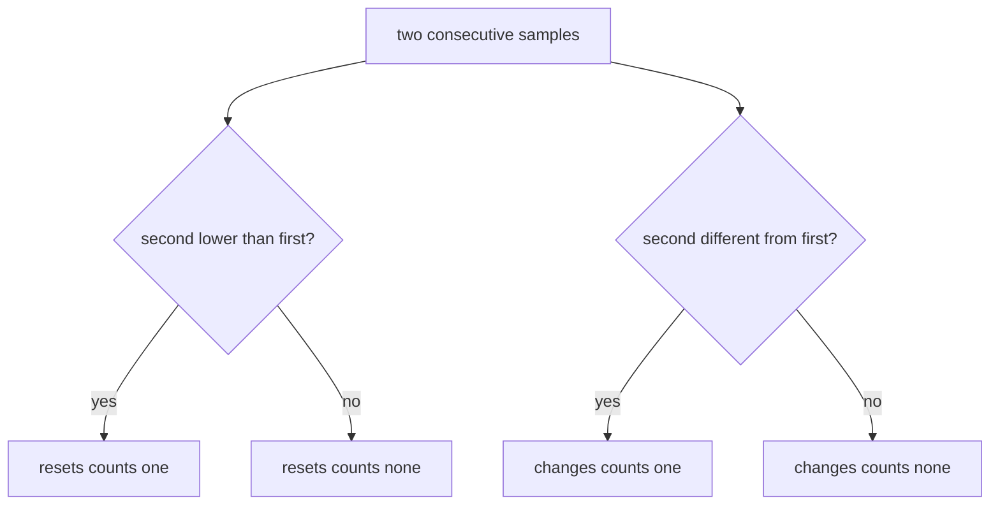
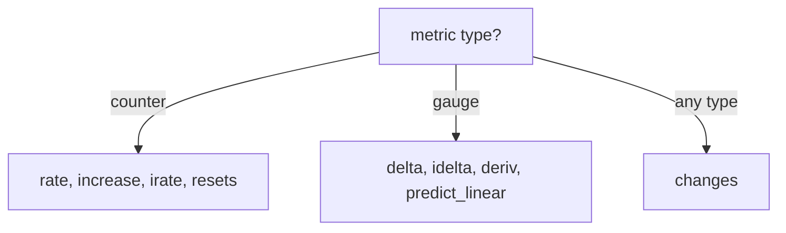

# changes(), resets() And Choosing The Right Function

Sometimes the question is not "how fast" or "how much" but "how often". How many times did a queue change direction? Did the service restart, and how many times in the last hour? Two more functions answer these questions by counting events in the samples of a range: `changes()` and `resets()`. This part runs both, and then puts all the functions of the chapter in one decision method, so that you can pick the right one for a question you have not seen before.

## changes(): how often the value is different

`changes()` returns, for each series, the number of times the value changed between two consecutive samples in the range. It does not care how large the change is or in which direction. It works on any metric type. If a float sample is followed by a different float sample, that is one change.

Predict the answer for the queue depth over 10 minutes. The range (left-open) holds 40 samples, from Unix time 1767228615 to 1767229200. In this range the queue of `bridge-0:8080` falls from 29 to 10 and then rises to 30, so each of the 39 gaps between samples is a change. The queue of `bridge-1:8080` stays at 25, so it has no changes. The queue of `shuttle-0:8080` grows by 2 in every step, so it has 39 changes. Run it:

<!-- astrona:playground:renew -->

```sh
kubectl -n starfleet exec deploy/shuttle -- python /tools/pq.py 'changes(queue_depth[10m])'
```

You should see:

```text
{instance="bridge-0:8080", job="bridge"} 39
{instance="bridge-1:8080", job="bridge"} 0
{instance="shuttle-0:8080", job="shuttle"} 39
```

`changes()` is a good function for values that should be stable, such as a version or a start time. The gauge `process_start_time_seconds` holds the Unix time at which a process started. If the process restarts, the value changes. Count the changes in the last hour:

```sh
kubectl -n starfleet exec deploy/shuttle -- python /tools/pq.py 'changes(process_start_time_seconds[1h])'
```

You should see:

```text
{instance="bridge-0:8080", job="bridge"} 0
{instance="bridge-1:8080", job="bridge"} 1
{instance="probe-0:9100", job="probe"} 0
{instance="probe-1:9100", job="probe"} 0
{instance="shuttle-0:8080", job="shuttle"} 0
```

Only `bridge-1:8080` restarted, and it restarted once. The series of `probe-1:9100` stopped 10 minutes before the end of the dataset, but it is still in the result because the 1 hour range holds its samples.

## resets(): how often a counter went down

`resets()` counts the decreases between two consecutive samples. For a counter this is the number of restarts, which is the same rule that `rate()` uses to find a reset. The documentation says that any decrease in the value between two consecutive float samples is interpreted as a counter reset.



The diagram shows that `changes()` and `resets()` look at the same pairs of samples with a different test.

The instance `bridge-1:8080` restarted once, so each of its counters has one reset. The counter `http_requests_total` has ten series. List the ones with a reset in the last hour, then add the resets up for each instance:

```sh
kubectl -n starfleet exec deploy/shuttle -- python /tools/pq.py 'resets(http_requests_total[1h]) > 0'
kubectl -n starfleet exec deploy/shuttle -- python /tools/pq.py 'sum by (instance) (resets(http_requests_total[1h]))'
```

You should see:

```text
{instance="bridge-1:8080", job="bridge", method="GET", status="200"} 1
{instance="bridge-1:8080", job="bridge", method="GET", status="500"} 1
{instance="bridge-1:8080", job="bridge", method="POST", status="200"} 1
{instance="bridge-1:8080", job="bridge", method="POST", status="500"} 1
```

and then:

```text
{instance="bridge-0:8080"} 0
{instance="bridge-1:8080"} 4
{instance="shuttle-0:8080"} 0
```

All four counters of `bridge-1:8080` dropped once, including the POST 500 counter that dropped from 50 to 0 and stayed at 0. The `> 0` comparison removes the series without a reset. Because the function counts decreases, it also counts the normal falls of a gauge. In the last 10 minutes the queue of `bridge-0:8080` fell in 19 steps, so:

```sh
kubectl -n starfleet exec deploy/shuttle -- python /tools/pq.py 'resets(queue_depth[10m])'
```

returns 19 for `bridge-0:8080` and 0 for the other two instances. The function does not know that the metric is a gauge. Use `resets()` only for counters.

## Choosing the function

Two questions decide the function. First, is the metric a counter (a drop means a restart) or a gauge (a drop is normal)? Second, what does the reader want: a speed, a total, a forecast or a count of events?



The diagram shows the three families. The table gives the function for each question:

| Question | Function |
| --- | --- |
| Average events per second of a counter | `rate()` |
| Events in the last N minutes | `increase()` |
| Speed from the last two samples | `irate()` |
| Change of a gauge over a range | `delta()` |
| Change of a gauge in the last step | `idelta()` |
| Units per second of a gauge | `deriv()` |
| Value of a gauge in the future | `predict_linear()` |
| How often a value differs | `changes()` |
| How often a counter restarted | `resets()` |

Apply it to four questions on this dataset. "How many 500 responses did each instance return in the last 10 minutes?" is a counter and a total, so `increase()`. "At what speed does the disk of `probe-0:9100` fill?" is a gauge and a speed, so `deriv()`. "How long until that disk is full?" is a gauge and a forecast, so `deriv()` or `predict_linear()` with the free space. "Did anything restart in the last hour?" is a counter question about events, so `resets()`, or `changes()` on a start time.

You now know all nine functions and the two questions that select one. A final check before you write a query is the unit: a per-second result from `rate()`, `irate()` and `deriv()`, a count from `increase()`, `changes()` and `resets()`, and a value in the unit of the gauge from `delta()`, `idelta()` and `predict_linear()`.

## Common pitfalls

> [!WARNING]
> - **Using `resets()` on a gauge.** Every normal fall counts as a reset. The result tells you how often the gauge went down, not how often a process restarted.
> - **Counting restarts with `changes()` on a counter.** A counter changes on almost every sample, so the count is meaningless. Use `resets()`.
> - **Reading `changes()` as a size.** It counts the number of changes, not how much the value moved. Use `delta()` for the size.
> - **Forgetting that a stopped series stays in a range function.** A series with samples in the range appears in the result even if a plain selector no longer shows it.
> - **Choosing by name and not by type.** A metric called `_total` is a counter, and a value that is a total of bytes on a disk can still be a gauge. Look at the behaviour of the samples.
