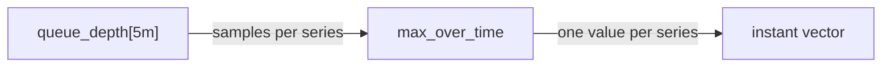

# Aggregating A Gauge Over A Window

A queue length changes every few seconds. If you look at one sample, you know the queue length at one moment. An operator usually needs more: how long did the queue get in the last five minutes, how low did it go, and what was it on average? This part shows the PromQL functions that answer these questions for a gauge, and it explains exactly which samples they read and what they return for every series.

## A range vector holds the samples of one window

A **gauge** is a metric whose value can go up and down, such as a queue length. The gauge `queue_depth` has three series in the playground. Prometheus stores each value as a **sample**: a timestamp and a number. In this dataset a sample exists every 15 seconds.

An instant vector selector such as `queue_depth` returns, for every series, the one sample that is valid at the evaluation time. A **range vector selector** returns more: it adds a duration in square brackets, such as `queue_depth[1m]`, and returns for every series all samples inside that window. The window ends at the evaluation time `t` and starts `1m` before it. The range is **left-open and right-closed**: it holds the samples with a timestamp greater than `t - 1m` and up to and including `t`. A sample that lies exactly on the left boundary is not part of the window.

Look at the samples of the last minute. The query evaluates at Unix time 1767229200, so the window holds the samples after 1767229140:

<!-- astrona:playground:renew -->

```sh
kubectl -n starfleet exec deploy/shuttle -- python /tools/pq.py 'queue_depth[1m]'
```

You should see:

```text
queue_depth{instance="bridge-0:8080", job="bridge"}
  1767229155 27
  1767229170 28
  1767229185 29
  1767229200 30
queue_depth{instance="bridge-1:8080", job="bridge"}
  1767229155 25
  1767229170 25
  1767229185 25
  1767229200 25
queue_depth{instance="shuttle-0:8080", job="shuttle"}
  1767229155 274
  1767229170 276
  1767229185 278
  1767229200 280
```

Each series has four samples. The sample at 1767229140 is missing on purpose: it lies exactly on the left boundary, so Prometheus 3 leaves it out. The dataset formulas explain the values. `bridge-0:8080` is a triangle wave between 10 and 30, so it rises by one per step near the top. `bridge-1:8080` stays at 25. `shuttle-0:8080` rises by two per step.

A range vector cannot be graphed or compared directly. It is only the input of a function that reduces each list of samples to one number. That is the job of the over_time functions.

## One function, one value per series

An over_time function takes a range vector and applies one reduction to the samples of each series separately. It never mixes series. The result is an **instant vector** with one value for each input series, evaluated at the evaluation time.



The diagram shows that the function sits between the range vector and the result, and that the number of series does not change.

There are five basic functions for a gauge. `count_over_time` returns how many samples the window holds. `sum_over_time` adds the sample values. `min_over_time` and `max_over_time` return the smallest and the largest value. `avg_over_time` returns the sum divided by the count. All five treat every sample the same, which Prometheus documents as: all values in the interval have the same weight, even when the samples are not evenly spaced.

Count the samples in a five minute window first. With a 15 second scrape interval, the window `(t - 5m, t]` holds 20 samples:

```sh
kubectl -n starfleet exec deploy/shuttle -- python /tools/pq.py 'count_over_time(queue_depth[5m])'
```

You should see:

```text
{instance="bridge-0:8080", job="bridge"} 20
{instance="bridge-1:8080", job="bridge"} 20
{instance="shuttle-0:8080", job="shuttle"} 20
```

Notice that the lines start with `{`. The function removed the metric name `queue_depth`, because the result is no longer a queue depth: it is a count of samples. The labels `instance` and `job` stay, so you can still tell the series apart. The sample count is the first thing to check when a result looks strange, because every other function depends on it.

## Highest and lowest value

`max_over_time` answers "how high did it get". Use the same five minute window:

```sh
kubectl -n starfleet exec deploy/shuttle -- python /tools/pq.py 'max_over_time(queue_depth[5m])'
```

You should see:

```text
{instance="bridge-0:8080", job="bridge"} 30
{instance="bridge-1:8080", job="bridge"} 25
{instance="shuttle-0:8080", job="shuttle"} 280
```

The values are the largest sample of each series in the window, and they come straight from the dataset formulas. `bridge-0:8080` reached 30 at the newest sample. `shuttle-0:8080` rises by two per step, so its newest value is the largest: 280. The same window with `min_over_time` returns the oldest values for the rising series:

```sh
kubectl -n starfleet exec deploy/shuttle -- python /tools/pq.py 'min_over_time(queue_depth[5m])'
```

You should see:

```text
{instance="bridge-0:8080", job="bridge"} 11
{instance="bridge-1:8080", job="bridge"} 25
{instance="shuttle-0:8080", job="shuttle"} 242
```

The window starts after 1767228900, so its oldest sample is the one at 1767228915. At that time `bridge-0:8080` was at 11 and `shuttle-0:8080` was at 242. The gap between the minimum and the maximum of a window is a quick measure of how much a gauge moved: 19 for `bridge-0:8080`, 0 for `bridge-1:8080` and 38 for `shuttle-0:8080`.

## Sum and average

`sum_over_time` adds the samples of the window. For a gauge such as a queue length, the sum has little meaning by itself, because it grows with the number of samples. It is useful when the gauge counts something per sample, or when a series only has the values 0 and 1. Run it for the queue depth anyway, so you can check the result by hand:

```sh
kubectl -n starfleet exec deploy/shuttle -- python /tools/pq.py 'sum_over_time(queue_depth[5m])'
```

You should see:

```text
{instance="bridge-0:8080", job="bridge"} 410
{instance="bridge-1:8080", job="bridge"} 500
{instance="shuttle-0:8080", job="shuttle"} 5220
```

`bridge-1:8080` is 25 for 20 samples, so the sum is 500. The values of `bridge-0:8080` in this window are 11 up to 30, and 11 + 12 + ... + 30 is 410. Those are exact sums of whole numbers, so every sum is exact.

`avg_over_time` is the sum divided by the count. Predict the three results from the lines above before you run it: 410 / 20 for `bridge-0:8080`, 500 / 20 for `bridge-1:8080` and 5220 / 20 for `shuttle-0:8080`.

```sh
kubectl -n starfleet exec deploy/shuttle -- python /tools/pq.py 'avg_over_time(queue_depth[5m])'
```

The three values should be 20.5, 25 and 261, or extremely close to them. Prometheus adds floating-point numbers with a compensated summation, so a long decimal tail is possible in other data, but the dataset values here are whole numbers. Compare the output with your prediction. The average of `shuttle-0:8080` is the value halfway through the window, which is true for any series that rises in a straight line.

## Series with 0 and 1 values

The metric `up` is a gauge with the value 1 when Prometheus could scrape a target and 0 when it could not. For such a series, `sum_over_time` counts the successful scrapes, and `count_over_time` counts all scrapes. In the dataset, `shuttle-0:8080` was down from Unix time 1767228000 until 1767228585. Evaluate five minutes at Unix time 1767228600, the first sample after the outage:

```sh
kubectl -n starfleet exec deploy/shuttle -- python /tools/pq.py 'sum_over_time(up[5m])' --time 1767228600
```

You should see:

```text
{instance="bridge-0:8080", job="bridge"} 20
{instance="bridge-1:8080", job="bridge"} 20
{instance="probe-0:9100", job="probe"} 20
{instance="probe-1:9100", job="probe"} 20
{instance="shuttle-0:8080", job="shuttle"} 1
```

Four targets were up for all 20 samples. `shuttle-0:8080` was down for 19 of them and up only at 1767228600, so its sum is 1. Add `count_over_time` with the same time and every series has 20 samples:

```sh
kubectl -n starfleet exec deploy/shuttle -- python /tools/pq.py 'count_over_time(up[5m])' --time 1767228600
```

You should see:

```text
{instance="bridge-0:8080", job="bridge"} 20
{instance="bridge-1:8080", job="bridge"} 20
{instance="probe-0:9100", job="probe"} 20
{instance="probe-1:9100", job="probe"} 20
{instance="shuttle-0:8080", job="shuttle"} 20
```

The ratio of the sum to the count is the share of scrapes that succeeded: 1 / 20 = 0.05 for `shuttle-0:8080` and 1 for the others. `avg_over_time(up[5m])` gives the same share in one function. Notice that `probe-1:9100` is still in the result at this time because its last sample is at 1767228600, which is inside the window that ends there.

## What the functions return when a window is empty

A series that has no sample in the window does not appear in the result. It does not return 0. The function reduces nothing, so nothing is returned for that series. This is easy to miss, because a missing line looks like a series that does not exist. The function `absent_over_time` detects that case on purpose.

You now know what a range vector holds and what the five basic functions return for every series: one value, no metric name, the same labels as the input. The open question is how to describe a gauge beyond its extremes and its average, for example how spread out the values are and what to do about a series that stopped reporting.

## Common pitfalls

> [!WARNING]
> - Reading a range as closed on both sides. In Prometheus 3 a sample exactly at `t - range` is not in the window, so a `5m` window over 15 second samples holds 20 samples, not 21.
> - Expecting the metric name in the result. `min_over_time`, `max_over_time`, `avg_over_time`, `sum_over_time` and `count_over_time` drop the name and keep the other labels.
> - Using `sum_over_time` on a gauge such as a queue length and reading the sum as a level. It grows with the number of samples in the window.
> - Treating a missing line as 0. A series with no sample in the window is left out of the result.
> - Giving a range vector to a function that needs an instant vector, or the other way round. The over_time functions need a range vector, and `queue_depth[5m]` alone cannot be drawn as a graph.
