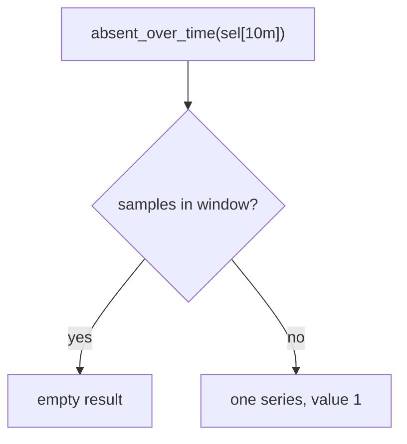

# Quantiles, Spread, Last Value And Presence

The minimum, the maximum and the average describe a gauge with three numbers, and they can hide the shape of the data. A queue that sits at 10 for ten minutes and jumps to 30 for one minute has an average that looks harmless and a maximum that looks alarming. This part adds the functions that describe the spread of a gauge, return its newest value, and tell you whether a series has any sample in a window at all. The last two matter for monitoring, because a target that stops reporting must not look the same as a healthy target.

## Quantiles of the samples in a window

A **quantile** is the value below which a given share of the samples falls. The 0.5 quantile is the median, the 0.9 quantile is the value that 90 percent of the samples do not exceed, the 0 quantile is the minimum and the 1 quantile is the maximum. `quantile_over_time(phi, range-vector)` takes the quantile as its first argument, a number between 0 and 1, and the range vector as its second argument.

Prometheus sorts the samples of each series and takes the value at position `phi * (n - 1)`, counting from 0, where `n` is the number of samples. When that position is not a whole number, it interpolates linearly between the two neighbouring sorted samples. This is the part of Prometheus that does the work: the query engine sorts and interpolates for every series separately.

Compute the median of the queue depth over five minutes. There are 20 samples, so the position is 0.5 * 19 = 9.5, halfway between the tenth and the eleventh sorted sample:

<!-- astrona:playground:renew -->

```sh
kubectl -n starfleet exec deploy/shuttle -- python /tools/pq.py 'quantile_over_time(0.5, queue_depth[5m])'
```

You should see:

```text
{instance="bridge-0:8080", job="bridge"} 20.5
{instance="bridge-1:8080", job="bridge"} 25
{instance="shuttle-0:8080", job="shuttle"} 261
```

For `bridge-0:8080` the sorted samples are 11 to 30. The tenth is 20 and the eleventh is 21, so the median is 20.5. For `shuttle-0:8080` the sorted samples are 242, 244, up to 280, and the tenth and the eleventh are 260 and 262, so the median is 261. A constant series gives the constant for every quantile.

Try the 0.9 quantile yourself and predict it first. The position is 0.9 * 19 = 17.1, so the result lies one tenth of the way from the eighteenth sorted sample to the nineteenth. For `bridge-0:8080` that is about 28.1, because the eighteenth sample is 28 and the nineteenth is 29. The result may show a few extra digits because of floating-point arithmetic.

If `phi` is outside the range 0 to 1, Prometheus does not stop with an error. It returns `+Inf` for a value above 1 and `-Inf` for a value below 0, and it attaches a warning. The helper does not print warnings, so you only see the infinite value. A typing mistake such as `quantile_over_time(90, ...)` therefore gives `+Inf` and not a useful result.

## Standard deviation of a window

**Standard deviation** measures how far the samples lie from their average. A value near 0 means the samples are almost equal, and a large value means they spread widely. `stddev_over_time` returns the **population** standard deviation: it divides by the number of samples, not by the number minus one. `stdvar_over_time` returns the variance, which is the square of it.

```sh
kubectl -n starfleet exec deploy/shuttle -- python /tools/pq.py 'stddev_over_time(queue_depth[5m])'
```

Predict the three values from the formulas before you read the output. `bridge-1:8080` is constant at 25, so its standard deviation is exactly 0. The 20 samples of `bridge-0:8080` are the consecutive whole numbers 11 to 30. For consecutive whole numbers, the population variance is `(n * n - 1) / 12`, which is 399 / 12 = 33.25, and the standard deviation is its square root, about 5.77. The samples of `shuttle-0:8080` step by 2, so the variance is four times larger, 133, and the standard deviation is about 11.53. Compare your numbers with the output. A decimal tail in the last digits is normal.

A standard deviation is most useful next to the average. A gauge with an average of 25 and a deviation of 0 is flat, and a gauge with the same average and a deviation of 10 swings widely.

## The newest sample in a window

`last_over_time` returns the newest sample of each series inside the window. At first this looks the same as an instant vector selector, but there is one important difference: the window length. An instant vector selector looks back only 5 minutes (the **lookback delta**, the longest age at which Prometheus still uses the newest sample as the current value). `last_over_time` looks back as far as you write. It is also the only over_time function that keeps the metric name in its result.

First select `up` in the normal way:

```sh
kubectl -n starfleet exec deploy/shuttle -- python /tools/pq.py 'up'
```

You should see:

```text
up{instance="bridge-0:8080", job="bridge"} 1
up{instance="bridge-1:8080", job="bridge"} 1
up{instance="probe-0:9100", job="probe"} 1
up{instance="shuttle-0:8080", job="shuttle"} 1
```

There are only four lines. The series for `probe-1:9100` has no sample after Unix time 1767228600, which is ten minutes before the evaluation time. That is older than the 5 minute lookback, so the instant vector selector no longer returns it. Now widen the lookup to one hour with `last_over_time`:

```sh
kubectl -n starfleet exec deploy/shuttle -- python /tools/pq.py 'last_over_time(up[1h])'
```

You should see:

```text
up{instance="bridge-0:8080", job="bridge"} 1
up{instance="bridge-1:8080", job="bridge"} 1
up{instance="probe-0:9100", job="probe"} 1
up{instance="probe-1:9100", job="probe"} 1
up{instance="shuttle-0:8080", job="shuttle"} 1
```

The series `probe-1:9100` is back, with the value of its last sample. The value 1 does not mean that the probe is healthy now. It means that 1 was the last value it reported inside the hour. Remember this when you use `last_over_time` on a series that may have ended: the result carries no timestamp, so you cannot see how old the value is.

## Did the series report at all

`present_over_time` returns 1 for every series that has at least one sample in the window, and it returns nothing for the others. It ignores the sample values, so it also returns 1 for a series whose values are all 0. Use a ten minute window, which ends exactly on the last sample of `probe-1:9100`:

```sh
kubectl -n starfleet exec deploy/shuttle -- python /tools/pq.py 'present_over_time(up[10m])'
```

You should see:

```text
{instance="bridge-0:8080", job="bridge"} 1
{instance="bridge-1:8080", job="bridge"} 1
{instance="probe-0:9100", job="probe"} 1
{instance="shuttle-0:8080", job="shuttle"} 1
```

The series `probe-1:9100` is missing. Its last sample is at 1767228600, and the window `(t - 10m, t]` starts after that timestamp, because the left boundary is excluded. Make the window one minute longer and the sample is inside:

```sh
kubectl -n starfleet exec deploy/shuttle -- python /tools/pq.py 'present_over_time(up[11m])'
```

You should see:

```text
{instance="bridge-0:8080", job="bridge"} 1
{instance="bridge-1:8080", job="bridge"} 1
{instance="probe-0:9100", job="probe"} 1
{instance="probe-1:9100", job="probe"} 1
{instance="shuttle-0:8080", job="shuttle"} 1
```

This shows a rule that is easy to get wrong in an alert: the answer depends on the exact window length, and a series that ended at the boundary can fall out of the window.

## Alerting on a missing series

`present_over_time` tells you which series exist. To alert when a series is missing, you need the opposite: a result when something is absent. `absent_over_time(range-vector)` returns an empty result when the range vector has at least one sample, and it returns one series with the value 1 when the range vector has no samples. Its labels come from the equality matchers in the selector, so `absent_over_time(up{instance="probe-1:9100"}[10m])` returns a series with the label `instance`.



The diagram shows that the function returns a result only in the failing case, which is why an alert rule can use the expression directly.

```sh
kubectl -n starfleet exec deploy/shuttle -- python /tools/pq.py 'absent_over_time(up{instance="probe-1:9100"}[10m])'
```

You should see:

```text
{instance="probe-1:9100"} 1
```

The selector has one equality matcher, so the result has exactly one label. The metric name `up` is not a label of the result. With the longer window the series has a sample, and the result is empty:

```sh
kubectl -n starfleet exec deploy/shuttle -- python /tools/pq.py 'absent_over_time(up{instance="probe-1:9100"}[11m])'
```

You should see:

```text
(empty result)
```

If you add the matcher `job="probe"` to the selector, the result carries both labels `instance` and `job`. If the selector uses only regular expressions such as `instance=~"probe.*"`, the result has no labels, because Prometheus can only copy labels from equality matchers. Write the exact labels in the selector when you want to know which target is missing.

You now have the full set of functions for one gauge: the extremes, the average, the median and other quantiles, the spread, the newest value, and a way to ask whether a series reported at all. The remaining question is how long the window should be, because every answer above changed when the window changed.

## Common pitfalls

> [!WARNING]
> - Passing a percentage to `quantile_over_time`. The first argument is a number from 0 to 1, and `90` returns `+Inf`.
> - Reading `stddev_over_time` as the sample standard deviation. Prometheus divides by the number of samples, so it is the population value.
> - Using `last_over_time` and trusting the value as current. The function has no timestamp in its result, and a series that ended long ago still returns its last value.
> - Using `present_over_time` when you need an alert condition. It returns a result for healthy series, and `absent_over_time` returns a result only for a missing one.
> - Writing `absent_over_time` with a regular expression matcher and expecting labels in the result. Only equality matchers give labels.
> - Using a window that ends exactly on the last sample of a series. Because the left boundary is excluded, a change of one scrape interval in the window length changes the result.
