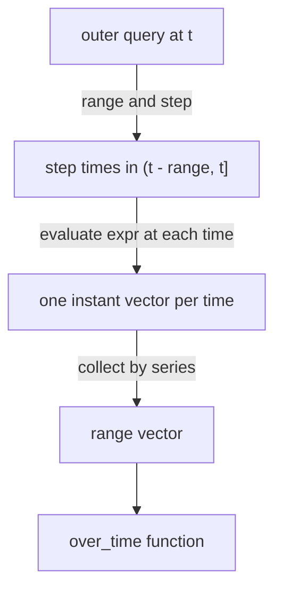

# Subquery Syntax And Evaluation Times

A range selector such as `queue_depth[5m]` reads stored samples. It cannot read a computed value. The total queue depth of a job is computed by `sum by (job) (queue_depth)`, and that expression returns an instant vector: one value for the evaluation time. If you want the highest total of the last ten minutes, there is no stored series that holds the totals, so there is nothing to put a range selector on. This part shows the syntax that closes this gap, and then it follows exactly which times Prometheus uses, because the details of those times decide the numbers you get.

## Syntax of a subquery

A **subquery** has the form `<instant vector expression>[<range>:<step>]`. The expression in front of the bracket can be any expression that returns an instant vector. The **range** says how far back from the evaluation time the subquery reaches. The **step** (also called the resolution) is the time between two evaluations of the expression. The colon between range and step is what makes it a subquery and not a range selector.

The result of a subquery is a range vector. Prometheus evaluates the inner expression once for every step time in the range, and each evaluation returns an instant vector. Prometheus collects the values of each series into a list of points, and that list is the range vector. An over_time function then takes the range vector like any other.

You can also write the subquery without a step, as `<expression>[<range>:]`. The step is then the **global evaluation interval** of the Prometheus server, which is the setting `evaluation_interval` in the `global` section of the Prometheus configuration. Its default is 1 minute. The Prometheus server of the playground sets it to 15 seconds, which equals the sample spacing of the dataset. A subquery can also be followed by `offset` and `@` modifiers, for example `expr[10m:1m] offset 5m`, which move the whole window back in time. The examples in this part use neither.

## A first subquery without a step

Start with the simplest possible inner expression, a plain selector. Select the last minute of `queue_depth` with the default step:

<!-- astrona:playground:renew -->

```sh
kubectl -n starfleet exec deploy/shuttle -- python /tools/pq.py 'queue_depth[1m:]'
```

You should see:

```text
queue_depth{instance="bridge-0:8080", job="bridge"}
  1767229155 27
  1767229170 28
  1767229185 29
  1767229200 30
queue_depth{instance="bridge-1:8080", job="bridge"}
  1767229155 25
  1767229170 25
  1767229185 25
  1767229200 25
queue_depth{instance="shuttle-0:8080", job="shuttle"}
  1767229155 274
  1767229170 276
  1767229185 278
  1767229200 280
```

Each series has four points. The step is 15 seconds, so Prometheus evaluated the selector `queue_depth` at 1767229155, 1767229170, 1767229185 and 1767229200. The first time lies 45 seconds before the end, not 60. This looks like the output of a plain range selector over the same minute, but the mechanism is different. A range selector returns stored samples. A subquery returns the value of the expression at each step time, and for a plain selector that value happens to be the stored sample because the step time and the sample time are the same.

## Which times does Prometheus use

The step times are not counted back from the evaluation time. Prometheus uses the multiples of the step on the Unix time axis. For a step of 30 seconds, the evaluation times are the Unix times that divide by 30 without a remainder. Of those, Prometheus keeps the ones that lie inside the range, which is left-open and right-closed: greater than `t - range` and at most `t`. This is the code path that does the work in the query engine: it rounds the start of the range to a multiple of the step and moves one step forward if the result lies on the left boundary.

Run a subquery with a range of one minute and a step of 30 seconds at the evaluation time 1767229200. That time is a multiple of 30, so the points are at 1767229170 and 1767229200:

```sh
kubectl -n starfleet exec deploy/shuttle -- python /tools/pq.py 'queue_depth[1m:30s]'
```

You should see:

```text
queue_depth{instance="bridge-0:8080", job="bridge"}
  1767229170 28
  1767229200 30
queue_depth{instance="bridge-1:8080", job="bridge"}
  1767229170 25
  1767229200 25
queue_depth{instance="shuttle-0:8080", job="shuttle"}
  1767229170 276
  1767229200 280
```

Now move the evaluation time ten seconds back to 1767229190. This is not a multiple of 30, so the last point is not at the evaluation time:

```sh
kubectl -n starfleet exec deploy/shuttle -- python /tools/pq.py 'queue_depth[1m:30s]' --time 1767229190
```

You should see:

```text
queue_depth{instance="bridge-0:8080", job="bridge"}
  1767229140 26
  1767229170 28
queue_depth{instance="bridge-1:8080", job="bridge"}
  1767229140 25
  1767229170 25
queue_depth{instance="shuttle-0:8080", job="shuttle"}
  1767229140 272
  1767229170 276
```

The window is `(1767229130, 1767229190]`. The multiples of 30 inside it are 1767229140 and 1767229170. The point at 1767229190 does not exist, because 1767229190 is not a multiple of 30. The consequence is useful to know: two dashboards that evaluate at slightly different times but use the same step look at the same grid of times, so their points line up. It also means that the newest point of a subquery can be older than the evaluation time by up to one step.



The diagram shows that the outer function never sees the inner expression directly. It sees the range vector that the evaluations produced.

## What a subquery sees when the step is long

Take a step of one minute, which is four times the sample spacing. The inner selector then reads only every fourth sample. Count the points over five minutes and look at the lowest of them:

```sh
kubectl -n starfleet exec deploy/shuttle -- python /tools/pq.py 'count_over_time(queue_depth[5m:1m])'
```

You should see:

```text
{instance="bridge-0:8080", job="bridge"} 5
{instance="bridge-1:8080", job="bridge"} 5
{instance="shuttle-0:8080", job="shuttle"} 5
```

The five points are at 1767228960, 1767229020, 1767229080, 1767229140 and 1767229200, which are the multiples of 60 in `(1767228900, 1767229200]`. Now the minimum:

```sh
kubectl -n starfleet exec deploy/shuttle -- python /tools/pq.py 'min_over_time(queue_depth[5m:1m])'
```

You should see:

```text
{instance="bridge-0:8080", job="bridge"} 14
{instance="bridge-1:8080", job="bridge"} 25
{instance="shuttle-0:8080", job="shuttle"} 248
```

A plain `min_over_time(queue_depth[5m])` returns 11 and 242 for `bridge-0:8080` and `shuttle-0:8080`, because it reads all 20 samples. The subquery with a one minute step reads only five of them, so its minimum is higher. The step is therefore a sampling rate: a larger step is cheaper, and it can miss a short peak or a short low point that falls between two step times.

A range that holds a single step gives a single point. Test it with a range of one minute and a step of one minute:

```sh
kubectl -n starfleet exec deploy/shuttle -- python /tools/pq.py 'count_over_time(queue_depth[1m:1m])'
```

You should see:

```text
{instance="bridge-0:8080", job="bridge"} 1
{instance="bridge-1:8080", job="bridge"} 1
{instance="shuttle-0:8080", job="shuttle"} 1
```

In Prometheus 3 the range is left-open, so the point at the left boundary is gone and only the point at the evaluation time remains. A function such as `rate()` or `increase()` needs at least two points, so `rate(x[1m:1m])` returns nothing. Make the range at least twice the step.

## The lookback delta inside a subquery

Every evaluation of the inner expression works like an instant query, so it uses the **lookback delta**: if a series has no sample at the step time, Prometheus uses its newest sample that is at most 5 minutes older. This matters for a series that has stopped. The series `up` of `probe-1:9100` has its last sample at 1767228600. Ask for ten minutes with a one minute step:

```sh
kubectl -n starfleet exec deploy/shuttle -- python /tools/pq.py 'up{instance="probe-1:9100"}[10m:1m]'
```

You should see:

```text
up{instance="probe-1:9100", job="probe"}
  1767228660 1
  1767228720 1
  1767228780 1
  1767228840 1
```

The window starts after 1767228600, and the series has no new sample in it. The first four step times still return the old value, because the sample at 1767228600 is less than 5 minutes older than each of them. At 1767228900 the sample is exactly 5 minutes old, which is outside the left-open lookback, so the series ends there. The subquery shows four points of a series that was already stopped, so a count of points over time can be larger than the number of samples that were stored in the window.

You now know how to write a subquery, at which times Prometheus evaluates it and how the step and the lookback change the points. The next question is what to put inside: expressions with aggregation and `rate()`, and how their order changes the answer.

## Common pitfalls

> [!WARNING]
> - Forgetting the colon. `x[5m]` is a range selector and works only on a selector, and `x[5m:1m]` is a subquery.
> - Counting the step times back from the evaluation time. They are multiples of the step on the Unix time axis, so the points shift when you evaluate at another time.
> - Using a range that holds one step. In Prometheus 3 `[1m:1m]` has one point, and `rate()` of it returns nothing.
> - Choosing a long step and expecting to see every peak. Only the step times are evaluated.
> - Assuming that the default step is 1 minute everywhere. It is the evaluation interval of the server you query, which is 15 seconds in the playground.
> - Reading the points of a stopped series as proof that it still reports. The lookback delta of 5 minutes keeps its last value alive.
