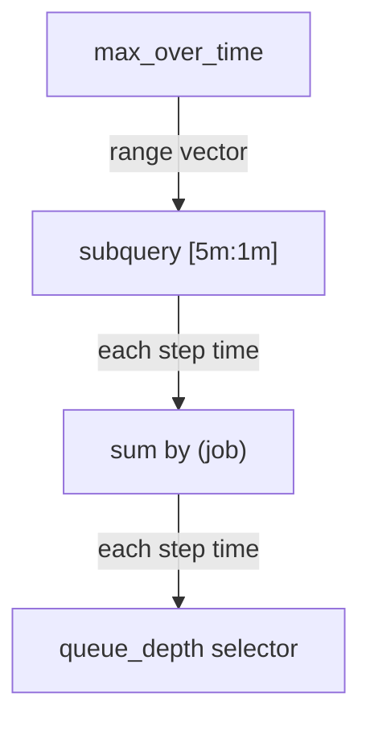

# Nesting Time Aggregation With Aggregates And Rates

An alert or a capacity report usually asks about a value that Prometheus has to compute first: the total request rate of a job, or the number of healthy instances per job. The question is then about how that computed value behaved over a period. A subquery lets you put the computation inside and the time aggregation outside. This part builds such nested expressions step by step, shows what each layer does, and shows that the order of the layers changes the result, so that you can write the one that answers your question.

## Maximum of a sum

Take the total queue depth of each job. `sum by (job) (queue_depth)` adds the series that share the same `job` label, so `bridge-0:8080` and `bridge-1:8080` add up to one series for the job `bridge`. The question is the highest total in the last 5 minutes, with one evaluation per minute. Wrap the sum in a subquery and give the subquery to `max_over_time`:

<!-- astrona:playground:renew -->

```sh
kubectl -n starfleet exec deploy/shuttle -- python /tools/pq.py 'max_over_time(sum by (job) (queue_depth)[5m:1m])' --time 1767227700
```

You should see:

```text
{job="bridge"} 51
{job="shuttle"} 80
```

The query uses the evaluation time 1767227700, which is 5 minutes after the instance `bridge-1:8080` changed from 5 to 25. Three layers do the work, from the inside out. First, the selector `queue_depth` returns three series at every step time. Second, `sum by (job)` adds them into one series per job and drops the metric name. Third, the subquery collects the totals at the five step times 1767227460 to 1767227700 in steps of 60 seconds, and `max_over_time` returns the largest total of each job.



The diagram shows the order of evaluation. The outer function asks the subquery for points, the subquery runs the aggregation at every step time, and the aggregation reads the stored samples.

The dataset formulas explain the numbers. At the five step times the gauge of `bridge-0:8080` is 26, 22, 18, 14 and 10 (it falls one per 15 seconds), and `bridge-1:8080` is 25. The totals are 51, 47, 43, 39 and 35, and the largest is 51. The job `shuttle` has one instance, which rises by 2 per step, so its largest total is its last value, 80.

## Lowest, average and the order of the layers

The same shape works for the other functions. Run the minimum and the average of the total queue depth with the same subquery:

```sh
kubectl -n starfleet exec deploy/shuttle -- python /tools/pq.py 'min_over_time(sum by (job) (queue_depth)[5m:1m])' --time 1767227700
```

You should see:

```text
{job="bridge"} 35
{job="shuttle"} 48
```

```sh
kubectl -n starfleet exec deploy/shuttle -- python /tools/pq.py 'avg_over_time(sum by (job) (queue_depth)[5m:1m])' --time 1767227700
```

You should see:

```text
{job="bridge"} 43
{job="shuttle"} 64
```

The five totals of `bridge` are 51, 47, 43, 39 and 35, so the minimum is 35 and the average is 215 divided by 5, which is 43. The five totals of `shuttle` are 48, 56, 64, 72 and 80, so the minimum is 48 and the average is 64. Every point has the same weight in the average, and with a step of one minute each point stands for one minute of the period.

The order of the layers is part of the meaning. `min_over_time(sum by (job) (up)[30m:1m])` first adds the `up` values of a job at every step time and then takes the lowest total, which is the fewest targets that were up at one moment. `sum by (job) (min_over_time(up[30m]))` takes the lowest value of every target separately and adds those. Run the first form:

```sh
kubectl -n starfleet exec deploy/shuttle -- python /tools/pq.py 'min_over_time(sum by (job) (up)[30m:1m])'
```

You should see:

```text
{job="bridge"} 2
{job="probe"} 1
{job="shuttle"} 0
```

Now run the second form:

```sh
kubectl -n starfleet exec deploy/shuttle -- python /tools/pq.py 'sum by (job) (min_over_time(up[30m]))'
```

You should see:

```text
{job="bridge"} 2
{job="probe"} 2
{job="shuttle"} 0
```

The two forms differ for the job `probe`. The instance `probe-1:9100` stopped reporting at 1767228600, and the lookback delta carried its last value for another 5 minutes. From 1767229200 minus 300 seconds on, the sum of the job `probe` has only one series, `probe-0:9100`, so the lowest total is 1. In the second form, `probe-1:9100` has the value 1 in every sample it has, so its own minimum is 1, and the sum is 2. The functions that work on each series separately do not know that the series ended. The form with the subquery looks at the totals at one moment in time and sees the drop.

## A rate inside a subquery

The most common use of a subquery is a rate. `rate(http_requests_total[1m])` returns the per-second average increase of each counter over the last minute. The expression `sum by (job) (rate(http_requests_total[1m]))` adds the rates per job: the total request rate. You cannot ask for the highest total rate of the last 10 minutes without a subquery, because the rate is a computed value:

```sh
kubectl -n starfleet exec deploy/shuttle -- python /tools/pq.py 'max_over_time(sum by (job) (rate(http_requests_total[1m]))[10m:1m])'
```

The dataset counters grow by a constant amount, so the total rate does not change in this window. The result should be close to 21.8 requests per second for `bridge` and 5 for `shuttle`. For `bridge` this is 10 + 2 + 0.4 + 0.2 requests per second of `bridge-0:8080` plus 8 + 1 + 0.2 + 0 of `bridge-1:8080`. For `shuttle` it is 4 + 1. Compare your output with these numbers, and expect a few extra digits from floating-point arithmetic.

Each of the ten step times starts an inner evaluation that reads its own range of raw samples. The rate at the step time `t` reads the samples in `(t - 1m, t]`, which are four samples, and the sum then adds the rates. The inner range is independent of the subquery range: the subquery range says how many step times are evaluated, and the range inside `rate()` says how many samples each evaluation reads.

You can keep the individual series by leaving out the `sum by`. Then the result has one line per counter, with the labels `instance`, `job`, `method` and `status`, and without the metric name:

```sh
kubectl -n starfleet exec deploy/shuttle -- python /tools/pq.py 'max_over_time(rate(http_requests_total{job="shuttle"}[1m])[10m:1m])'
```

The two lines should show about 4 requests per second for the status 200 series and about 1 for the status 500 series. The per-series form is useful for finding which series produced a peak. The summed form is useful for an alert on the total.

## Choosing the inner range and the step

Two numbers need a deliberate choice. The inner range, here `[1m]`, should hold at least four samples of the scrape interval, so the rate is stable. The step of the subquery, here `1m`, should not be larger than the inner range. If the inner range is 1 minute and the step is 5 minutes, each evaluation reads one minute of data and the next four minutes are never read, so a spike in those four minutes does not count. A step equal to the inner range reads every sample once. A step smaller than the inner range reads samples several times and costs more.

The two layers also describe different things. The inner function describes the short-term behavior, such as the rate over one minute. The outer function describes the behavior of that value over the longer period, such as the highest one-minute rate within ten minutes. State both ranges when you describe the expression to a colleague: "the highest one-minute request rate in the last ten minutes".

You can now put an aggregation and a rate inside a subquery, and you know that the order of the layers is part of the meaning. The remaining questions are how much work a subquery makes Prometheus do, when a recording rule is the better tool, and which nestings give wrong numbers.

## Common pitfalls

> [!WARNING]
> - Writing `sum by (job) (min_over_time(up[30m]))` when you want the lowest total. It adds the lowest value of every series separately, and it does not see that a series ended. Use `min_over_time(sum by (job) (up)[30m:1m])`.
> - Leaving the aggregation outside the subquery and expecting the outer function to aggregate across series. The over_time functions work on each series separately and never mix series.
> - Using a subquery step that is longer than the range inside `rate()`. The evaluations skip the samples between the ranges.
> - Choosing a `rate()` range of one scrape interval. The range must hold at least two samples, and four or more is safer.
> - Forgetting that the outer function drops the metric name and keeps the labels that the inner expression left. After `sum by (job)` only `job` remains.
> - Comparing results that were evaluated at different times. Use `--time` or the same evaluation time when you compare two forms.
