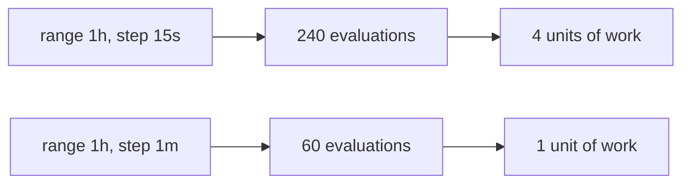

# Cost, Recording Rules And Nesting Pitfalls

A subquery is convenient, and it hides work. A plain range selector reads the stored samples once. A subquery runs a whole expression once for every step time, and every run reads samples again. On a dashboard that refreshes every 15 seconds, the same subquery runs again and again, and the cost adds up. This part counts the evaluations that a subquery makes, shows how to move the inner expression into a recording rule so that Prometheus computes it only once per interval, and lists the nestings that return wrong numbers without any error.

## Counting the evaluations

The number of evaluations of the inner expression is the range divided by the step. Count them with `count_over_time`, which returns the number of points that the subquery produced for each series. A step of 15 seconds over one hour gives 240 points:

<!-- astrona:playground:renew -->

```sh
kubectl -n starfleet exec deploy/shuttle -- python /tools/pq.py 'count_over_time(queue_depth[1h:15s])'
```

You should see:

```text
{instance="bridge-0:8080", job="bridge"} 240
{instance="bridge-1:8080", job="bridge"} 240
{instance="shuttle-0:8080", job="shuttle"} 240
```

Every point is one evaluation of `queue_depth`, so Prometheus ran the selector 240 times for this query. Change the step to one minute and the count falls to a quarter:

```sh
kubectl -n starfleet exec deploy/shuttle -- python /tools/pq.py 'count_over_time(queue_depth[1h:1m])'
```

You should see 60 for each of the three series. A step of 5 minutes over a range of 10 minutes gives two points:

```sh
kubectl -n starfleet exec deploy/shuttle -- python /tools/pq.py 'count_over_time(queue_depth[10m:5m])'
```

You should see 2 for each of the three series.

The cost of one evaluation depends on the inner expression. A selector reads the latest sample of each series. A `rate(x[1m])` reads every sample in its range, which is four samples per series here. An aggregation such as `sum by (job)` must first read all the series that it adds. The total work is roughly the number of evaluations multiplied by the work of one evaluation, so halving the step doubles the work and widening the range with the same step grows the work in the same way.



The diagram compares two steps over the same range. A finer step gives a more detailed picture of the value and costs proportionally more. Choose the coarsest step that still shows the behavior you care about. For a one-hour question about a gauge that changes over minutes, a step of one minute is enough.

## Nested subqueries multiply

A subquery can contain another subquery. The counts then multiply. The expression below asks for the highest of the one-minute peaks of a five-minute window, for the last hour:

```text
max_over_time(max_over_time(sum by (job) (queue_depth)[5m:15s])[1h:1m])
```

The outer subquery has 60 step times. At each of them, the inner subquery has 20 step times. The `sum by (job)` runs 60 times 20 evaluations, which is 1200, and the selector is read 1200 times. The same question, answered by a single subquery `max_over_time(sum by (job) (queue_depth)[1h:15s])`, needs 240 evaluations. When you notice a subquery inside a subquery, check whether one subquery with a finer step gives the same answer for less work. For a maximum or a minimum it does, because the largest of the window peaks is the largest value overall. For an average it does not always, because windows that overlap count some points twice.

## When a recording rule is better

A recording rule is a query that Prometheus evaluates on a schedule and stores as a new series. Querying that series later is a plain selector, so a range selector works on it directly and no subquery is needed. A rule file for the summed request rate looks like this:

```yaml
groups:
  - name: starfleet-rates
    interval: 15s
    rules:
      - record: job:http_requests:rate1m
        expr: sum by (job) (rate(http_requests_total[1m]))
```

The name follows the convention `level:metric:operations`, which tells a reader that the series is aggregated to the level `job`, comes from `http_requests`, and is a one-minute rate. With the rule in place, the peak over ten minutes is `max_over_time(job:http_requests:rate1m[10m])`. Prometheus has paid for the sum and the rate once per interval, and each later query reads 40 stored samples per series instead of running the expression.

The playground has no rule files, and Prometheus stores no such series. You can check this with a selector:

```sh
kubectl -n starfleet exec deploy/shuttle -- python /tools/pq.py 'job:http_requests:rate1m'
```

You should see:

```text
(empty result)
```

The rule above is shown only for illustration. Use a recording rule when the same subquery is used by a dashboard or an alert that runs often, when the inner expression is expensive, or when you want the history of the computed value to stay readable. A subquery is the better tool for a one-off question, because it needs no change to the server settings, and it works on data that was stored before you thought of the question. A recording rule stores values only from the time it is loaded.

## Nesting pitfalls

Some nestings run without error and give a wrong number. The most common one is a counter that is summed before `rate()` is applied. Run the wrong form for the evaluation time that follows the restart of `bridge-1:8080`:

```sh
kubectl -n starfleet exec deploy/shuttle -- python /tools/pq.py 'rate(sum by (job) (http_requests_total)[10m:1m])' --time 1767227700
```

The value for the job `bridge` is several hundred requests per second, and the real rate is about 22. The reason is that `bridge-1:8080` started again from 0 at 1767227400, so the sum of the job `bridge` drops at that time. `rate()` reads a drop as a counter reset, and it adds the value from before the drop to the increase. That value is the total of all requests so far, a number in the hundreds of thousands. The sum hides the reset of one series inside the total of several, and no later step can separate them. Run the correct form, which applies `rate()` to each series first:

```sh
kubectl -n starfleet exec deploy/shuttle -- python /tools/pq.py 'sum by (job) (rate(http_requests_total[1m]))' --time 1767227700
```

The job `bridge` should show about 21.8 and the job `shuttle` about 5. The rule is: apply `rate()` or `increase()` to each counter series, then aggregate. Never aggregate a counter first.

Three more traps are easy to miss:

- A step longer than the inner range leaves gaps. With `rate(x[1m])` inside `[10m:5m]`, each evaluation reads one minute, and the next four minutes are never read.
- A range that holds one step, such as `[1m:1m]`, gives a single point per series. `stddev_over_time` of one point is 0, and `max_over_time` is just that point.
- The lookback delta keeps a stopped series alive. In a subquery, each evaluation uses the 5 minute lookback, so the series `probe-1:9100` still returns 1 for 5 minutes after its last sample. A subquery therefore reports a stopped target as healthy for a while.

One more difference is easy to forget when you move a query to another server. The default step is the global evaluation interval of that server. It is 15 seconds in the playground and 1 minute in a default installation, so a subquery without a step can cost four times as much here as in a default installation, and it gives different points. Write the step explicitly in every subquery that you save in a dashboard or an alert.

You can now count what a subquery costs, decide between a subquery and a recording rule, and avoid the nestings that give wrong numbers without an error.

## Common pitfalls

> [!WARNING]
> - Summing a counter before `rate()`. The sum hides the resets of single series, and `rate()` adds the whole pre-drop total. Apply `rate()` first, then `sum by`.
> - Leaving the step out in a saved query. The default step is the evaluation interval of the server, so the same query returns different points on different servers.
> - Using a step much finer than the data. A step of 1 second over data that arrives every 15 seconds repeats the same value 15 times and costs 15 times more.
> - Nesting a subquery in a subquery without counting. The evaluations multiply, and a dashboard that refreshes often makes the cost permanent.
> - Using a step longer than the inner range. The samples between the ranges are never read.
> - Expecting a recording rule to hold history. It stores values only from the time the rule is loaded.
> - Trusting a subquery to show that a target stopped. The lookback delta carries the last value forward for 5 minutes.
