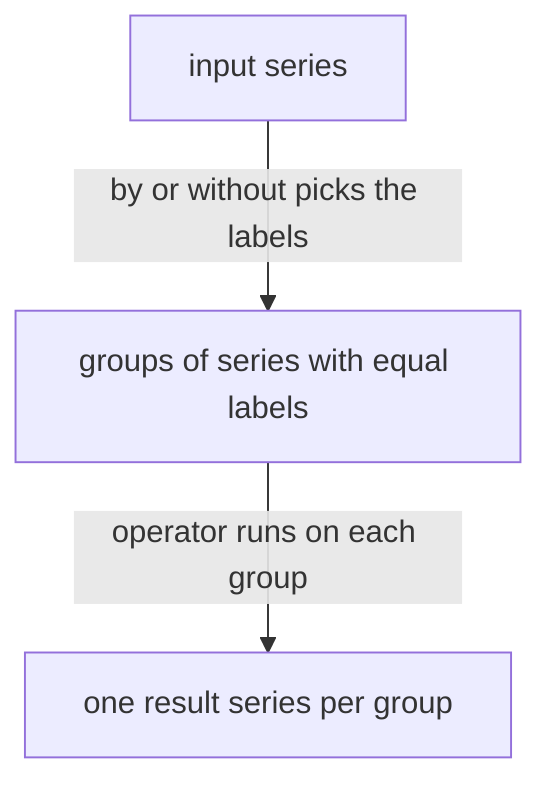

# Aggregation Operators, by And without

A selector such as `http_requests_total` returns one series for every instance, method and status code. When you want one number for a whole job, or one line per job in a dashboard, you must combine series. An aggregation operator does this. This part runs each basic operator on the playground data, then explains the rule that decides which labels the result keeps. That rule is the most tested detail of aggregation.

## One expression, many series

An aggregation operator takes one instant vector and returns another instant vector with fewer series. An instant vector is a set of series that each have exactly one sample at the evaluation time. The simplest aggregation has no grouping at all: it combines every input series into one output series.

The playground has a metric `up` with one series per target. The value is `1` when the last scrape of the target worked and `0` when it failed. Prometheus adds `up` itself for every scrape target. The dataset has no scraping, but it contains the same series that real scraping would have written. Start with the raw series and then add them up.

<!-- astrona:playground:renew -->

```sh
kubectl -n starfleet exec deploy/shuttle -- python /tools/pq.py 'up'
```

You should see four series, not five:

```text
up{instance="bridge-0:8080", job="bridge"} 1
up{instance="bridge-1:8080", job="bridge"} 1
up{instance="probe-0:9100", job="probe"} 1
up{instance="shuttle-0:8080", job="shuttle"} 1
```

The dataset has a fifth target, `probe-1`. Its last sample is at Unix time `1767228600`, which is 600 seconds before the evaluation time `1767229200`. An instant query only uses a sample that is at most 5 minutes old, called the lookback delta, so `probe-1` is not in the result. Keep this in mind: a target that stopped reporting does not show `0`. It disappears.

Now add the four values together with `sum`:

```sh
kubectl -n starfleet exec deploy/shuttle -- python /tools/pq.py 'sum(up)'
```

You should see:

```text
{} 4
```

The result has one series and no labels at all. The line starts with `{}` because the result has no metric name either. Both facts follow from the rule in the next section.

## The six basic operators

Each operator reads the values of all series in one group and returns one value for that group:

| Operator | Result for one group |
| --- | --- |
| `sum` | The total of all values |
| `min` | The smallest value |
| `max` | The largest value |
| `avg` | The arithmetic mean: the total divided by the number of series |
| `count` | The number of series in the group, whatever their values are |
| `group` | The value `1` for the group, whatever the values are |

The metric `queue_depth` is a gauge (a value that can go up and down) with one series for each of `bridge-0`, `bridge-1` and `shuttle-0`. At the evaluation time its three values are 30, 25 and 280. Run five operators on it:

```sh
kubectl -n starfleet exec deploy/shuttle -- python /tools/pq.py 'min(queue_depth)'
kubectl -n starfleet exec deploy/shuttle -- python /tools/pq.py 'max(queue_depth)'
kubectl -n starfleet exec deploy/shuttle -- python /tools/pq.py 'sum(queue_depth)'
kubectl -n starfleet exec deploy/shuttle -- python /tools/pq.py 'count(queue_depth)'
kubectl -n starfleet exec deploy/shuttle -- python /tools/pq.py 'group(queue_depth)'
```

You should see these five results, one after the other:

```text
{} 25
{} 280
{} 335
{} 3
{} 1
```

The mean of 30, 25 and 280 is 335 divided by 3, a number with endless decimals. Run `avg(queue_depth)` yourself and check that the value is about 111.67. `group` looks useless at first. It matters when you only want to know that something exists, or when you need a clean set of labels with the value `1` for a later comparison.

## by and without choose the output labels

Every series has labels. Aggregation puts series in the same group when they have the same values for the labels that the grouping keeps. The grouping has two forms:

- `by (a, b)` keeps only the labels `a` and `b`. Every other label is removed from the result.
- `without (a, b)` removes the labels `a` and `b` and keeps every other label.



The diagram shows that the grouping labels decide how many groups exist, and that the operator then produces exactly one result series for each group.

Group the `up` series by job. The two `bridge` series fall into one group:

```sh
kubectl -n starfleet exec deploy/shuttle -- python /tools/pq.py 'sum by (job) (up)'
```

You should see:

```text
{job="bridge"} 2
{job="probe"} 1
{job="shuttle"} 1
```

Now ask for the same grouping the other way round. The series have two labels, `instance` and `job`. Removing `instance` leaves `job`:

```sh
kubectl -n starfleet exec deploy/shuttle -- python /tools/pq.py 'sum without (instance) (up)'
```

You should see the same three lines. The two forms give the same result here because `up` has exactly two labels. They are not the same in general. With `by`, a label that appears in the data later never shows up in the result. With `without`, the new label automatically appears and splits the groups. Use `without` when you want to keep every label except a few known ones. Use `by` when you want a fixed, small set of labels.

The clause can stand before or after the parentheses: `sum by (job) (up)` and `sum(up) by (job)` are the same expression. The first form is easier to read for long expressions.

## What disappears: the metric name and every other label

The result of an aggregation never has the metric name `__name__`. In Prometheus the metric name is stored as the label `__name__`, and `by` and `without` treat it like any other label: aggregation drops it unless you list `__name__` in `by`. The result is no longer a count of `up`. It is a new quantity, so it has no name. The helper prints such a series with a line that starts with `{`.

Look at a metric with four labels, `job`, `instance`, `method` and `status`. Remove only `instance`:

```sh
kubectl -n starfleet exec deploy/shuttle -- python /tools/pq.py 'sum without (instance) (http_requests_total)'
```

You should see six series, one for each combination of the labels that remain:

```text
{job="bridge", method="GET", status="200"} 150400
{job="bridge", method="GET", status="500"} 2200
{job="bridge", method="POST", status="200"} 29000
{job="bridge", method="POST", status="500"} 820
{job="shuttle", method="GET", status="200"} 64400
{job="shuttle", method="GET", status="500"} 4400
```

The ten input series became six. The first line is the sum of the `GET` series with status `200` from `bridge-0` (136000) and `bridge-1` (14400). The values come from the dataset formulas. Summing raw counters is only useful here to show the mechanism. The next part explains why you almost always sum a rate instead.

Two behaviours surprise beginners. First, naming a label that no series has is not an error. The query below groups `up` by `team`, a label that only `team_info` has:

```sh
kubectl -n starfleet exec deploy/shuttle -- python /tools/pq.py 'sum by (team) (up)'
```

You should see:

```text
{} 4
```

Every series has the same value for a missing label (no value), so all series fall into one group. Second, an aggregation over nothing returns nothing, not zero. `sum(no_such_metric)` prints `(empty result)`. A dashboard panel that shows "no data" instead of 0 usually has this cause.

This part showed that every aggregation produces one series per group, with only the labels that `by` keeps or `without` leaves. The next question is how to apply this to counters, which only grow, and for that you need a rate first.

## Common pitfalls

> [!WARNING]
> - Do not expect the metric name in the result. After `sum`, `min`, `max`, `avg`, `count` or `group` the name is gone, so a later query cannot select the result by name.
> - `by (team)` with a label that does not exist is not an error. All series land in one group and the result has no labels, which looks like a plain total.
> - An empty input gives an empty result, not `0`. A target that vanished is missing from `sum(up)` and `count(up)`; it is not counted as down.
> - `by` and `without` are not interchangeable once new labels appear. Decide which labels the result must keep, then pick the form that says it directly.
> - `avg` divides by the number of series that have a sample at the evaluation time. Series without a sample do not count, so a vanished instance can leave the average unchanged.
