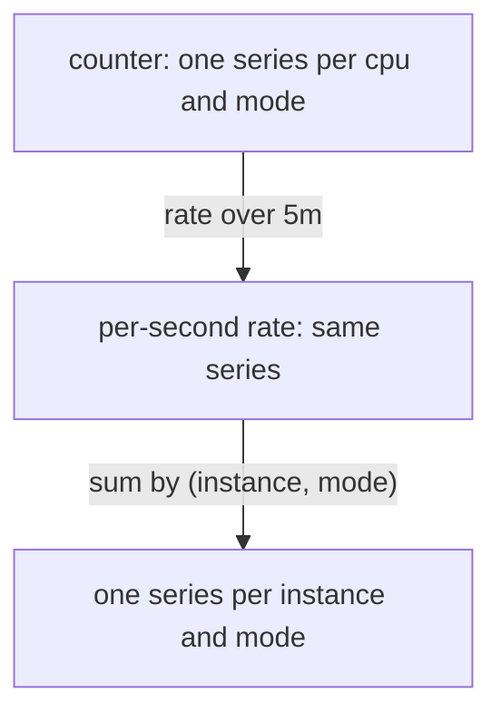

# Sum Of A Rate By Instance And Mode

The most common aggregation in real dashboards is not `sum(metric)`. It is `sum by (...) (rate(metric[5m]))`. Counters only grow, so their raw value says little, and the useful quantity is how fast they grow. This part builds that expression step by step on the CPU counters of the `probe` targets, and explains why the order of `sum` and `rate` matters.

## The counter: one series per cpu and mode

The operating system counts how many seconds each CPU core spent in each mode: `idle`, `user` and `system`. A metrics exporter on the host publishes these counts as the counter `node_cpu_seconds_total`. A counter is a value that only increases, except when the process that owns it restarts and it starts again at zero. In the playground, `probe-0` and `probe-1` each have two cores, `cpu` `0` and `1`, and three modes. That makes six series for each target.

Look at the six series of `probe-0`:

<!-- astrona:playground:renew -->

```sh
kubectl -n starfleet exec deploy/shuttle -- python /tools/pq.py 'node_cpu_seconds_total{instance="probe-0:9100"}'
```

You should see these six lines. The values come from the dataset formulas:

```text
node_cpu_seconds_total{cpu="0", instance="probe-0:9100", job="probe", mode="idle"} 7520
node_cpu_seconds_total{cpu="0", instance="probe-0:9100", job="probe", mode="system"} 5360
node_cpu_seconds_total{cpu="0", instance="probe-0:9100", job="probe", mode="user"} 5720
node_cpu_seconds_total{cpu="1", instance="probe-0:9100", job="probe", mode="idle"} 6800
node_cpu_seconds_total{cpu="1", instance="probe-0:9100", job="probe", mode="system"} 5540
node_cpu_seconds_total{cpu="1", instance="probe-0:9100", job="probe", mode="user"} 6260
```

These numbers are total seconds since the counters began, so they say nothing about the current load. Subtracting two readings and dividing by the time between them gives the rate. That is what the function `rate` does.

## rate turns a counter into a per-second value

`rate(v[5m])` takes a range vector and returns, for every series in it, the average increase per second over the last five minutes. A range selector such as `[5m]` selects, for each series, all samples in a window that ends at the evaluation time and starts five minutes earlier. In Prometheus 3 the window excludes its start: a sample exactly five minutes old is not inside. At the evaluation time `1767229200` the window holds the 20 samples at 15-second spacing that lie after `1767228900`. `rate` also handles counter resets inside the window: when a value falls, it assumes the counter restarted at zero and counts the new value as increase.

The dataset formulas give `cpu` `0` of `probe-0` an idle growth of 10.5 seconds every 15 seconds. That is 0.7 seconds of idle time per second. Predict the value, then run:

```sh
kubectl -n starfleet exec deploy/shuttle -- python /tools/pq.py 'rate(node_cpu_seconds_total{instance="probe-0:9100", cpu="0", mode="idle"}[5m])'
```

The result has one series and its value should be about `0.7`. Floating-point arithmetic can add trailing digits such as `0.7000000000000001`. Compare with your own output. The result keeps the labels but loses the metric name, because `rate` also drops it.

## Add the aggregation: sum of the rate by instance and mode

The rate is per core. A dashboard that shows idle, user and system time for a host does not want one line per core. It wants one line per mode, summed over all cores of the host. The labels that must stay are `instance` and `mode`. The label `cpu` must go, and so must `job`, which a dashboard that groups by host does not need.

`probe-1` has no samples after Unix time `1767228600`, so the default evaluation time shows only `probe-0`. To see both targets, evaluate at `1767228600`, the last moment `probe-1` has a sample:

```sh
kubectl -n starfleet exec deploy/shuttle -- python /tools/pq.py 'sum by (instance, mode) (rate(node_cpu_seconds_total[5m]))' --time 1767228600
```

The result has six series: three modes for each of the two instances. Check the values against the dataset formulas. For both instances the `idle` sum is about `1.2` (0.7 plus 0.5), the `user` sum is about `0.55` (0.2 plus 0.35) and the `system` sum is about `0.25` (0.1 plus 0.15). The two targets have the same sums even though their two cores are swapped. The sum hides which core is busier, which is a reminder that every aggregation also removes information.



The diagram shows the required order: `rate` runs first on every original series, and `sum` combines the rates afterwards.

## Two ways to remove cpu

You can describe the same grouping with `without`. The result differs in one label. Run it at the same time:

```sh
kubectl -n starfleet exec deploy/shuttle -- python /tools/pq.py 'sum without (cpu) (rate(node_cpu_seconds_total[5m]))' --time 1767228600
```

The six series now carry the labels `instance`, `job` and `mode`. The `job` label stays because `without (cpu)` removes only `cpu`. The values are the same as in the previous query. Choose `by` when the dashboard must show exactly the named labels, and `without` when every other label is still useful.

Adding all modes shows a second fact about this metric. Run:

```sh
kubectl -n starfleet exec deploy/shuttle -- python /tools/pq.py 'sum by (instance) (rate(node_cpu_seconds_total[5m]))' --time 1767228600
```

Each instance should return about `2`. A core is always in exactly one mode, so one core adds one second of CPU time per second, and a host with two cores adds two. The sum of the rates over all modes equals the number of cores.

## Why the rate comes before the sum

It is tempting to sum first and take the rate of the total, because the expression is shorter. That is wrong, and Prometheus does not allow it directly: `rate` needs a range vector, and `sum` returns an instant vector, so `rate(sum(x)[5m])` is a syntax error. The reason for the rule is the counter reset. A counter that restarts falls back to zero, and `rate` treats that fall as a reset. If you add the counters of several targets first, a reset in one target hides inside the total.

The dataset has a reset: the target `bridge-1` restarts at Unix time `1767227400`, and all of its counters return to zero. Sum the `GET` requests with status `200` of the job `bridge` just before and at the restart:

```sh
kubectl -n starfleet exec deploy/shuttle -- python /tools/pq.py 'sum by (job) (http_requests_total{job="bridge", method="GET", status="200"})' --time 1767227385
kubectl -n starfleet exec deploy/shuttle -- python /tools/pq.py 'sum by (job) (http_requests_total{job="bridge", method="GET", status="200"})' --time 1767227400
```

You should see:

```text
{job="bridge"} 222130
{job="bridge"} 118000
```

The total of a counter fell by 104130 in 15 seconds, although `bridge-0` only grew. A rate computed over this total would see a reset of the whole sum and count the new total of 118000 as fresh increase, which makes the rate far too large for a short time. `sum by (job) (rate(...))` rates every series on its own, so only `bridge-1` shows a reset and only its own growth is lost for one interval.

This part gave you the standard shape `sum by (labels) (rate(counter[window]))`. The labels in `by` say what the dashboard shows, and the rate inside makes each counter comparable. The next question is how many series feed such a sum, and for that you count them.

## Common pitfalls

> [!WARNING]
> - Never write the sum first. The rate of a sum cannot see resets of the single counters, and `rate(sum(x)[5m])` is not valid syntax.
> - A rate needs at least two samples in the window. With a window shorter than twice the sample spacing the result is empty. The `5m` window used here holds 20 samples.
> - `sum by (instance, mode)` removes `cpu`. The sum is correct, but it can hide that one core does all the work while the other idles.
> - A target that stopped reporting is absent from the result. At the default evaluation time the `probe-1` series are not in the sum, and nothing says that they are missing.
> - The value of a rate is an estimate with floating-point digits. Compare approximately, not with `==`.
