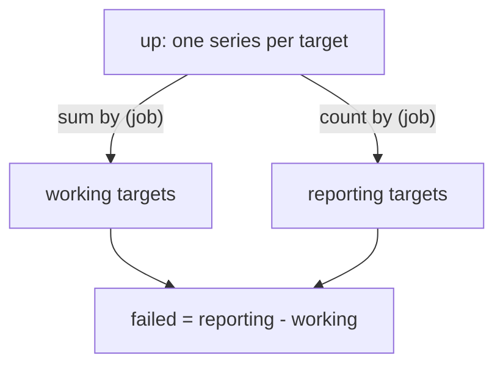

# count, count by, Cardinality And The up Metric

The operators `sum`, `min`, `max` and `avg` work on the values of series. `count` is different: it ignores the values and counts the series. That makes it the tool for two jobs. The first job is to measure cardinality, the number of distinct series that a metric or a whole server holds. The second job is to read the `up` metric, which tells you which scrape targets work. This part shows both with numbers you can check against the dataset.

## count counts series, not values

`count(v)` returns the number of series in the input vector at the evaluation time. `count by (job) (v)` returns that number for each job. A series without a sample at the evaluation time is not in the input vector, so it is not counted.

Count the targets that have an `up` series and then count them per job:

<!-- astrona:playground:renew -->

```sh
kubectl -n starfleet exec deploy/shuttle -- python /tools/pq.py 'count(up)'
kubectl -n starfleet exec deploy/shuttle -- python /tools/pq.py 'count by (job) (up)'
```

You should see:

```text
{} 4
{job="bridge"} 2
{job="probe"} 1
{job="shuttle"} 1
```

The job `probe` was configured with two targets, `probe-0` and `probe-1`, but the result shows one. The newest `up` sample of `probe-1` is 600 seconds old at the default evaluation time, and Prometheus ignores samples older than the 5-minute lookback delta. Evaluate ten minutes earlier, at `1767228600`, and the second target is back:

```sh
kubectl -n starfleet exec deploy/shuttle -- python /tools/pq.py 'count by (job) (up)' --time 1767228600
```

You should see:

```text
{job="bridge"} 2
{job="probe"} 2
{job="shuttle"} 1
```

Compare the two results. A count of targets that is lower than the number you expect is a signal in itself: a target disappeared, because it was removed, crashed or lost its network, and its series went stale. No value in the data says `0` for it.

## up is a value and a count at the same time

For every scrape, Prometheus writes the series `up` for that target. The value is `1` when the scrape succeeded and `0` when it failed. Because the value is only ever `0` or `1`, two aggregations answer two different questions:

- `sum by (job) (up)` is the number of targets that are working.
- `count by (job) (up)` is the number of targets that report at all.

The dataset has a failure: the target `shuttle-0` has `up` equal to `0` from Unix time `1767228000` until `1767228585`. Filter the series with a comparison and count what is left. A comparison operator such as `==` keeps only the series for which the comparison is true, and drops the rest. Run the query at `1767228300`, in the middle of the failure, and then at the default time:

```sh
kubectl -n starfleet exec deploy/shuttle -- python /tools/pq.py 'count by (job) (up == 0)' --time 1767228300
kubectl -n starfleet exec deploy/shuttle -- python /tools/pq.py 'count by (job) (up == 0)'
```

You should see:

```text
{job="shuttle"} 1
(empty result)
```

The second result is empty, not `0`. No series is equal to zero, so the filter leaves nothing, and `count` of nothing is nothing. A graph or an alert rule on this expression is silent while all targets work, which is the wanted behaviour. When you need a number that is also `0`, compare the two counts: `count by (job) (up) - sum by (job) (up)` gives the number of failed targets for every job, including `0` for the healthy ones. Both sides have the same label set, so Prometheus matches each series with its partner by the label `job`.



The diagram shows that the working targets and the reporting targets come from the same metric, and that their difference is the number of failed targets that are still reporting.

A target that vanished completely, such as `probe-1` at the default time, is in neither count. Only a comparison with the number you expect finds it. For example, `count by (job) (up) < 2` returns the jobs that have fewer than two reporting targets, which includes `probe` at the default time.

## Measuring cardinality

Cardinality is the number of distinct series. Every distinct combination of metric name and label values is one series, and each series costs memory and disk in the server. A label with many values, such as a user name or a request identifier, can multiply the series count. Counting is the way to find out where the series come from.

You can select every series of a job without naming a metric: the selector `{job="bridge"}` matches the series of all metrics with that label. Count them, and count all series in the server. A selector must contain at least one matcher that does not match the empty string, which `__name__=~".+"` satisfies:

```sh
kubectl -n starfleet exec deploy/shuttle -- python /tools/pq.py 'count({job="bridge"})'
kubectl -n starfleet exec deploy/shuttle -- python /tools/pq.py 'count({__name__=~".+"})'
kubectl -n starfleet exec deploy/shuttle -- python /tools/pq.py 'count({__name__=~".+"})' --time 1767228600
```

You should see:

```text
{} 35
{} 56
{} 68
```

The dataset has 68 series. At `1767228600` all of them have a sample. At the default time, the 12 series of `probe-1` are stale, which leaves 56. The 35 series of the job `bridge` come from two targets: the metric `http_request_duration_seconds_bucket` alone has 12 of them, six `le` buckets for each of two instances. These numbers follow from the dataset formulas.

To see which metric names make up the total, keep `__name__` in the grouping. This is the one case where the metric name survives an aggregation, because you list it in `by`:

```sh
kubectl -n starfleet exec deploy/shuttle -- python /tools/pq.py 'count by (__name__) ({job="bridge"})'
```

The result has one line for each metric name that the job has, and the numbers should add up to 35. For `http_requests_total` it should show 8 (four `method` and `status` combinations for each of two instances), and for `http_request_duration_seconds_bucket` it should show 12. Compare with your own output. In a real system the largest number in such a list points to the metric that needs fewer labels.

## Counting distinct values: a count of a count

Sometimes you do not want the number of series but the number of different values of one label. For that, aggregate twice. The inner `count by (label)` makes one series for each value of the label. The outer `count` counts those series. Ask how many teams own targets, using the metric `team_info`, which has the value `1` and a `team` label:

```sh
kubectl -n starfleet exec deploy/shuttle -- python /tools/pq.py 'count(count by (team) (team_info))'
```

You should see:

```text
{} 2
```

The inner query gives `{team="logistics"} 1` and `{team="ops"} 1`, because `by (team)` keeps one series for each value of `team`. The outer `count` counts those two series. The value `1` in the inner result is a count of its own group and does not matter. The same pattern counts distinct versions, distinct instances or distinct mount points.

You now know how to measure how many series exist, how many targets report, and how many of them work. The open question for the rest of aggregation is no longer how many series, but which ones are largest, smallest or unusual.

## Common pitfalls

> [!WARNING]
> - `count` does not read values. `count(up)` is `4` whether the targets are up or down; use `sum(up)` or `up == 0` for health.
> - A filter that matches nothing returns an empty result, not `0`. An alert or a panel on `count(up == 0)` has no data when all targets work.
> - A vanished target has no `up` series after the lookback period. Neither `sum(up)` nor `count(up)` shows it, so compare `count by (job) (up)` with the number you expect.
> - `count by (__name__) ({...})` and `count({__name__=~".+"})` read every matching series. On a large server they are expensive, so use them with a narrow `job` matcher when you can.
> - A count depends on the evaluation time. Series that were stale at that moment are not counted, even though they exist in storage.
