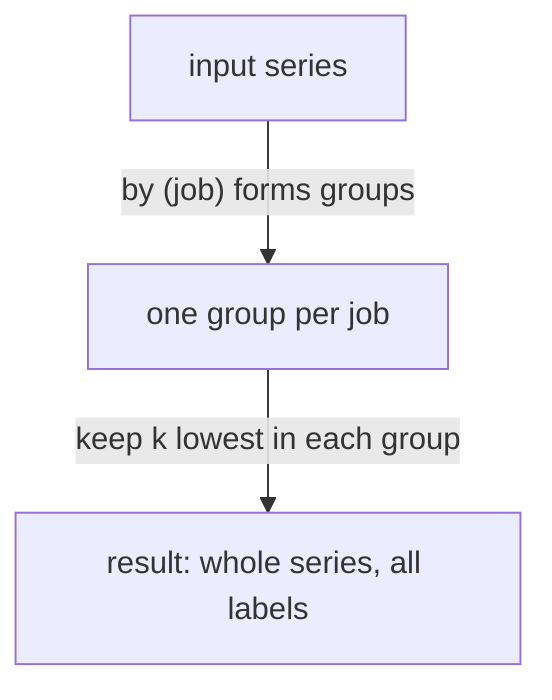

# topk And bottomk

`max` tells you that the largest queue has 280 entries. It does not tell you which instance has it, because aggregation removes the labels that identify the series. `topk` and `bottomk` solve this. They select the series with the highest or lowest values and return them whole, with all their labels. This part shows the syntax, the difference to `max`, ranking inside groups, ties, and why the answer can change from one evaluation time to the next.

## The first example: the two biggest queues

The metric `queue_depth` is a gauge with one series for each of `bridge-0`, `bridge-1` and `shuttle-0`. At the evaluation time its values are 30, 25 and 280. Ask for the two largest. The first argument of `topk` is the number of series to keep, written as a plain number. The second argument is the vector to rank.

<!-- astrona:playground:renew -->

```sh
kubectl -n starfleet exec deploy/shuttle -- python /tools/pq.py 'topk(2, queue_depth)'
```

You should see:

```text
queue_depth{instance="bridge-0:8080", job="bridge"} 30
queue_depth{instance="shuttle-0:8080", job="shuttle"} 280
```

The two series are returned exactly as they were stored, with the metric name `queue_depth` and every label. `topk` does not calculate a new value. It filters: it keeps a subset of the input series and passes them on unchanged. The helper prints the lines sorted as text, so the larger value appears second here. Prometheus itself orders the result of an instant query by value, with the largest first for `topk`.

`bottomk` is the mirror image and keeps the series with the lowest values:

```sh
kubectl -n starfleet exec deploy/shuttle -- python /tools/pq.py 'bottomk(1, queue_depth)'
```

You should see:

```text
queue_depth{instance="bridge-1:8080", job="bridge"} 25
```

## Why not max or min

`max by (job) (queue_depth)` and `topk by (job) (1, queue_depth)` both find the largest value of each job. They differ in what they return. Run the aggregation first:

```sh
kubectl -n starfleet exec deploy/shuttle -- python /tools/pq.py 'max by (job) (queue_depth)'
```

You should see:

```text
{job="bridge"} 30
{job="shuttle"} 280
```

The result has no `instance` label, so it does not say which bridge instance has 30. The ranking operator keeps it, as the next section shows. Use `max` or `min` when only the number matters, for example as input to an alert threshold or a ratio. Use `topk` and `bottomk` when a person must act on the answer and needs the name of the instance.

## Ranking inside groups with by and without

Without a grouping clause, `topk(2, ...)` returns two series in total. With `by` or `without` it returns up to k series for each group. The clause only decides the groups for the ranking. It does not change the labels of the result, which stay as stored. This is the opposite of `sum by (job)`, where `by` decides the result labels.



The diagram shows that grouping only separates the ranking into independent rounds, and that the series come out unchanged.

Ask for the lowest queue of each job:

```sh
kubectl -n starfleet exec deploy/shuttle -- python /tools/pq.py 'bottomk by (job) (1, queue_depth)'
```

You should see:

```text
queue_depth{instance="bridge-1:8080", job="bridge"} 25
queue_depth{instance="shuttle-0:8080", job="shuttle"} 280
```

The job `bridge` has two series, so the lowest one wins (25 from `bridge-1`). The job `shuttle` has one series, so that series is the lowest of its group even though 280 is large. A group with fewer than k series returns all of them. The order inside the result is not defined between groups, because Prometheus returns the groups in no fixed order.

## Ranking raw values and ranking rates

`topk` works on any instant vector. Ranking raw counter values is rarely useful, because a counter's size depends on how long the process has run. Run it once to see why:

```sh
kubectl -n starfleet exec deploy/shuttle -- python /tools/pq.py 'topk(3, http_requests_total)'
```

You should see:

```text
http_requests_total{instance="bridge-0:8080", job="bridge", method="GET", status="200"} 136000
http_requests_total{instance="bridge-0:8080", job="bridge", method="POST", status="200"} 27200
http_requests_total{instance="shuttle-0:8080", job="shuttle", method="GET", status="200"} 64400
```

`bridge-1` is absent from the top three because it restarted at `1767227400`, so its counters are small, although it handles a large share of the traffic. The meaningful form ranks the sum of rates, which compares traffic per second:

```sh
kubectl -n starfleet exec deploy/shuttle -- python /tools/pq.py 'topk(2, sum by (instance) (rate(http_requests_total[5m])))'
```

Derive the answer from the dataset: `bridge-0` gets 150, 30, 6 and 3 requests per 15 seconds, which is 12.6 requests per second. `bridge-1` gets 8 plus 1 plus 0.2 plus 0, which is 9.2 per second. `shuttle-0` gets 4 plus 1, which is 5 per second. So `topk(2, ...)` should return `bridge-0` with about `12.6` and `bridge-1` with about `9.2`, and the lines have only the label `instance`, because the inner `sum by (instance)` already removed the others. Compare with your own output.

You can also continue aggregating on the ranked result. The sum of the two largest queues is a number you can check by hand:

```sh
kubectl -n starfleet exec deploy/shuttle -- python /tools/pq.py 'sum(topk(2, queue_depth))'
```

You should see:

```text
{} 310
```

## Ties and moving results

When several series have the same value at the cut, Prometheus still returns exactly k series, but the documentation does not say which ones. In the dataset all four `up` series that exist at the default time have the value `1`. The expression `topk(2, up)` returns two of the four, and you cannot rely on which two. If the choice matters, add a tie-breaking rule, for example by ranking a second expression, or return all tied series with a comparison such as `queue_depth >= 30`. A `NaN` value counts as the furthest from the top or the bottom, so it is chosen last.

The result also depends on the evaluation time, because ranking runs separately at every time step. At `1767225900`, five minutes into the data, the three queues are 10, 5 and 0, so the largest is on `bridge-0`. At the default time it is on `shuttle-0`:

```sh
kubectl -n starfleet exec deploy/shuttle -- python /tools/pq.py 'topk(1, queue_depth)' --time 1767225900
kubectl -n starfleet exec deploy/shuttle -- python /tools/pq.py 'topk(1, queue_depth)'
```

You should see:

```text
queue_depth{instance="bridge-0:8080", job="bridge"} 10
queue_depth{instance="shuttle-0:8080", job="shuttle"} 280
```

In a graph over a time range, the series that is the top one changes along the time axis. A line then appears and disappears when its series enters and leaves the top k. Range queries are not sorted by value.

This part showed that `topk` and `bottomk` select instead of calculate, and that they keep every label. The next question is how to describe a whole group of values, not just its extremes.

## Common pitfalls

> [!WARNING]
> - `by` and `without` do not change the result labels of `topk` and `bottomk`. They only form the groups that are ranked.
> - Ranking a raw counter ranks the age of the process, not the traffic. Rank `sum by (...) (rate(...))` instead.
> - With ties the choice among equal values is not defined. Do not build an alert or a report that needs a stable winner from a tied `topk`.
> - `topk` is evaluated at every step of a range query. A series that is in the top k at one step may be missing at the next, and a graph of it has gaps.
> - A group with fewer than k series returns all of its series. The result count is at most k per group, not exactly k.
