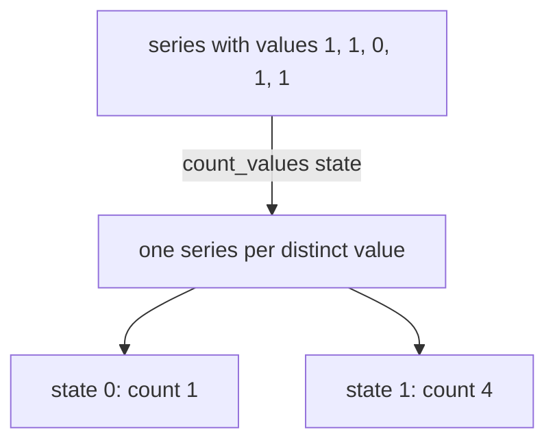

# quantile, stddev, stdvar And count_values

Averages and extremes describe a set of values poorly. The average of 30, 25 and 280 is about 112, a value that no instance has, and the maximum 280 says nothing about the other two. Statistics across series give a better picture: the median shows the typical instance, the standard deviation shows how far the instances spread, and a value count shows how many instances share each value. This part runs `quantile`, `stddev`, `stdvar` and `count_values` on the playground data and explains what each result means.

## quantile across series

A quantile is the value below which a given share of the values lies. The aggregation `quantile(φ, v)` takes a number φ between 0 and 1 as its first argument and a vector as its second. For each group it sorts the values of all series and returns the value at position φ. A φ of 0.5 is the median, 0 is the minimum and 1 is the maximum.

The three queue depths at the evaluation time are 25, 30 and 280 when sorted. The median is the middle one. The extremes are the first and the last. Run the three:

<!-- astrona:playground:renew -->

```sh
kubectl -n starfleet exec deploy/shuttle -- python /tools/pq.py 'quantile(0.5, queue_depth)'
kubectl -n starfleet exec deploy/shuttle -- python /tools/pq.py 'quantile(0, queue_depth)'
kubectl -n starfleet exec deploy/shuttle -- python /tools/pq.py 'quantile(1, queue_depth)'
```

You should see:

```text
{} 30
{} 25
{} 280
```

The median 30 is a better description of a typical instance than the average of about 112, which one large value pulls up. Like every aggregation, `quantile` removes the metric name and all labels that are not in `by`, so the result has no labels here.

When φ falls between two positions, Prometheus interpolates linearly between the two nearest sorted values. For three values the position of φ is φ times 2, so `quantile(0.25, queue_depth)` lies halfway between the first value 25 and the second value 30. Run it, and also run the grouped form, which ranks each job on its own:

```sh
kubectl -n starfleet exec deploy/shuttle -- python /tools/pq.py 'quantile(0.25, queue_depth)'
kubectl -n starfleet exec deploy/shuttle -- python /tools/pq.py 'quantile by (job) (0.5, queue_depth)'
```

The first result should be `27.5`. The second should have `bridge` at `27.5`, the middle of 25 and 30, and `shuttle` at `280`, because a group with one series returns that value for every φ. Compare with your own output. A φ below 0 returns `-Inf` and a φ above 1 returns `+Inf`, so a typing mistake such as `quantile(50, ...)` does not give an error but a useless infinite value.

Three different things carry the word quantile in PromQL, and they answer different questions. The aggregation `quantile` works across series at one moment, which is what this part shows. The function `histogram_quantile` estimates a quantile of observed measurements, such as request durations, from the buckets of a histogram. The function `quantile_over_time` works on one series over a time range. The quantile across series describes how your instances are distributed. It does not describe how your requests are distributed, because every instance counts as one value, however many requests it handled.

## stddev and stdvar: how far the values spread

The standard deviation measures the typical distance of the values from their mean. The variance is the standard deviation squared. Prometheus calculates the population forms, which divide by the number of series, not by the number of series minus one. `stddev(v)` and `stdvar(v)` return one value for each group.

The job `bridge` has two queue depths, 30 and 25. Their mean is 27.5, each value is 2.5 away from the mean, so the variance is 6.25 and the standard deviation is 2.5:

```sh
kubectl -n starfleet exec deploy/shuttle -- python /tools/pq.py 'stdvar(queue_depth{job="bridge"})'
kubectl -n starfleet exec deploy/shuttle -- python /tools/pq.py 'stddev(queue_depth{job="bridge"})'
```

You should see:

```text
{} 6.25
{} 2.5
```

Now add the third instance, `shuttle-0`, with 280:

```sh
kubectl -n starfleet exec deploy/shuttle -- python /tools/pq.py 'stddev(queue_depth)'
```

The mean is about 111.7, the three distances are about 82, 87 and 168, and the standard deviation should be about `119`. One far value moves the deviation from 2.5 to 119. That is the use of these operators: a standard deviation that is large compared with the mean says that the instances do not behave alike, and a single average hides it. A group with a single series has a standard deviation of exactly `0`, so check how many series a group has before you trust it.

## count_values: how many series have each value

`count_values("label", v)` counts how often each distinct sample value occurs. It returns one series for each distinct value. The first argument is a string in quotes. It names a new label, and Prometheus puts the value into that label as text. The value of the new series is the count. All other labels and the metric name are dropped.

Count the queue depths. Every value occurs once, so the result lists the three values as label values:

```sh
kubectl -n starfleet exec deploy/shuttle -- python /tools/pq.py 'count_values("depth", queue_depth)'
```

You should see:

```text
{depth="25"} 1
{depth="280"} 1
{depth="30"} 1
```

The label values are text, so the helper sorts `"280"` before `"30"`. The operator is useful for metrics whose value encodes a state or a number of a kind. The metric `up` has the values 0 and 1. At Unix time `1767228300` the target `shuttle-0` is down. Count the states:

```sh
kubectl -n starfleet exec deploy/shuttle -- python /tools/pq.py 'count_values("state", up)' --time 1767228300
```

You should see:

```text
{state="0"} 1
{state="1"} 4
```

Five targets report at this time: one is down and four are up. The same pattern counts how many instances run each software version or each kernel generation, when a gauge holds that number as its value. Add `by` to count inside groups: `count_values by (job) ("state", up)` keeps the label `job` next to `state`.



The diagram shows that the values become label values and that the counts become the sample values of the new series.

A warning about cardinality belongs here. Every distinct value makes a new series. Applying `count_values` to a metric such as a byte counter, where every series has a different value, returns one series for each input series and gives nothing useful. Use it only on values from a small set.

This part gave you three ways to describe a set of values beyond the average. The remaining question is how to combine averages correctly, and what an average can hide.

## Common pitfalls

> [!WARNING]
> - The aggregation `quantile` works across series. It is not `histogram_quantile`, and it does not give the latency that a share of requests had.
> - A φ outside 0 to 1 returns an infinite value without an error. `quantile(95, ...)` is a mistake; write `quantile(0.95, ...)`.
> - `stddev` and `stdvar` are population values. A group with one series always gives `0`, which says nothing about spread.
> - The first argument of `count_values` is a quoted string, and the new label holds the value as text. A numeric comparison on that label does not work, and the lines sort as text.
> - `count_values` on a metric with many different values creates one series per value. Use it on states, codes and small numbers.
