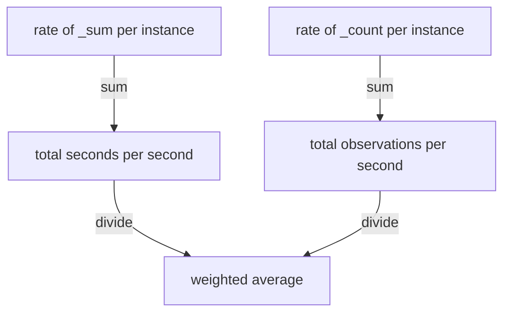

# Correct Averaging And Hidden Failures

Aggregation makes dashboards readable, and it can also make them wrong. Two mistakes are common. The first is to average values that already are averages or ratios, which gives a number that is not the real average. The second is to use an aggregate that looks healthy while one instance fails. This part shows both with numbers from the dataset, and gives the rule that avoids the first and the habit that finds the second.

## Average of averages

The metric family `http_request_duration_seconds` is a histogram. It has three kinds of series: the counter `http_request_duration_seconds_sum` is the total of all observed durations in seconds, the counter `http_request_duration_seconds_count` is the number of observations, and the `_bucket` series count the observations by size. The average duration over a period is the increase of the sum divided by the increase of the count. With rates, that is the rate of the sum divided by the rate of the count.

The dataset formulas give `bridge-0` an increase of 30 seconds of duration and 200 observations every 15 seconds, so its average duration is 0.15 seconds. They give `bridge-1` 40 seconds and 100 observations, so its average is 0.4 seconds. Check the per-instance averages. The division is allowed because both sides have the same label set after `sum by (instance)`, so each instance divides by itself:

<!-- astrona:playground:renew -->

```sh
kubectl -n starfleet exec deploy/shuttle -- python /tools/pq.py 'sum by (instance) (rate(http_request_duration_seconds_sum[5m])) / sum by (instance) (rate(http_request_duration_seconds_count[5m]))'
```

You should see two series with the labels `instance` only: `bridge-0:8080` with a value of about `0.15` and `bridge-1:8080` with about `0.4`. The results are rates, so they can carry floating-point digits. Compare with your own output.

Now ask for the average over both instances. The tempting form averages the two averages:

```sh
kubectl -n starfleet exec deploy/shuttle -- python /tools/pq.py 'avg(sum by (instance) (rate(http_request_duration_seconds_sum[5m])) / sum by (instance) (rate(http_request_duration_seconds_count[5m])))'
```

The value should be about `0.275`, the middle of 0.15 and 0.4. It is wrong. `bridge-0` handles 200 observations in every 15 seconds and `bridge-1` handles 100, so `bridge-0` carries twice the weight. The true average is the total duration divided by the total number of observations: 70 seconds over 300 observations, which is about 0.2333 seconds. Compute it correctly by summing both parts before the division:

```sh
kubectl -n starfleet exec deploy/shuttle -- python /tools/pq.py 'sum(rate(http_request_duration_seconds_sum[5m])) / sum(rate(http_request_duration_seconds_count[5m]))'
```

The value should be about `0.2333`. The difference between 0.275 and 0.2333 is 18 percent, and it grows when the load of the instances differs more.



The diagram shows the rule: add the numerators, add the denominators, and divide once at the end.

## The same mistake with ratios

An error ratio is errors divided by requests. The rule is the same as for averages: sum the numerators and the denominators, then divide. Averaging per-instance ratios gives every instance the same weight, however little traffic it has.

From the dataset formulas, `bridge-0` gets 0.6 errors per second (status `500`) out of 12.6 requests per second, a ratio of about 0.0476. `bridge-1` gets 0.2 errors out of 9.2 requests, about 0.0217. The mean of the two ratios is about 0.0347. The real ratio of the job is 0.8 errors out of 21.8 requests, about 0.0367. The correct query sums both sides by job:

```sh
kubectl -n starfleet exec deploy/shuttle -- python /tools/pq.py 'sum by (job) (rate(http_requests_total{status="500"}[5m])) / sum by (job) (rate(http_requests_total[5m]))'
```

The job `bridge` should be about `0.0367`, and the job `shuttle` about `0.2` (1 error out of 5 requests per second). Both sides of the division have only the label `job`, so every job divides by itself. The wrong form, `avg by (job) (...)` over the per-instance ratios, gives about 0.0347 for `bridge`. The error is small here, and it grows when one instance has far more traffic than another.

Averaging is only safe when every series has the same weight, for example the same kind of gauge on identical hosts. Even then, the question of what the average is for matters, as the next section shows.

## An average hides a failing instance

An aggregate is built to remove detail, and the detail it removes can be the failure. Look at `up` at Unix time `1767228300`, when `shuttle-0` is down. Five targets report, four are up and one is down:

```sh
kubectl -n starfleet exec deploy/shuttle -- python /tools/pq.py 'avg(up)' --time 1767228300
```

The value should be about `0.8`, four ones and one zero divided by five. Compare with your own output. Now take the minimum per job:

```sh
kubectl -n starfleet exec deploy/shuttle -- python /tools/pq.py 'min by (job) (up)' --time 1767228300
```

You should see:

```text
{job="bridge"} 1
{job="probe"} 1
{job="shuttle"} 0
```

The average of about `0.8` says that 80 percent of the targets work, but not which one fails. A rule that alerts on `avg(up) < 0.5` would not fire. The minimum per job shows a `0` for the failing job, and the filter `up == 0` returns the full series with the instance label:

```sh
kubectl -n starfleet exec deploy/shuttle -- python /tools/pq.py 'up == 0' --time 1767228300
```

You should see:

```text
up{instance="shuttle-0:8080", job="shuttle"} 0
```

The same happens with queue depth. At the default time the three queues are 30, 25 and 280. The average `avg(queue_depth)` is about 111.7, which looks like a moderate load, while `max(queue_depth)` is 280 and `topk(1, queue_depth)` names the instance that holds it. For failure detection use `min`, `max`, a filter or `topk`. Use `avg` only when the question is about the typical level.

The worst case is an instance that is not there. At the default time `probe-1` has no `up` series, and an average over the job cannot see it:

```sh
kubectl -n starfleet exec deploy/shuttle -- python /tools/pq.py 'avg by (job) (up)'
```

You should see:

```text
{job="bridge"} 1
{job="probe"} 1
{job="shuttle"} 1
```

Every job looks perfect, although one of the two `probe` targets stopped reporting ten minutes earlier. An average divides by the number of series it finds, and a missing series is not found. Only a count that is compared with the expected number, such as `count by (job) (up)`, shows the gap.

You can now average without distorting the result and you know which aggregates can hide a fault. Together with ranking, statistics and counting, these are the tools of aggregation over dimensions.

## Common pitfalls

> [!WARNING]
> - Do not average averages or ratios. Sum the numerators and the denominators separately and divide once.
> - Do not use `avg` to detect failures. It hides the failing instance, and it cannot see an instance that has no series.
> - A division between two aggregations needs equal label sets on both sides. Group both sides with the same `by` clause, or the series do not match and the result is empty.
> - Compare the number of series with the number you expect. `avg`, `sum` and `max` give a normal-looking answer for the series that are present.
> - Rates and ratios are estimates with floating-point digits. Compare them approximately.
