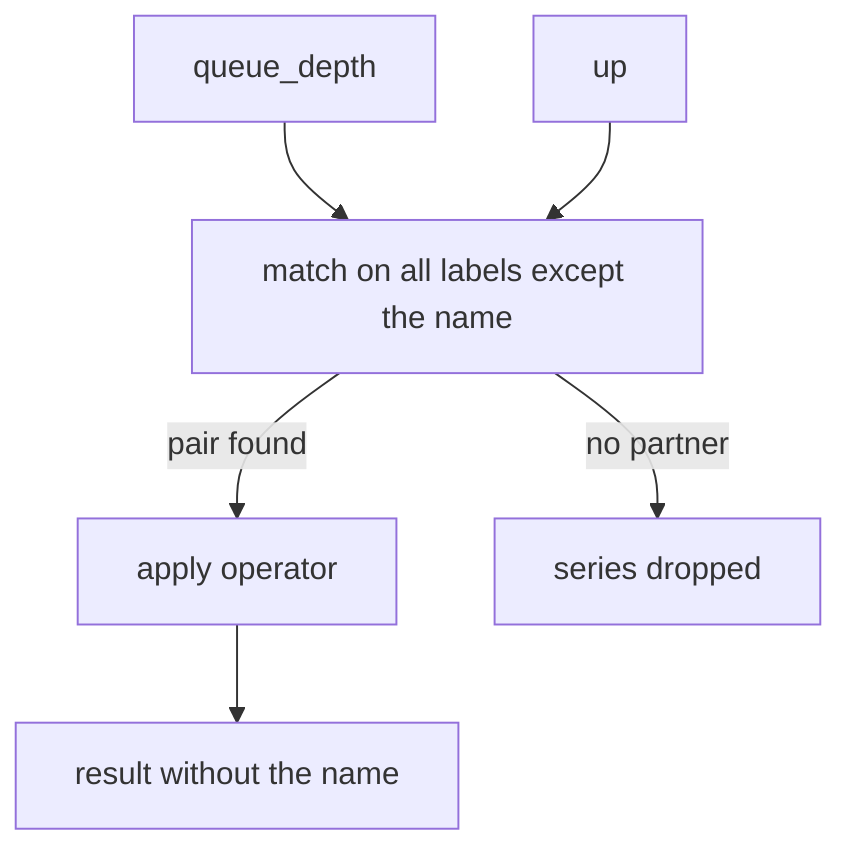

# Arithmetic Operators On Scalars And Vectors

The `bridge` queue depth is stored as a number of items. A dashboard may need it as a percentage of a limit, in another unit, or added to another number. PromQL does this with arithmetic operators: you write the calculation in the query, and Prometheus runs it for every series at the moment of evaluation. This part shows what the operators are, how they treat scalars and vectors, and which labels the result carries.

## The seven arithmetic operators

PromQL has seven arithmetic binary operators. A binary operator is an operator with two operands, one on the left and one on the right.

| Operator | Meaning |
| --- | --- |
| `+` | addition |
| `-` | subtraction |
| `*` | multiplication |
| `/` | division |
| `%` | modulo, the remainder of a division |
| `^` | power, `2 ^ 3` is 8 |
| `atan2` | the arc tangent of `y / x`, with the quadrant taken from the signs of both |

`atan2` is the only one written as a word. It works like the others: `1 atan2 1` is the angle whose tangent is 1 and returns about 0.785, which is a quarter of pi. Prometheus uses the `atan2` function of the Go programming language for this.

All of them work on 64-bit floating point numbers. The query engine, the component of Prometheus that evaluates a query, does not have an integer type. It follows the IEEE 754 standard for floating point arithmetic, so `7 / 2` is 3.5 and no rounding to a whole number happens.

## A scalar and an instant vector

PromQL has two types that an operator can use. A scalar is a single number, such as `2` or the result of `time()`. An instant vector is a set of series with one sample each, taken at the evaluation time. A selector such as `queue_depth` returns an instant vector. A range vector, such as `queue_depth[5m]`, holds many samples per series and cannot be an operand. The engine rejects a binary operation on a range vector with an error of type `bad_data`.

The dataset in the playground has three `queue_depth` series at the default evaluation time. Look at them first.

<!-- astrona:playground:renew -->

```sh
kubectl -n starfleet exec deploy/shuttle -- python /tools/pq.py 'queue_depth'
```

The helper prints one line per series. The values come from the formulas of the dataset: `bridge-0` is at 30, `bridge-1` at 25 and `shuttle-0` at 280.

```text
queue_depth{instance="bridge-0:8080", job="bridge"} 30
queue_depth{instance="bridge-1:8080", job="bridge"} 25
queue_depth{instance="shuttle-0:8080", job="shuttle"} 280
```

Now multiply the whole vector by a scalar. The engine applies the operator to the sample of every series, one at a time.

```sh
kubectl -n starfleet exec deploy/shuttle -- python /tools/pq.py 'queue_depth * 2'
```

```text
{instance="bridge-0:8080", job="bridge"} 60
{instance="bridge-1:8080", job="bridge"} 50
{instance="shuttle-0:8080", job="shuttle"} 560
```

Two things changed. Every value doubled, and the name `queue_depth` is gone: each line now starts with `{`. The labels `instance` and `job` are still there.

## Why the metric name disappears

The name of a series is stored as the label `__name__`. It says what the number measures. After `queue_depth * 2` the number is no longer a queue depth, it is a queue depth times two, and Prometheus does not know what that means. The rule is therefore fixed: every arithmetic operation involving a vector removes `__name__` from the result and keeps all other labels. This is true for all seven operators.

The effect matters when a later step needs the name. A selector can still use a label such as `job`, but `{__name__="queue_depth"}` no longer finds a result of arithmetic. If you need the original name again you can add it with `label_replace`, which belongs to another topic. The more common habit is to keep the meaning in the way you name a recording rule or a dashboard panel.

## A scalar with the metric on either side

The scalar can sit on the left or on the right. `1000 - queue_depth` subtracts each value from 1000, and `queue_depth - 1000` subtracts 1000 from each value. The order matters for `-`, `/`, `%`, `^` and `atan2`. The unit conversion below divides a size in bytes by one billion:

```sh
kubectl -n starfleet exec deploy/shuttle -- python /tools/pq.py 'disk_used_bytes / 1e9'
```

At the default time only `probe-0` has a disk sample, because the `probe-1` series stopped at 1767228600 and is older than the five-minute lookback. The lookback delta is the time window of 5 minutes that an instant query searches backwards for the newest sample of each series. The value of `probe-0` is 43,600,000,000 bytes, so the answer is 43.6 gigabytes:

```text
{instance="probe-0:9100", job="probe", mountpoint="/"} 43.6
```

The literal `1e9` is a number in scientific notation. PromQL accepts it like any other number.

## Two vectors

When both operands are instant vectors, the engine has to decide which sample goes with which. The default rule is one-to-one matching: a sample on the left meets the sample on the right that has exactly the same labels, not counting the metric name. The operator runs on each pair. A series that finds no partner is dropped without an error.



The diagram shows the two steps for every pair: the engine pairs the series first and applies the operator second, and a series without a partner leaves the result.

Try it with `up` and `queue_depth`. Both have the labels `job` and `instance`. At the default time `up` has four series, because `bridge-0`, `bridge-1`, `shuttle-0` and `probe-0` have a current sample, and every one of them is 1. `queue_depth` has three.

```sh
kubectl -n starfleet exec deploy/shuttle -- python /tools/pq.py 'up + queue_depth'
```

```text
{instance="bridge-0:8080", job="bridge"} 31
{instance="bridge-1:8080", job="bridge"} 26
{instance="shuttle-0:8080", job="shuttle"} 281
```

The series for `probe-0` has no `queue_depth` partner, so it is not in the result. The query did not fail, which is why a missing series in the data is easy to overlook. There are ways to change how series are paired, but this pair needs none because the labels are identical.

## A value that comes from the clock

The function `time()` returns the evaluation time as a scalar number of seconds since 1970. A series that holds a Unix timestamp, such as `process_start_time_seconds`, can be subtracted from it to get an age. This is a scalar on the left and a vector on the right:

```sh
kubectl -n starfleet exec deploy/shuttle -- python /tools/pq.py 'time() - process_start_time_seconds'
```

Each value is the number of seconds since the process started. `bridge-0` started 90,000 seconds before the evaluation time and `bridge-1` restarted, so it shows only 1,800. The restart is visible in the data: its start time moved from before the dataset to 1767227400.

```text
{instance="bridge-0:8080", job="bridge"} 90000
{instance="bridge-1:8080", job="bridge"} 1800
{instance="probe-0:9100", job="probe"} 176400
{instance="shuttle-0:8080", job="shuttle"} 4200
```

## Modulo and power

`%` returns the remainder of a division, with the sign of the left operand. `queue_depth % 7` gives 30 mod 7 = 2, 25 mod 7 = 4 and 280 mod 7 = 0:

```sh
kubectl -n starfleet exec deploy/shuttle -- python /tools/pq.py 'queue_depth % 7'
```

```text
{instance="bridge-0:8080", job="bridge"} 2
{instance="bridge-1:8080", job="bridge"} 4
{instance="shuttle-0:8080", job="shuttle"} 0
```

The power operator squares the values with `queue_depth ^ 2`. The result is 900, 625 and 78400:

```sh
kubectl -n starfleet exec deploy/shuttle -- python /tools/pq.py 'queue_depth ^ 2'
```

```text
{instance="bridge-0:8080", job="bridge"} 900
{instance="bridge-1:8080", job="bridge"} 625
{instance="shuttle-0:8080", job="shuttle"} 78400
```

## Two scalars

Two scalars give a scalar. The helper prints it with the word `scalar` in front, because the result has no labels and no series:

```sh
kubectl -n starfleet exec deploy/shuttle -- python /tools/pq.py '7 / 2'
```

```text
scalar 3.5
```

This also shows that the engine itself does the calculation. Prometheus does not need any data for it, so a query of two numbers works on an empty server.

## What you now know

An arithmetic operator takes two operands, each a scalar or an instant vector. With a scalar it runs on every sample. With two vectors it runs on pairs with identical labels, and unpaired series are dropped. The result never has a metric name, but it keeps every other label. The open question is how to compare values instead of calculating with them, and how to keep a series only when a condition is true.

## Common pitfalls

> [!WARNING]
> - Do not search for the original metric name in the result of arithmetic. The name is removed, and the result starts with `{`.
> - A series without a partner in a two-vector operation disappears without an error. If a result has fewer series than you expect, compare the labels of both sides.
> - `queue_depth[5m] * 2` fails, because a range vector is not allowed as an operand. Use a function such as `avg_over_time` first to turn the range into an instant vector.
> - `-`, `/`, `%` and `^` depend on the order of the operands. `1000 - queue_depth` and `queue_depth - 1000` return different values.
> - A result can have many digits, such as a byte count. Do not round it in your head when you compare it with a limit; compare it with the same unit as the limit.
