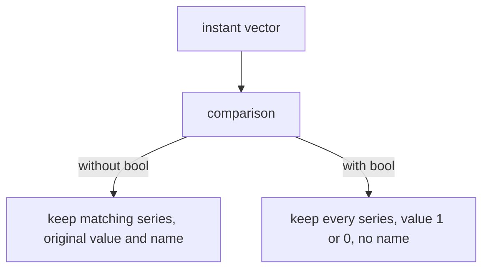

# Comparison Operators, Filtering And The bool Modifier

Calculating a value is only half of monitoring. The other half is a decision: is the queue too long, is the target down, is the backup too old? PromQL answers these questions with comparison operators. They behave in a way that surprises many learners, because in PromQL a comparison between a vector and a number does not return true or false. It returns the series that pass the test. This part explains that filtering behaviour, the `bool` modifier that changes it, and the rule for two scalars.

## The six comparison operators

| Operator | Meaning |
| --- | --- |
| `==` | equal |
| `!=` | not equal |
| `>` | greater than |
| `<` | less than |
| `>=` | greater than or equal |
| `<=` | less than or equal |

An alerting rule in Prometheus uses the same idea. A rule such as `up == 0` fires for every series that the expression returns, so an alert exists exactly while the filter keeps at least one series.

## A comparison filters a vector

Start with the `queue_depth` gauge. At the default time `bridge-0` is at 30, `bridge-1` at 25 and `shuttle-0` at 280. Keep only the series above 26:

<!-- astrona:playground:renew -->

```sh
kubectl -n starfleet exec deploy/shuttle -- python /tools/pq.py 'queue_depth > 26'
```

```text
queue_depth{instance="bridge-0:8080", job="bridge"} 30
queue_depth{instance="shuttle-0:8080", job="shuttle"} 280
```

The series for `bridge-1` is gone, because 25 is not greater than 26. The two series that remain look exactly like the raw metric: the name `queue_depth` is still there and the values are the original ones, 30 and 280, not 1. The comparison did not change any sample. It only decided which series stay in the result.

This differs from arithmetic in two ways. The values are not replaced by a new calculation, and the metric name is kept. The reason is that the value of a surviving series is still the original measurement, so its name still describes it.

If no series passes, the result is an empty vector. That is not an error. The helper prints `(empty result)` for it, and in an alerting rule an empty result means that no alert fires.

## Filtering with the time dimension

The dataset has a period in which a target is down. The series `up` for `shuttle-0` is 0 between 1767228000 and 1767228585. At the default time every target is up, so a filter for zero finds nothing:

```sh
kubectl -n starfleet exec deploy/shuttle -- python /tools/pq.py 'up == 0'
```

```text
(empty result)
```

Evaluate the same query inside the failure period. `1767228300` is a sample time in it:

```sh
kubectl -n starfleet exec deploy/shuttle -- python /tools/pq.py 'up == 0' --time 1767228300
```

```text
up{instance="shuttle-0:8080", job="shuttle"} 0
```

Only the failing target remains, with the name `up` and the value 0. The other four targets have the value 1 at that time and the comparison removes them.

## The bool modifier

Sometimes you want a number for every series and not a filter. The `bool` modifier does that. It goes right after the comparison operator, and the comparison then returns 1 for true and 0 for false and keeps every series:

```sh
kubectl -n starfleet exec deploy/shuttle -- python /tools/pq.py 'queue_depth > bool 26'
```

```text
{instance="bridge-0:8080", job="bridge"} 1
{instance="bridge-1:8080", job="bridge"} 0
{instance="shuttle-0:8080", job="shuttle"} 1
```

All three series are present now. `bridge-1` returns 0, because its value is not greater than 26. The metric name is removed, just as with arithmetic, because the new value is a flag and no longer a queue depth.

The result of `bool` is a normal vector of numbers, so you can calculate with it. Adding the flags counts the series that pass the test:

```sh
kubectl -n starfleet exec deploy/shuttle -- python /tools/pq.py 'sum(queue_depth > bool 26)'
```

```text
{} 2
```

The function `sum` adds all samples of a vector into one series without labels. Two of the three values are 1, so the sum is 2. This is a way to count how many series break a limit. A filter and `count` give the same number, but the `bool` form still returns a value when nothing breaks the limit, because every series stays in the result with the value 0. The sum is then 0 and not an empty result.



The diagram shows the two outcomes of one comparison. The modifier decides whether the result is a filtered vector or a vector of flags.

The same difference shows at the failure time. The next query returns all five targets with a flag that is 1 only for the target that is down:

```sh
kubectl -n starfleet exec deploy/shuttle -- python /tools/pq.py 'up == bool 0' --time 1767228300
```

The values come from the dataset: `shuttle-0` is 1 and `bridge-0`, `bridge-1`, `probe-0` and `probe-1` are 0, because they are up. Every line has the `instance` and `job` labels and no name.

## Two scalars need bool

A scalar has no series to keep or remove, so a filter makes no sense for two scalars. PromQL therefore rejects `5 > 3` when you send it as a query. The helper prints an error of type `bad_data`, and the message says that a comparison between scalars must use the `bool` modifier. The valid form is:

```sh
kubectl -n starfleet exec deploy/shuttle -- python /tools/pq.py '5 > bool 3'
```

```text
scalar 1
```

The result is a scalar again: 1 for true. With `bool`, a comparison between scalars is always valid, and the same holds for `==`, `!=`, `<`, `>=` and `<=`.

## Comparing a calculation

The left side of a comparison can be any expression. A common check is the age of a backup. The gauge `backup_last_success_timestamp_seconds` holds the Unix time of the last good backup, so `time()` minus the gauge is the age in seconds. Keep the series whose age is above 1800 seconds, which is 30 minutes:

```sh
kubectl -n starfleet exec deploy/shuttle -- python /tools/pq.py 'time() - backup_last_success_timestamp_seconds > 1800'
```

The engine first calculates the age, which is a vector without a name, and then filters it. `shuttle-0` was refreshed at 1767228900, so its age is 300 seconds and it is removed. `probe-0` froze at 1767226800, so its age is 2400 seconds and it stays. The `probe-1` series has no sample at the default time. The result has one line:

```text
{instance="probe-0:9100", job="probe"} 2400
```

The metric name is not in the line, because the subtraction removed it before the comparison ran. This confirms the rule from arithmetic: the name is lost in the calculation, and the filter does not bring it back.

## Comparing two vectors

A comparison can also have a vector on both sides. Series are paired the same way as for arithmetic, by identical labels without the name, and the left sample is kept when the comparison is true. For example, `disk_used_bytes > disk_total_bytes * 0.42` keeps the disks that are more than 42 percent full. At time 1767228600 the used values are 43,000,000,000 bytes for `probe-0` and 41,500,000,000 bytes for `probe-1`, and the total is 100,000,000,000 for both. Only `probe-0` passes. Compare your own output with this. The line keeps the name `disk_used_bytes`, because the left side is a plain selector, and its value is the used bytes and not the ratio.

## What you now know

A comparison with a vector filters it: the original value and the name stay on the series that pass. The `bool` modifier turns the same comparison into a vector of 1 and 0 for every series, and it removes the name. Two scalars always need `bool`. The comparison can use any expression on either side, and the calculation inside it has already removed the name. The open question is how Prometheus decides which operator to run first when an expression has several, and what happens when a division goes wrong.

## Common pitfalls

> [!WARNING]
> - A filter without `bool` returns the original value of the series, not 1. Do not expect `queue_depth > 26` to return a flag.
> - An empty result from `up == 0` means that no target is down. It is not a failure of the query.
> - `5 > 3` is rejected. Use `5 > bool 3` for two scalars.
> - `bool` goes after the operator, as in `> bool 26`. Writing `bool >` is a syntax error.
> - `sum(x > bool 26)` returns 0 when nothing passes, while a filter returns an empty result. Choose the form that suits what the next step needs.
> - After arithmetic the name is gone, so a filter on the result cannot use `__name__`.
