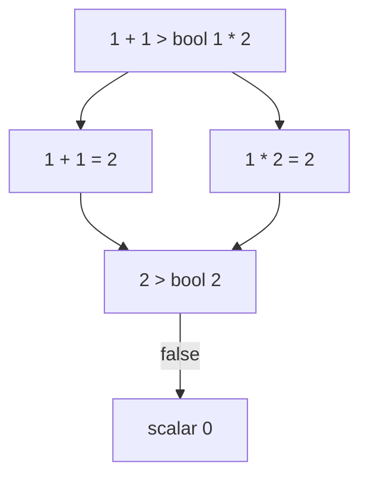

# Operator Precedence, Error Ratios And Division By Zero

An expression such as `a + b * c` has two operators, and Prometheus has to decide which one runs first. If you guess wrong, the query still runs and returns a number, but it is the wrong number. This part gives the exact order, shows the rule for operators of the same level, builds the most common real expression with several operators, the error ratio, and then follows what happens when a division has a zero in it.

## Precedence

Precedence is the order in which operators run when an expression has no parentheses. The operator with the higher precedence runs first. PromQL has six levels, from highest to lowest:

| Level | Operators |
| --- | --- |
| 1 | `^` |
| 2 | `*`, `/`, `%`, `atan2` |
| 3 | `+`, `-` |
| 4 | `==`, `!=`, `<=`, `<`, `>=`, `>` |
| 5 | `and`, `unless` |
| 6 | `or` |

Multiplication binds tighter than addition, as in school mathematics. Comparisons are below all arithmetic, so a calculation on each side of a comparison finishes before the comparison runs. The set operators `and`, `unless` and `or` are at the bottom, and they are the subject of other topics. Only note here that they run after comparisons.

Try the rule with plain numbers. The query `2 + 3 * 4` multiplies first and adds second, so the result is 14. Parentheses override the table and force the addition first, which gives 20.

<!-- astrona:playground:renew -->

```sh
kubectl -n starfleet exec deploy/shuttle -- python /tools/pq.py '2 + 3 * 4'
```

```text
scalar 14
```

```sh
kubectl -n starfleet exec deploy/shuttle -- python /tools/pq.py '(2 + 3) * 4'
```

```text
scalar 20
```

The component that applies this rule is the PromQL parser. It reads the text of the query and builds a tree of operations before any data is read, so the order does not depend on the data and does not change at run time.

## Associativity

When two operators have the same precedence, associativity decides. Left associative means the leftmost runs first. Every operator except `^` is left associative. So `10 - 4 - 3` is `(10 - 4) - 3`, which is 3, and not `10 - (4 - 3)`, which is 9.

The power operator `^` is right associative: the rightmost runs first. `2 ^ 3 ^ 2` is `2 ^ (3 ^ 2)`, which is 2 to the power of 9, so 512. With the other grouping the result would be 64.

```sh
kubectl -n starfleet exec deploy/shuttle -- python /tools/pq.py '2 ^ 3 ^ 2'
```

```text
scalar 512
```

Precedence and the `bool` modifier work together. In `1 + 1 > bool 1 * 2`, both sides of the comparison are calculated first: the left side is 2 and the right side is 2. A comparison of 2 greater than 2 is false, so the result is 0:

```sh
kubectl -n starfleet exec deploy/shuttle -- python /tools/pq.py '1 + 1 > bool 1 * 2'
```

```text
scalar 0
```



The diagram shows that both arithmetic operations finish before the comparison, because the comparison has lower precedence.

A precedence mistake with vectors is quiet. In `queue_depth > 26 * 2`, the engine calculates `26 * 2` first and compares with 52, which may not be what you meant. Add parentheses whenever the reader could doubt the order. They cost nothing.

## The error ratio

The most important expression in this area is the error ratio: the share of requests that fail. The counter `http_requests_total` has a `status` label. Requests with status `500` are errors. The ratio of the error rate to the total rate is:

```text
sum(rate(http_requests_total{status="500"}[5m])) / sum(rate(http_requests_total[5m]))
```

Read it from the inside. The function `rate` takes a range vector and returns the per-second increase of a counter, averaged over the window, here five minutes. `sum` adds the rates of all series into one series without labels. The division then runs between two single-series vectors, and both have no labels, so the pairing is trivial.

```sh
kubectl -n starfleet exec deploy/shuttle -- python /tools/pq.py 'sum(rate(http_requests_total{status="500"}[5m])) / sum(rate(http_requests_total[5m]))'
```

The result has one series with no name and no labels. Derive the expected value from the dataset. The error rates are 0.4, 0.2, 0.2, 0 and 1 requests per second, which sum to 1.8. The total rates are 10, 2, 0.4, 0.2, 8, 1, 0.2, 0, 4 and 1, which sum to 26.8. The ratio is 1.8 divided by 26.8, which is about 0.0672. Because the counters grow in a straight line, the rate is exactly the increase per step divided by 15, and your output should agree with 0.0672 to several digits.

The same expression with `by (job)` on both sums returns one ratio per job:

```sh
kubectl -n starfleet exec deploy/shuttle -- python /tools/pq.py 'sum by (job) (rate(http_requests_total{status="500"}[5m])) / sum by (job) (rate(http_requests_total[5m]))'
```

For `bridge` the errors are 0.8 per second of 21.8, about 0.0367. For `shuttle` they are 1 of 5, which is 0.2. Both results keep the `job` label, so the two sides pair one to one.

Why aggregate first? The alternative is to divide without `sum`: `rate(http_requests_total{status="500"}[5m]) / rate(http_requests_total[5m])`. The left side has five series, all with `status="500"`. The right side has ten series. One-to-one matching pairs a left series only with the right series that has exactly the same labels, and that is the same 500 series. Every pair divides a rate by itself, so the result is 1, or `NaN` for the series that never increases. The ten-series right side also holds the 200 series, which have no partner and disappear. The ratio of a rate to itself says nothing about quality. The sums remove the labels that make the two sides different, and the ratio of two totals is the number you want. Do not average the ratios of single series either, because a series with little traffic would count as much as one with a lot.

## Division by zero

Prometheus follows the IEEE 754 standard, and it does not raise an error for a division by zero. The result depends on the numerator:

| Expression | Result |
| --- | --- |
| positive / 0 | `+Inf` |
| negative / 0 | `-Inf` |
| 0 / 0 | `NaN` |

`NaN` means not a number. `%` by zero also returns `NaN`.

The dataset has a counter that has a zero value. `bridge-1` restarted at 1767227400, and its counter for `POST` requests with status `500` never increases, so at the default time it is exactly 0. Its `GET` counter with status `500` is 360. Divide both by zero:

```sh
kubectl -n starfleet exec deploy/shuttle -- python /tools/pq.py 'http_requests_total{instance="bridge-1:8080", status="500"} / 0'
```

```text
{instance="bridge-1:8080", job="bridge", method="GET", status="500"} +Inf
{instance="bridge-1:8080", job="bridge", method="POST", status="500"} NaN
```

A real error ratio meets the same case. If a service handles no requests in the window, both sums are 0 and the ratio is `NaN`. If the denominator series is missing, the ratio has no result at all and the answer is empty. The two cases are different: zero traffic gives `NaN` and absent data gives nothing.

## Removing NaN with a comparison

`NaN` is not equal to any number, including itself. This means every comparison with `NaN` is false, except `!=`, which is true. A filter without `bool` therefore removes `NaN` series. Appending `>= 0` to the division above keeps the `+Inf` series, because infinity is greater than zero, and removes the `NaN` series:

```sh
kubectl -n starfleet exec deploy/shuttle -- python /tools/pq.py 'http_requests_total{instance="bridge-1:8080", status="500"} / 0 >= 0'
```

```text
{instance="bridge-1:8080", job="bridge", method="GET", status="500"} +Inf
```

Because `/` has higher precedence than `>=`, the division runs first and the comparison second. With `bool`, the `NaN` series would return 0, not disappear.

## What you now know

Precedence puts `^` first, then multiplication level, then addition level, then comparisons, then `and` and `unless`, then `or`. The parser builds the order of operations from the text, and parentheses change it. Operators on one level run from left to right and `^` from right to left. The error ratio divides the sum of the 500 rates by the sum of all rates, with the same `by` clause on both sides. A division by zero returns `+Inf`, `-Inf` or `NaN` without an error. What remains open is how to pair series when the two sides do not carry the same labels.

## Common pitfalls

> [!WARNING]
> - `2 ^ 3 ^ 2` is 512, not 64. Only `^` runs from right to left.
> - Dividing a rate by a rate without `sum` pairs each series with itself. Aggregate both sides with the same `by` clause.
> - Zero traffic makes the error ratio `NaN`, and an absent denominator makes it empty. Do not read either as "no errors".
> - `NaN != 0` is true, so a filter with `!=` keeps `NaN`. A filter with `>=`, `>`, `<=`, `<` or `==` removes it.
> - A comparison has lower precedence than arithmetic, so `a > b * 2` compares with `b * 2`. Add parentheses when you mean something else.
