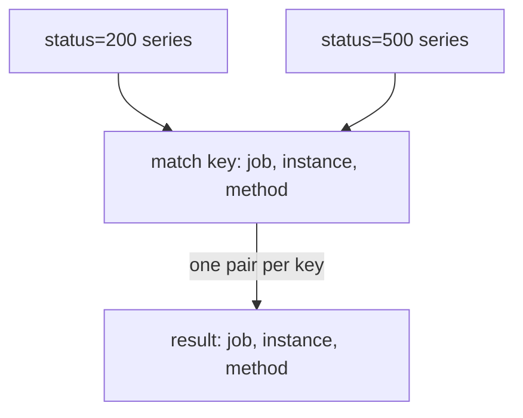

# One-To-One Matching With on And ignoring

An error ratio needs the error counters on one side and the request counters on the other. Both live in the same metric, `http_requests_total`, and the only thing that tells them apart is the label `status`. If you write the division in the obvious way, Prometheus returns nothing. This part explains why, and how the modifiers `on` and `ignoring` fix it.

## The default: all labels must match

A binary operator between two instant vectors pairs the series of the left vector with the series of the right vector. The default rule is one-to-one matching. A left series and a right series form a pair when they have exactly the same set of labels, with the label `__name__` not counted. The operator then runs on the two values. The pair is the unit of work, and it produces one series in the result.

A label set that does not appear on the other side has no partner, so the series is dropped. Prometheus does not report this. You find out only because the result is smaller than you expected, or empty.

Try it with the request counters. The query takes the series with status `500` on the left and the series with status `200` on the right and divides them:

<!-- astrona:playground:renew -->

```sh
kubectl -n starfleet exec deploy/shuttle -- python /tools/pq.py 'http_requests_total{status="500"} / http_requests_total{status="200"}'
```

```text
(empty result)
```

Every left series has `status="500"` and every right series has `status="200"`. No two label sets are identical, so there is no pair, and the result is empty. The query is valid, and Prometheus ran it correctly.

## ignoring: leave a label out of the comparison

The modifier `ignoring(label, ...)` goes right after the operator. It tells the engine to compare all labels except the listed ones. With `ignoring(status)` the two sides now pair when `job`, `instance` and `method` are equal, and `status` can differ.

The next query adds the failed requests to the successful requests of every pair. It uses `+` so that the results are whole numbers that you can check against the dataset. The dataset has counters that never reset in this window, except for `bridge-1`, which restarted and counts from 0:

```sh
kubectl -n starfleet exec deploy/shuttle -- python /tools/pq.py 'http_requests_total{status="200"} + ignoring(status) http_requests_total{status="500"}'
```

```text
{instance="bridge-0:8080", job="bridge", method="GET"} 137840
{instance="bridge-0:8080", job="bridge", method="POST"} 28020
{instance="bridge-1:8080", job="bridge", method="GET"} 14760
{instance="bridge-1:8080", job="bridge", method="POST"} 1800
{instance="shuttle-0:8080", job="shuttle", method="GET"} 68800
```

Each line is the sum of two counters. For `bridge-0` and `GET`, 136000 plus 1840 is 137840. Two things about the labels are visible. The metric name is gone, as with every arithmetic operation. And the label `status` is gone as well: in a one-to-one result, `ignoring` removes the listed labels from the left series, because they no longer describe the single value that came from two series.



The diagram shows that the match key is built from the labels that are not ignored, and that the result carries the same labels.

## on: compare only the listed labels

The modifier `on(label, ...)` is the opposite. It compares only the listed labels and ignores every other label. The same sum with `on(instance, method)` pairs by instance and method:

```sh
kubectl -n starfleet exec deploy/shuttle -- python /tools/pq.py 'http_requests_total{status="200"} + on(instance, method) http_requests_total{status="500"}'
```

```text
{instance="bridge-0:8080", method="GET"} 137840
{instance="bridge-0:8080", method="POST"} 28020
{instance="bridge-1:8080", method="GET"} 14760
{instance="bridge-1:8080", method="POST"} 1800
{instance="shuttle-0:8080", method="GET"} 68800
```

The values are the same, but the label `job` is gone too. A one-to-one result with `on` carries only the labels in the `on` list. Choose between the two modifiers by what the result should show. `ignoring` is the better choice when you want to keep every label except one or two. `on` is the better choice when a short list of labels identifies the pair, and the other labels may differ or are not needed.

## When a match key is not unique

One-to-one means that each match key may appear at most once on each side. Run the same sum with `on(job)`. The key `job` is the same for four of the five series on each side, so each key has several series:

```sh
kubectl -n starfleet exec deploy/shuttle -- python /tools/pq.py 'http_requests_total{status="200"} + on(job) http_requests_total{status="500"}'
```

Prometheus cannot decide which of the four `bridge` series on the right belongs to which of the four on the left, and it does not guess. It returns an error of type `execution`. The message names the match group, for example `{job="bridge"}`, and says that matching labels must be unique on one side. A wrong guess would give a wrong number with no sign of it, so the engine refuses. The fix is to add labels to the `on` list until the key is unique, or to use `ignoring`, or to use the grouping modifiers.

The unique side may be only one side. If one side has several series for a key and the other has exactly one, the query still fails without an explicit grouping modifier. That case is the topic of many-to-one matching.

## Matching two different metrics

Matching is not limited to one metric. The info metrics `build_info` and `team_info` have one series per instance, both with value 1. They have different labels, `version` and `team`, so a plain match finds nothing. Ignoring the one label that differs on each side lets them pair:

```sh
kubectl -n starfleet exec deploy/shuttle -- python /tools/pq.py 'build_info * ignoring(version, team) team_info'
```

```text
{instance="bridge-0:8080", job="bridge"} 1
{instance="bridge-1:8080", job="bridge"} 1
{instance="shuttle-0:8080", job="shuttle"} 1
```

Here `ignoring(version, team)` lists both labels. The left side has `version` and the right side has `team`, and the engine removes each listed label when it builds the match key. Listing a label that one side does not have is allowed.

A realistic use is a check of the error ratio against the budget of each job. The metric `error_budget_ratio` has only the label `job`. The ratio of the sums has only the label `job` too, so the two pair one to one, and `on(job)` says it clearly:

```sh
kubectl -n starfleet exec deploy/shuttle -- python /tools/pq.py 'sum by (job) (rate(http_requests_total{status="500"}[5m])) / sum by (job) (rate(http_requests_total[5m])) > on(job) error_budget_ratio'
```

The division runs first and the comparison second. For `bridge`, the ratio is about 0.0367 against a budget of 0.02, and for `shuttle` it is about 0.2 against 0.1. Both are above the budget, so both series stay in the result with the value of the ratio, because a filter keeps the left value. Compare your output with these approximate values.

## What you now know

A pair needs identical labels, without the metric name. `ignoring` removes labels from the comparison, `on` restricts the comparison to the listed labels, and both change which labels the result carries. A series without a partner disappears silently, and a match key that is not unique on one side makes the query fail. The open question is how to join many series to one, for example all request counters of an instance to its `build_info` series.

## Common pitfalls

> [!WARNING]
> - An empty result from a division of two vectors usually means that the label sets differ. Look at the labels of both sides before you suspect the data.
> - `ignoring` and `on` also change the labels of the result. A label you ignore or leave out of `on` is not in the output.
> - Do not choose `on(job)` just because it is short. If a job has several series, the query fails with an error about the match group.
> - The metric name is never part of the match, so two different metrics with the same labels pair with each other.
