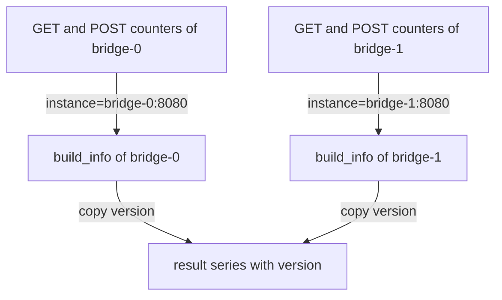

# Many-To-One Matching With group_left And group_right

The counters in `http_requests_total` say how many requests an instance handled, but they do not say which software version the instance runs. That fact lives in a different metric, `build_info`, which has one series per instance. To see request counts by version, you must attach the version to every counter. In PromQL this is a many-to-one match: several counter series on one side meet one `build_info` series on the other side. This part explains the modifiers `group_left` and `group_right`, which allow it, and how they copy labels.

## Why a plain match fails

The metric `build_info` has the labels `job`, `instance` and `version`, and its value is always 1. At the default time there are three series: `bridge-0` runs version 1.4.2, `bridge-1` runs 1.5.0 and `shuttle-0` runs 2.0.1.

The counters with status `500` have five series. `bridge-0` and `bridge-1` have one series for `GET` and one for `POST`, and `shuttle-0` has one for `GET`. Match them on `instance`, which is the label they share:

<!-- astrona:playground:renew -->

```sh
kubectl -n starfleet exec deploy/shuttle -- python /tools/pq.py 'http_requests_total{status="500"} * on(instance) build_info'
```

The query fails. `bridge-0` has two counter series on the left and one `build_info` series on the right, so the match key `instance="bridge-0:8080"` has several series on one side. The engine returns an error of type `execution` that names the match group. It will not decide for you that many series may share one partner, because in most queries that means a mistake in the labels. You have to say so explicitly.

## group_left

The modifier `group_left` says: the left side is the many side, and several left series may match one right series. It is written after `on` or `ignoring`:

```sh
kubectl -n starfleet exec deploy/shuttle -- python /tools/pq.py 'http_requests_total{status="500"} * on(instance) group_left(version) build_info'
```

```text
{instance="bridge-0:8080", job="bridge", method="GET", status="500", version="1.4.2"} 1840
{instance="bridge-0:8080", job="bridge", method="POST", status="500", version="1.4.2"} 820
{instance="bridge-1:8080", job="bridge", method="GET", status="500", version="1.5.0"} 360
{instance="bridge-1:8080", job="bridge", method="POST", status="500", version="1.5.0"} 0
{instance="shuttle-0:8080", job="shuttle", method="GET", status="500", version="2.0.1"} 4400
```

The query returns all five counter series. Each value is the counter times 1, so it is unchanged, and the label `version` appears on every series. This is the standard way to add the information of an info metric to a measurement. The value of the info metric is always 1, so the multiplication changes nothing, and only the labels matter.

The labels in the parentheses of `group_left(version)` are copied from the right side, the one side, to the result. The result has all labels of the many side, the left series, plus the copied labels. The metric name is dropped, because `*` is an arithmetic operator.



The diagram shows that the match key is `instance`, that the several counters of one instance share one `build_info` series, and that `version` flows from the one side to the result.

The parentheses may be left empty, as in `group_left`, or the modifier may be written without them. It then allows the many-to-one match but copies no labels. This is useful when the right side is only a lookup that decides which series are kept.

## Direction: which side is many

The direction is a fact about the data and not a choice of style. `group_left` is correct when the left side has the many series. If you put the many series on the left and write `group_right`, the engine treats the right side as the many side, finds several left series for one match key, and returns an error. If you write `group_left` but the right side has several series per key, the one side is not unique, and the engine also returns an error. The one side must always be unique per match key.

Matching without a partner still drops the series. The metric `up` has a series for `probe-0`, which has no `build_info` series. The next query returns only three series, because the `probe-0` series finds no partner:

```sh
kubectl -n starfleet exec deploy/shuttle -- python /tools/pq.py 'up * on(instance) group_left(version) build_info'
```

```text
{instance="bridge-0:8080", job="bridge", version="1.4.2"} 1
{instance="bridge-1:8080", job="bridge", version="1.5.0"} 1
{instance="shuttle-0:8080", job="shuttle", version="2.0.1"} 1
```

This is a quiet way to filter. The result includes only the instances that have a `build_info` series, and the values are the `up` values multiplied by 1.

## Copying labels from two metrics

One info metric gives one set of labels. The metric `team_info` has the label `team`, and it is also one series per instance. To attach both `version` and `team`, chain two matches. The first multiplication adds `version`, and its result becomes the left side of the second multiplication:

```sh
kubectl -n starfleet exec deploy/shuttle -- python /tools/pq.py 'queue_depth * on(instance) group_left(version) build_info * on(instance) group_left(team) team_info'
```

```text
{instance="bridge-0:8080", job="bridge", team="ops", version="1.4.2"} 30
{instance="bridge-1:8080", job="bridge", team="ops", version="1.5.0"} 25
{instance="shuttle-0:8080", job="shuttle", team="logistics", version="2.0.1"} 280
```

Both operators have the same precedence and run from left to right, so the first match runs first. The values are the queue depths from the dataset: 30, 25 and 280. A label in the parentheses cannot also appear in the `on` list, because it would be both a match key and a copied label.

## group_right

The modifier `group_right` is the mirror image. The right side is the many side, the left side is the one side, and the labels in the parentheses are copied from the left side. The next query writes the same idea with the info metric on the left:

```sh
kubectl -n starfleet exec deploy/shuttle -- python /tools/pq.py 'team_info * on(instance) group_right(team) queue_depth'
```

```text
{instance="bridge-0:8080", job="bridge", team="ops"} 30
{instance="bridge-1:8080", job="bridge", team="ops"} 25
{instance="shuttle-0:8080", job="shuttle", team="logistics"} 280
```

The result has the labels of `queue_depth`, the many side, and the copied `team`. Each instance has only one `queue_depth` series, so the match is really one-to-one here, but the modifier is still allowed. Prometheus checks only that the one side is unique. Most people write `group_left` and put the info metric on the right, because the query then reads from the measurement to its description.

## What the result looks like

For many-to-one matching the result keeps the labels of the many side and adds the copied labels. If the copied label already exists on the many side, the value from the one side replaces it. For arithmetic the metric name is dropped. For a comparison without `bool`, the name of the many side is kept. The value of each result series comes from the operator applied to the many sample and the one sample.

## What you now know

A many-to-one match needs an explicit modifier. `group_left` names the left side as the many side and `group_right` names the right side. The labels in the parentheses come from the one side, which must have one series per match key. The result has the many side's labels plus the copied ones, and series without a partner disappear. The open question is how to combine vectors by their labels alone, without any arithmetic on the values.

## Common pitfalls

> [!WARNING]
> - Without `group_left` or `group_right`, a key with several series on one side makes the query fail. The error names the match group.
> - The many side must match the modifier. `group_left` with the many series on the right fails.
> - The one side must have exactly one series per key. Two `build_info` series for one instance break the query.
> - A label cannot appear in both `on(...)` and the group list.
> - Multiplying by an info metric works because its value is 1. An info metric with another value changes the numbers.
