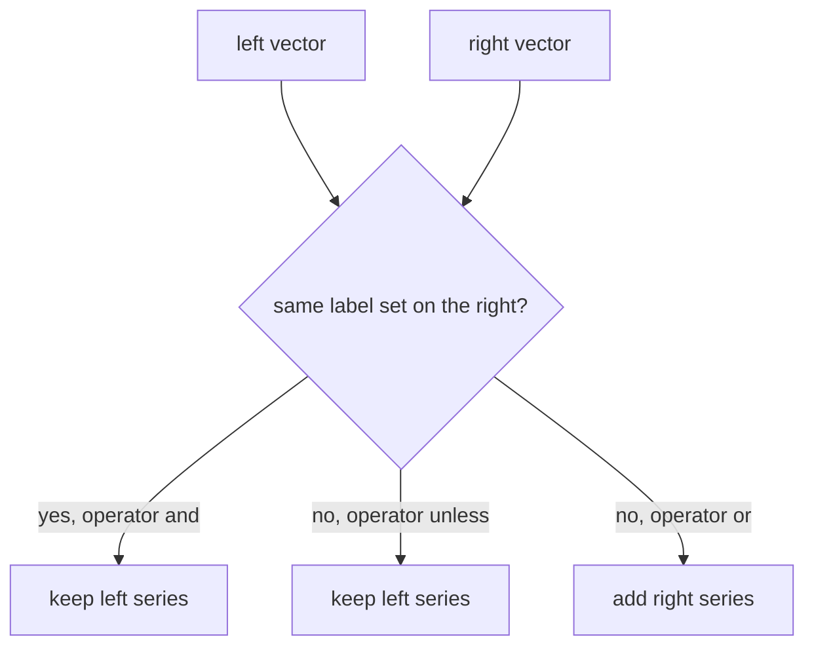

# Set Operators: and, or And unless

Arithmetic and comparison operators combine values. Sometimes the question is not about values at all. Which queue depths belong to targets that are down? Which series exist in one metric but not in another? Which series should a query return even when its own metric is missing? The set operators `and`, `or` and `unless` answer these questions by looking only at labels. This part explains what each one returns, why the values on the right are ignored, and how to select by value with a comparison on the right side.

## How set operators work

A set operator treats each vector as a set of label sets. Two series have the same label set when all labels are equal, not counting the metric name. The operators work only between two instant vectors. A scalar on either side is a parse error with the type `bad_data`.

Three rules cover all of them:

| Operator | Returns |
| --- | --- |
| `a and b` | the series of `a` whose label set also exists in `b` |
| `a unless b` | the series of `a` whose label set does not exist in `b` |
| `a or b` | all series of `a`, plus the series of `b` whose label set does not exist in `a` |

The series that come back are the original series, with their metric name and their values. The operators do not calculate. They also need no `group_left` or `group_right`: several left series may share one right series, and the result keeps every matching left series. The modifiers `on(...)` and `ignoring(...)` work as before: they choose the labels that make up the label set.

## and keeps the series that have a partner

The dataset has a period in which `shuttle-0` is down. Take the evaluation time 1767228300, inside it. At this time `up` is 0 for `shuttle-0`, and 1 for the other four targets. The queue depths at this time are 10 for `bridge-0`, 25 for `bridge-1` and 160 for `shuttle-0`. Find the queue depths of targets that are down. The comparison `up == 0` is on the right side, and it has higher precedence than `and`, so it runs first:

<!-- astrona:playground:renew -->

```sh
kubectl -n starfleet exec deploy/shuttle -- python /tools/pq.py 'queue_depth and up == 0' --time 1767228300
```

```text
queue_depth{instance="shuttle-0:8080", job="shuttle"} 160
```

The right side `up == 0` is a filter, so it returns only the series of the target that is down. The result is the one `queue_depth` series with that label set. The name `queue_depth` and the value 160 come from the left side. This is how a set operator selects by a value: the filter on the right side decides which label sets exist, and `and` keeps the left series with the same label sets.

## The values on the right are ignored

Remove the filter and use `up` alone on the right:

```sh
kubectl -n starfleet exec deploy/shuttle -- python /tools/pq.py 'queue_depth and up' --time 1767228300
```

```text
queue_depth{instance="bridge-0:8080", job="bridge"} 10
queue_depth{instance="bridge-1:8080", job="bridge"} 25
queue_depth{instance="shuttle-0:8080", job="shuttle"} 160
```

All three series stay, including `shuttle-0`, although its `up` value is 0. The operator asks only whether a series with the same label set exists on the right. A sample with the value 0 exists, so it counts. This is a common mistake: people write `and up` expecting "only healthy targets". The healthy ones need `and up == 1`.



The diagram shows the single question that all three operators ask. The operator decides what happens to the series for each answer.

## on and ignoring with set operators

The counters of `http_requests_total` have more labels than `up`, so a plain `and` finds no equal label sets. The query below limits the label set to `instance` with `on(instance)`. It returns all counters of targets that are down at the evaluation time:

```sh
kubectl -n starfleet exec deploy/shuttle -- python /tools/pq.py 'http_requests_total and on(instance) up == 0' --time 1767228300
```

```text
http_requests_total{instance="shuttle-0:8080", job="shuttle", method="GET", status="200"} 60800
http_requests_total{instance="shuttle-0:8080", job="shuttle", method="GET", status="500"} 3500
```

Two counter series of `shuttle-0` are returned, with all their labels and their original values. Here several left series share one right series. That is why set operators need no grouping modifier: they never combine values, so no value is ambiguous.

## unless removes the series that have a partner

`unless` is the opposite of `and`. It keeps the left series that have no partner. With the same right side, it returns the queue depths of the targets that are not down:

```sh
kubectl -n starfleet exec deploy/shuttle -- python /tools/pq.py 'queue_depth unless on(instance) up == 0' --time 1767228300
```

```text
queue_depth{instance="bridge-0:8080", job="bridge"} 10
queue_depth{instance="bridge-1:8080", job="bridge"} 25
```

The series for `shuttle-0` has a partner on the right, so `unless` removes it. A typical use is to silence an alert for a target that is in maintenance: the alert expression is the left side, and a metric that exists only for targets in maintenance is the right side.

## or adds the series that are missing

`or` returns all left series and adds the right series whose label sets are not in the left. Because the metric name does not count, `queue_depth or up` shows a surprising result. The label sets of `queue_depth` and `up` are identical for three instances, so those `up` series are hidden. Only the `up` series of `probe-0` has a label set that is not on the left, so only that one is added:

```sh
kubectl -n starfleet exec deploy/shuttle -- python /tools/pq.py 'queue_depth or up'
```

```text
queue_depth{instance="bridge-0:8080", job="bridge"} 30
queue_depth{instance="bridge-1:8080", job="bridge"} 25
queue_depth{instance="shuttle-0:8080", job="shuttle"} 280
up{instance="probe-0:9100", job="probe"} 1
```

The left side wins when label sets collide. The result is a union by label set, not by metric name.

The other common use of `or` is a default value. An aggregation of a selector that matches nothing returns an empty result, not 0. Adding `or vector(0)` gives the result a fallback. The function `vector(0)` returns one series with no labels and the value 0. The selector below matches no series, so `sum` returns nothing and the right side is used:

```sh
kubectl -n starfleet exec deploy/shuttle -- python /tools/pq.py 'sum(queue_depth{job="nothing"}) or vector(0)'
```

```text
{} 0
```

If the sum had a result, it would also have no labels, so its label set equals the label set of `vector(0)`, and the left value would win.

## What you now know

`and`, `unless` and `or` combine vectors by their label sets. `and` keeps left series with a partner, `unless` keeps left series without one, and `or` adds right series that the left does not have. They return the left samples unchanged and ignore the values on the right, so a comparison on the right side is the way to select by value. They need no grouping modifier, and `on` and `ignoring` choose the labels that form the label set. These operators complete the set of binary operators: they calculate, compare, pair and combine.

## Common pitfalls

> [!WARNING]
> - `and up` does not mean "only targets that are up". The value is ignored, so use `and up == 1`.
> - The metric name is not part of the label set. `queue_depth or up` hides every `up` series that has the same labels as a `queue_depth` series.
> - Set operators do not work with scalars. Use `vector(0)` to get a series.
> - The comparison on the right side runs before `and`, `or` and `unless`, because comparison has higher precedence. Add parentheses when it helps the reader.
> - `or` with an empty left side returns the right side unchanged, which can hide that the left metric is missing.
