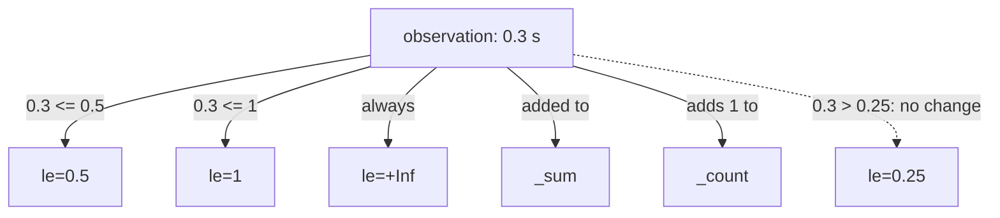

# What A Classic Histogram Exposes

An average response time of 0.15 seconds says nothing about the slowest requests. To answer questions such as "how many requests took longer than half a second?", a service must keep the shape of the distribution of its request durations, not one number. A classic histogram does this with a fixed set of counters. This lesson shows exactly which series one histogram creates, what each value means, and how to read them in PromQL before any function is applied.

## One histogram, many series

A histogram is a metric type. The application that is monitored (here the `bridge` service) chooses a list of upper bounds in advance, for example 0.05, 0.1, 0.25, 0.5 and 1 second. Every time it serves a request, it measures the duration and increases the counters of all the buckets whose upper bound is greater than or equal to that duration. The client library does this, not Prometheus. Prometheus only stores the counters that it scrapes.

One histogram named `http_request_duration_seconds` therefore appears as three kinds of series:

- `http_request_duration_seconds_bucket`: one counter per upper bound, with the label `le` ("less than or equal"). The value of `le="0.25"` is the number of observations that took 0.25 seconds or less.
- `http_request_duration_seconds_sum`: the sum of all observed durations in seconds.
- `http_request_duration_seconds_count`: the number of observations.

The last bucket has the label `le="+Inf"`. Its upper bound is infinity, so every observation counts in it, and its value always equals `_count`. The `le` value is a string label, so a selector must write it exactly as the series does: `le="0.25"` matches, `le="0.250"` does not.



The diagram shows one observation of 0.3 seconds. It increases the buckets `le="0.5"`, `le="1"` and `le="+Inf"`, adds 0.3 to the sum and 1 to the count, and leaves `le="0.25"` and the smaller buckets as they are.

## Read the buckets of one instance

The playground holds this histogram for two instances. Start with `bridge-0` and select all its bucket series at the default time:

<!-- astrona:playground:renew -->

```sh
kubectl -n starfleet exec deploy/shuttle -- python /tools/pq.py 'http_request_duration_seconds_bucket{instance="bridge-0:8080"}'
```

You should see:

```text
http_request_duration_seconds_bucket{handler="/orders", instance="bridge-0:8080", job="bridge", le="+Inf"} 48000
http_request_duration_seconds_bucket{handler="/orders", instance="bridge-0:8080", job="bridge", le="0.05"} 14400
http_request_duration_seconds_bucket{handler="/orders", instance="bridge-0:8080", job="bridge", le="0.1"} 28800
http_request_duration_seconds_bucket{handler="/orders", instance="bridge-0:8080", job="bridge", le="0.25"} 40800
http_request_duration_seconds_bucket{handler="/orders", instance="bridge-0:8080", job="bridge", le="0.5"} 45600
http_request_duration_seconds_bucket{handler="/orders", instance="bridge-0:8080", job="bridge", le="1"} 47520
```

The helper sorts the lines as text, so `+Inf` comes first and the bounds follow in text order. The values grow with the bound, as cumulative counters must. These numbers come from the dataset formulas: at the last sample, `bridge-0` has taken 240 steps, and per step the buckets grow by 60, 120, 170, 190, 198 and 200.

## Buckets are cumulative

Each bucket counts everything below its bound, not only the observations between its bound and the previous one. So `le="0.5"` includes all the requests that are already counted in `le="0.25"`. To find how many requests took longer than 0.25 seconds and at most 0.5 seconds, subtract the two neighbouring buckets. PromQL can subtract two vectors when the `le` label is ignored for the matching:

```sh
kubectl -n starfleet exec deploy/shuttle -- python /tools/pq.py 'http_request_duration_seconds_bucket{instance="bridge-0:8080",le="0.5"} - ignoring(le) http_request_duration_seconds_bucket{instance="bridge-0:8080",le="0.25"}'
```

You should see:

```text
{handler="/orders", instance="bridge-0:8080", job="bridge"} 4800
```

The result is 45600 minus 40800. The Prometheus query engine did the work: `ignoring(le)` tells it to pair the two series although their `le` labels differ, and it drops `le` and the metric name from the result. The same subtraction works for every pair of neighbours. From the values above: 14400 observations were at most 0.05 seconds, 14400 were between 0.05 and 0.1, 12000 between 0.1 and 0.25, 4800 between 0.25 and 0.5, 1920 between 0.5 and 1, and 480 took longer than 1 second (48000 minus 47520).

## The sum and the count

The sum and the count make the average possible, and the count is the total of the histogram. Select both for `bridge-0` with one selector that matches the two metric names:

```sh
kubectl -n starfleet exec deploy/shuttle -- python /tools/pq.py '{__name__=~"http_request_duration_seconds_(sum|count)",instance="bridge-0:8080"}'
```

You should see:

```text
http_request_duration_seconds_count{handler="/orders", instance="bridge-0:8080", job="bridge"} 48000
http_request_duration_seconds_sum{handler="/orders", instance="bridge-0:8080", job="bridge"} 7200
```

The count 48000 equals the value of `le="+Inf"` above. The sum is 7200 seconds, so the average duration since the start of the series is 7200 divided by 48000, which is 0.15 seconds. The mean is only one number. The buckets show that about 30 percent of the requests were at most 0.05 seconds and that 480 of 48000 took more than a second.

## Count the series

A histogram with six bounds creates six bucket series, one sum series and one count series for each combination of the other labels. Count the bucket series of both instances:

```sh
kubectl -n starfleet exec deploy/shuttle -- python /tools/pq.py 'count(http_request_duration_seconds_bucket)'
```

You should see:

```text
{} 12
```

Two instances times six bounds make 12 series. This is the cost of a classic histogram: more buckets give more detail and more series, and every extra label value multiplies the number again. The bounds cannot change after the application is released without breaking comparisons with older data.

## Values are lifetime counters

The bucket values are counters that grow from the start of the process, so the raw values of two instances are not comparable. Select the `le="0.25"` bucket of both instances:

```sh
kubectl -n starfleet exec deploy/shuttle -- python /tools/pq.py 'http_request_duration_seconds_bucket{le="0.25"}'
```

You should see:

```text
http_request_duration_seconds_bucket{handler="/orders", instance="bridge-0:8080", job="bridge", le="0.25"} 40800
http_request_duration_seconds_bucket{handler="/orders", instance="bridge-1:8080", job="bridge", le="0.25"} 9600
```

The instance `bridge-1` shows a much smaller number, not because it is faster, but because it restarted at Unix time 1767227400 and its counters began again at 0. A raw bucket value says how many observations happened since the process started. To ask about a time window, a query must work with the increase of the counters, which is what `rate` does.

You now know the three kinds of series that make a classic histogram, that bucket values are cumulative and that the `+Inf` bucket equals the count. The open question is how to turn these counters into one number such as the 90th percentile.

## Common pitfalls

> [!WARNING]
> - **Reading a bucket as a range.** `le="0.5"` counts everything up to 0.5 seconds, not only the requests between 0.25 and 0.5 seconds. Subtract the neighbouring bucket to get a range.
> - **Writing the bound differently from the series.** `le` is a string, so `le="0.250"` and `le="1.0"` match nothing, and the result is empty without an error. Copy the value from a selector first.
> - **Comparing raw values of two instances.** Raw buckets count from the process start, so an instance that restarted recently shows smaller numbers for the same speed.
> - **Forgetting that the buckets are fixed.** The bounds are chosen in the application. PromQL cannot create a bucket at 0.3 seconds when the series only has 0.25 and 0.5.
