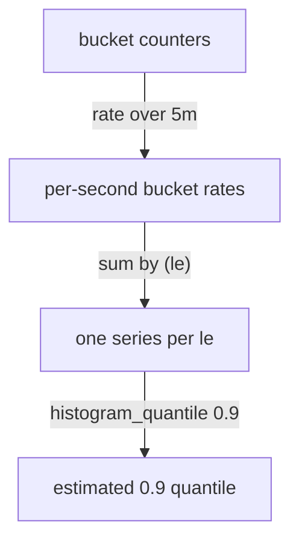

# Rate Over Buckets And histogram_quantile

The buckets of a histogram are counters that grow for as long as the process runs, so the raw values describe the whole lifetime of the process. An operator who looks for slow requests needs the distribution of the last few minutes. The function `histogram_quantile` estimates a quantile (for example the 90th percentile, written 0.9) from bucket counts, and `rate` turns the lifetime counters into counts for a time window. This lesson builds the expression step by step, shows what the function does inside a bucket, and explains why the result is only an estimate.

## What a quantile means

The 0.9 quantile (the 90th percentile) is the duration below which 90 percent of the observations fall. If the 0.9 quantile of the duration is 0.375 seconds, then 9 of 10 requests took at most 0.375 seconds and 1 of 10 took longer. A quantile answers "how slow is the slow end?", which a mean cannot do.

Prometheus does not store single observations, so it cannot sort them. It only has the bucket counters. The function `histogram_quantile(φ, b)` takes a quantile φ between 0 and 1 and an instant vector `b` of bucket series that carry the label `le`. It finds the bucket that contains the observation at rank φ times the total, and then estimates a value inside that bucket.



The diagram shows the order of the three steps: `rate` first, then the aggregation that keeps `le`, then `histogram_quantile`.

## Step 1: rate over the buckets

The function `rate` takes a range vector of a counter and returns the per-second increase over the window, and it works on each bucket series separately. The dataset adds 60, 120, 170, 190, 198 and 200 observations per 15 seconds to the six buckets of `bridge-0`, and the counters never reset. Perfectly linear counters give a rate of the increase per step divided by 15. Run the rate for `bridge-0`:

<!-- astrona:playground:renew -->

```sh
kubectl -n starfleet exec deploy/shuttle -- python /tools/pq.py 'rate(http_request_duration_seconds_bucket{instance="bridge-0:8080"}[5m])'
```

The output has six lines, one per bucket. The values should be about 4, 8, 11.33, 12.67, 13.2 and 13.33 observations per second for the bounds 0.05, 0.1, 0.25, 0.5, 1 and `+Inf`. Floating-point arithmetic can add trailing digits, so compare the first digits only. The rates are still cumulative: each bucket rate includes the slower buckets below it.

## Step 2: the quantile

Pass the rates to `histogram_quantile`. For one instance, the vector from `rate` already has one series per `le` value and identical other labels, so no aggregation is needed:

```sh
kubectl -n starfleet exec deploy/shuttle -- python /tools/pq.py 'histogram_quantile(0.9, rate(http_request_duration_seconds_bucket{instance="bridge-0:8080"}[5m]))'
```

The result has one line, with the labels `handler`, `instance` and `job` but no `le`, and the value should be about 0.375 seconds. The function groups the input by all labels except `le`, so one group is one histogram, and it returns one value per group.

## How the value 0.375 is calculated

The Prometheus query engine does the following for the group of `bridge-0`, using the rates above. Work with the per-step numbers 60, 120, 170, 190, 198 and 200, because the ratios are the same.

1. The total number of observations is the value of the `+Inf` bucket: 200.
2. The rank is 0.9 times 200, which is 180.
3. The first bucket whose count is at least 180 is `le="0.5"`, with count 190. The bucket below it is `le="0.25"`, with count 170.
4. The observation at rank 180 is therefore in the range from 0.25 to 0.5 seconds, and 10 of the 20 observations in this bucket are below it (190 minus 170 is 20, and 180 minus 170 is 10).
5. Linear interpolation assumes that the 20 observations are spread evenly across the bucket. Half of them is half of the width: 0.25 plus 0.25 times 10 divided by 20 gives 0.375.

So the result has this formula: lower bound plus bucket width times the share of the bucket's observations that lie below the rank. Check the case of the instance `bridge-1`, with per-step counts 10, 40, 80, 95, 99 and 100. The rank is 90, the bucket is 0.25 to 0.5 (count 95, below it 80), and the result is 0.25 plus 0.25 times 10 divided by 15, which is about 0.4167. Run the quantile for both instances at once to compare with your own calculation:

```sh
kubectl -n starfleet exec deploy/shuttle -- python /tools/pq.py 'histogram_quantile(0.9, sum by (instance, le) (rate(http_request_duration_seconds_bucket[5m])))'
```

You should see two lines with only the label `instance`, with values of about 0.375 and 0.4167. Here `sum by (instance, le)` removes the labels `handler` and `job` and keeps `instance` and `le`. The window `[5m]` at the default time holds the samples at 20 steps, all after the restart of `bridge-1`, so the counters have no reset inside it.

## Why `le` must stay in the aggregation

An aggregation that drops `le` leaves the function with series that have no bucket bound. The docs state that float samples without the `le` label are ignored. Try an aggregation by `instance` only:

```sh
kubectl -n starfleet exec deploy/shuttle -- python /tools/pq.py 'histogram_quantile(0.9, sum by (instance) (rate(http_request_duration_seconds_bucket[5m])))'
```

The result is empty: `(empty result)`. The query is valid and no error appears. `sum by (instance)` added all six buckets of an instance into one series without `le`, and `histogram_quantile` ignores it. This silent empty result is the most common mistake with histograms, so always check that `le` is in the `by` clause or not in the `without` clause.

## The accuracy limit

The value 0.375 is an estimate. Prometheus knows only that 20 of the 200 observations were between 0.25 and 0.5 seconds, not where inside the range. The assumption of an even spread can be wrong. If all 20 observations were 0.26 seconds, the true 90th percentile would be close to 0.26. If all were 0.49, it would be close to 0.49. The estimate can be wrong by up to the width of the bucket, here 0.25 seconds, and the width of the bucket is set by the bounds that the application defined.

Two rules follow. First, a quantile is only as accurate as the buckets around it: put bounds close together near the value that matters, for example near a limit in a service level objective. Second, a bound that sits exactly at the limit makes the answer to "is the quantile under the limit?" exact, even when the number is inexact.

The edge cases are fixed by the function. When the rank falls in the `+Inf` bucket, the function cannot interpolate towards infinity, so it returns the upper bound of the highest finite bucket. The 0.999 quantile of `bridge-0` has rank 199.8, which is above the count 198 of `le="1"`, so it returns 1:

```sh
kubectl -n starfleet exec deploy/shuttle -- python /tools/pq.py 'histogram_quantile(0.999, sum by (le) (rate(http_request_duration_seconds_bucket{instance="bridge-0:8080"}[5m])))'
```

You should see:

```text
{} 1
```

The 1 does not mean that every request took 1 second. It means that the 0.999 quantile is above the last finite bound and the function reports that bound. A quantile argument below 0 returns `-Inf`, one above 1 returns `+Inf`, and a vector without observations returns `NaN`. When the rank falls in the first bucket, the function assumes that the lower bound is 0.

You now know how to compute a quantile from one instance, what the function does inside a bucket and why the bucket width limits the accuracy. The open question is how to combine several instances into one answer for the whole service.

## Common pitfalls

> [!WARNING]
> - **Using the raw buckets without `rate`.** The raw counters cover the whole lifetime of the process, so the quantile describes all requests since the start, not the last minutes.
> - **Dropping `le`.** `sum by (instance)` or `sum` without `by (le)` gives an empty result and no error.
> - **Reading the result as exact.** The value is an interpolation. The true quantile can be anywhere in the bucket, so judge a result against the width of its bucket.
> - **Trusting a result that equals a bucket bound.** A value such as 1 for the 0.999 quantile means that the rank is above the last finite bucket. Add a bucket above the expected maximum if you need to see more.
