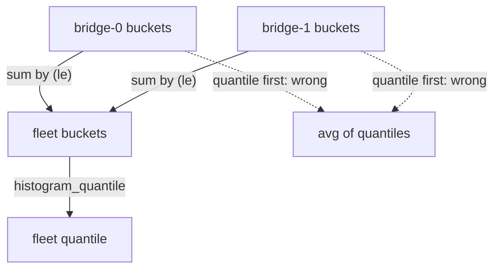

# Aggregating Buckets Across Instances

A service runs on several instances, and a dashboard shows one latency number for the whole service. The tempting way to get it is to compute a quantile for each instance and then average the results. That answer is wrong, and the error can be large. The correct way is to add up the bucket rates of all instances first and compute the quantile once. This lesson shows the difference with the two `bridge` instances, then follows one instance through a counter reset, to see that `rate` keeps the buckets usable.

## The wrong way: average of quantiles

A quantile is not a sum. The 0.9 quantile of two groups of requests is not the mean of the two group quantiles, because the mean ignores how many requests each group holds. In the dataset, `bridge-0` serves 200 requests per 15 seconds and `bridge-1` serves 100, so their 0.9 quantiles should not count equally. Compute the per-instance quantiles and then average them with `avg`:

<!-- astrona:playground:renew -->

```sh
kubectl -n starfleet exec deploy/shuttle -- python /tools/pq.py 'avg(histogram_quantile(0.9, sum by (instance, le) (rate(http_request_duration_seconds_bucket[5m]))))'
```

The instance quantiles are about 0.375 and 0.4167, so the average is about 0.3958 seconds. The result is one series without labels. It looks plausible, and nothing in the output says that it is wrong.

## The right way: add the buckets, then take the quantile

Buckets can be added because they are counters of the same kind: the count of observations at most `le` seconds. The sum over two instances is the count of observations at most `le` seconds in the whole fleet, as long as both instances use the same bounds. After the sum, the histogram represents all requests, and the quantile follows from it. Aggregate with `sum by (le)`:

```sh
kubectl -n starfleet exec deploy/shuttle -- python /tools/pq.py 'histogram_quantile(0.9, sum by (le) (rate(http_request_duration_seconds_bucket[5m])))'
```

You should see one line with no labels. Work out the expected value from the per-step counts. The fleet buckets per step are 60 plus 10, 120 plus 40, 170 plus 80, 190 plus 95, 198 plus 99 and 200 plus 100, which is 70, 160, 250, 285, 297 and 300. The rank is 0.9 times 300, which is 270. The first bucket with at least 270 is `le="0.5"` (285), and the bucket below it holds 250. The result is 0.25 plus 0.25 times 20 divided by 35, which is about 0.3929 seconds.

So the correct fleet quantile is about 0.3929 and the average of quantiles is about 0.3958. The two differ because the quantile of the average ignores the weights. Here the gap is small because the two instances are similar. With one fast instance that serves many requests and one slow instance that serves few, an average of quantiles can be far from the real value, and it can hide an instance that is slow for a small group of users.



The diagram shows the two orders. The solid path sums the buckets and then takes the quantile. The dotted path takes quantiles first and loses the information about how many requests each instance served.

## Which labels to keep

The `by` clause decides what the result describes. `sum by (le)` gives one quantile for the whole fleet. `sum by (instance, le)` gives one per instance. `sum by (job, le)` gives one per job. The rule is always that `le` stays and the other labels are those that you want in the result. You can also write the same thing with `without`, for example `sum without (instance, job) (...)`, which keeps `handler` and `le`. The aggregation works only when every instance uses the same bounds. If one version of the application adds a bucket and another does not, summing the series mixes counts for bounds that exist only in part of the fleet. Prometheus does not warn about this, and the result becomes meaningless. Keep the bounds of a histogram the same on all instances.

## Raw buckets without rate

A fleet quantile from raw buckets is also possible, but it answers a different question. Run it without `rate`:

```sh
kubectl -n starfleet exec deploy/shuttle -- python /tools/pq.py 'histogram_quantile(0.9, sum by (le) (http_request_duration_seconds_bucket))'
```

The result should be about 0.3864 seconds, because the raw buckets add up to 15600, 33600, 50400, 57000, 59400 and 60000 observations since the processes started. Compare it with 0.3929 from the rates. The raw sum weights `bridge-0` by 48000 observations and `bridge-1` by only 12000, because `bridge-1` restarted and started counting again. The result describes the whole lifetime and gives the instance with the longest life more weight. With `rate`, both instances contribute what they did in the same time window.

## A counter reset in the middle of a window

A counter reset happens when a process restarts and its counters begin again at 0. The instance `bridge-1` restarts at Unix time 1767227400. Look at one of its raw buckets just before and at the restart. The sample at 1767227385 comes before the restart:

```sh
kubectl -n starfleet exec deploy/shuttle -- python /tools/pq.py 'http_request_duration_seconds_bucket{instance="bridge-1:8080",le="+Inf"}' --time 1767227385
```

You should see:

```text
http_request_duration_seconds_bucket{handler="/orders", instance="bridge-1:8080", job="bridge", le="+Inf"} 11900
```

Now evaluate the same selector at the restart, with `--time 1767227400`. The same series then has the value 0: the counter dropped from 11900 to 0, and all its buckets, its sum and its count dropped in the same way. A raw quantile or a subtraction of the raw values over this moment gives nonsense, because the counts moved backwards.

The function `rate` expects this. When it finds a sample that is lower than the one before, it treats the drop as a reset and counts the new value from 0. The increase over the window is then the sum of the increases before and after the reset, and the step that contains the reset adds nothing. Because every bucket of `bridge-1` resets at the same sample, every bucket loses the same share of one step. The ratios between the buckets stay the same, so the quantile of `bridge-1` stays near 0.4167. Evaluate the fleet quantile at 1767227475, five samples after the restart, so that the window `[5m]` contains the reset:

```sh
kubectl -n starfleet exec deploy/shuttle -- python /tools/pq.py 'histogram_quantile(0.9, sum by (le) (rate(http_request_duration_seconds_bucket[5m])))' --time 1767227475
```

The result should be about 0.392, close to 0.3929 from the window without a reset. The bucket rates of `bridge-1` in this window are slightly smaller than 10, 40, 80, 95, 99 and 100 divided by 15, by about one part in 19, because one 15-second step of the 19 in the window has no increase. The effect on the fleet quantile is tiny. Compare your own output with 0.39.

You now know that quantiles must be computed from summed bucket rates and never from averaged quantiles, that all instances need the same bounds, and that `rate` repairs a counter reset for histogram buckets. The next question is what else the sum and the count can tell you, such as the mean and the share of fast requests.

## Common pitfalls

> [!WARNING]
> - **Averaging quantiles.** `avg(histogram_quantile(...))` and `max(histogram_quantile(...))` do not give the quantile of the combined requests. Sum the buckets with `sum by (le)` first.
> - **Different bounds on different instances.** Summing series with different `le` values gives counts for bounds that only part of the fleet reports. Keep the bounds identical in every version of the application.
> - **Using raw buckets after a restart.** The counters start again at 0, so the instance with the longest lifetime dominates the result. Use `rate` or `increase` over a window.
> - **Subtracting raw bucket values across a reset.** The difference can be negative. Use functions that handle resets, and keep the window longer than the restart interval of the instances.
