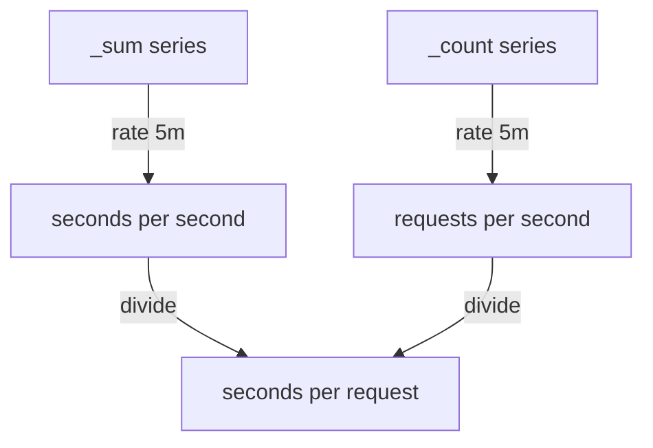

# Mean Duration From Sum And Count

The quantiles of a histogram describe the slow end, and the mean describes the typical cost of a request. A histogram stores everything the mean needs: the sum of all observed durations in `_sum` and the number of observations in `_count`. Dividing one by the other gives the average duration. This lesson shows the division for a time window, per instance and for the whole service, and explains why the order of aggregation and division matters.

## The lifetime mean

Both `_sum` and `_count` are counters. Divided as they are, they give the average over the whole life of the process. The two series have the same labels, so PromQL matches them one to one without extra syntax. Divide them at the default time:

<!-- astrona:playground:renew -->

```sh
kubectl -n starfleet exec deploy/shuttle -- python /tools/pq.py 'http_request_duration_seconds_sum / http_request_duration_seconds_count'
```

You should see:

```text
{handler="/orders", instance="bridge-0:8080", job="bridge"} 0.15
{handler="/orders", instance="bridge-1:8080", job="bridge"} 0.4
```

The numbers come from the dataset: `bridge-0` has a sum of 7200 seconds over 48000 observations, and `bridge-1` has 4800 seconds over 12000 observations since its restart. The division operator dropped the metric name and kept the other labels. This mean covers the whole life of each process, so it reacts slowly to a change. A dashboard needs the mean of a recent window.

## The mean over a window

To get a recent mean, take the rate of each counter and divide. The `rate` of `_sum` is the seconds of work per second of time, and the `rate` of `_count` is the number of requests per second. The ratio of the two is seconds per request:

```sh
kubectl -n starfleet exec deploy/shuttle -- python /tools/pq.py 'rate(http_request_duration_seconds_sum[5m]) / rate(http_request_duration_seconds_count[5m])'
```

The output has two lines with the labels `handler`, `instance` and `job`. The values should be about 0.15 for `bridge-0:8080` (30 seconds of duration per 200 observations) and about 0.4 for `bridge-1:8080` (40 per 100). The window length cancels out, because both rates use the same window. The Prometheus server evaluates `rate` for each series on its own and then divides the two result vectors element by element.



The diagram shows that the mean is a division of two rates, so it has the unit seconds per request.

## One value per instance

The expression above keeps all labels. To report one mean per instance with only the label `instance`, aggregate both sides the same way before the division:

```sh
kubectl -n starfleet exec deploy/shuttle -- python /tools/pq.py 'sum by (instance) (rate(http_request_duration_seconds_sum[5m])) / sum by (instance) (rate(http_request_duration_seconds_count[5m]))'
```

You should see two lines with only the label `instance` and about the same values, 0.15 and 0.4. Here the aggregation is only a way to choose the labels. It becomes necessary when the histogram has more labels than you want in the result, for example `handler` or `method`. Both sides must be reduced to the same label set, otherwise the one-to-one matching fails and the result is empty.

## The mean of the whole service

For the whole service, add the rates of all instances in the numerator and in the denominator, and divide once. The total duration per second is 30 plus 40 divided by 15, and the total requests per second are 200 plus 100 divided by 15:

```sh
kubectl -n starfleet exec deploy/shuttle -- python /tools/pq.py 'sum(rate(http_request_duration_seconds_sum[5m])) / sum(rate(http_request_duration_seconds_count[5m]))'
```

The result has no labels and should be about 0.2333 seconds, which is 70 divided by 300. It is the mean over all 300 requests of a step: the 200 requests of `bridge-0` at 0.15 seconds and the 100 requests of `bridge-1` at 0.4 seconds.

## Why a mean of means is wrong

It is tempting to average the two instance means. The `avg` aggregation does that:

```sh
kubectl -n starfleet exec deploy/shuttle -- python /tools/pq.py 'avg(rate(http_request_duration_seconds_sum[5m]) / rate(http_request_duration_seconds_count[5m]))'
```

The result should be about 0.275, the plain average of 0.15 and 0.4. It is wrong for the service, because it counts both instances equally although `bridge-0` serves twice as many requests. The real mean is 0.2333. A mean is a weighted quantity: each instance mean must be weighted by its request count, and dividing the summed sums by the summed counts does exactly that. The rule is the same as for quantiles: sum the counters of all instances first, then compute the derived number.

## Empty windows and resets

When an instance serves no requests in the window, `rate` of `_count` is 0 and the division 0 divided by 0 is `NaN`. A dashboard shows a gap, which is the honest answer, because there is no mean without requests. If you add instances with `sum`, an instance without traffic simply contributes 0 to both sums. If an instance restarts inside the window, `rate` handles the reset as for every counter, and the mean stays correct because `_sum` and `_count` reset at the same moment.

You now know that the mean of a histogram is the rate of the sum divided by the rate of the count, that the same window must be used on both sides, and that service-wide values come from summed rates. The open question is how to use the buckets to find the share of requests that meet a threshold.

## Common pitfalls

> [!WARNING]
> - **Averaging instance means.** `avg` of per-instance means weights every instance equally. Sum the sums and the counts first, then divide.
> - **Using different windows on the two sides.** A `[1m]` numerator and a `[5m]` denominator do not give seconds per request.
> - **Dividing counters without `rate`.** The result is the mean since the process started, not the mean of the recent window.
> - **Leaving different labels on the two sides.** If one side keeps `handler` and the other does not, the division matches nothing and returns an empty result.
