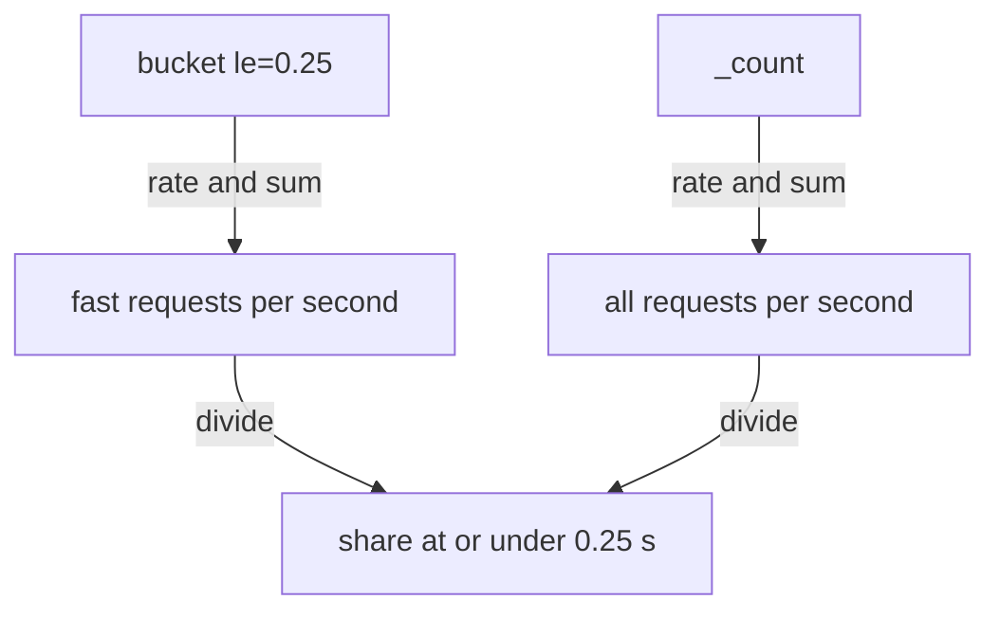

# Share Of Requests Under A Threshold

A service level objective (SLO) often reads "95 percent of requests must finish within 0.5 seconds". That is a share, not a quantile: the question is what fraction of the requests were fast enough. A classic histogram answers it directly, because the bucket `le="0.5"` counts exactly the observations at or under 0.5 seconds. This lesson divides a bucket by the total, shows the label matching that the division needs, and explains why only existing bucket bounds work as thresholds.

## A bucket divided by the total

The fraction of observations at or under a bound is the bucket for that bound divided by the total number of observations. The total is the `_count` series, or the `le="+Inf"` bucket, which has the same value. Start with the lifetime values at the default time and try the obvious division:

<!-- astrona:playground:renew -->

```sh
kubectl -n starfleet exec deploy/shuttle -- python /tools/pq.py 'http_request_duration_seconds_bucket{le="0.25"} / http_request_duration_seconds_count'
```

You should see:

```text
(empty result)
```

The query is valid, but nothing matches. The left side has the labels `handler`, `instance`, `job` and `le`. The right side has no `le`. Vector matching pairs two series only when their label sets (except the metric name) are equal, so no pair is found. This is the same silent failure as with other label mismatches.

## Ignore `le` in the matching

The modifier `ignoring(le)` tells the query engine to leave `le` out when it compares labels. The pairs then match on `handler`, `instance` and `job`:

```sh
kubectl -n starfleet exec deploy/shuttle -- python /tools/pq.py 'http_request_duration_seconds_bucket{le="0.25"} / ignoring(le) http_request_duration_seconds_count'
```

You should see:

```text
{handler="/orders", instance="bridge-0:8080", job="bridge"} 0.85
{handler="/orders", instance="bridge-1:8080", job="bridge"} 0.8
```

The values come from the dataset: `bridge-0` has 40800 of 48000 observations at or under 0.25 seconds, and `bridge-1` has 9600 of 12000. So 85 percent and 80 percent of the requests were fast enough, counted since the processes started. The result has no `le` label, because `ignoring(le)` also removes it from the output.

## The share over a window

For a recent window, use `rate` on both sides and sum over the instances you want to include. The share for the whole service is the summed rate of the bucket `le="0.25"` divided by the summed rate of all observations:

```sh
kubectl -n starfleet exec deploy/shuttle -- python /tools/pq.py 'sum(rate(http_request_duration_seconds_bucket{le="0.25"}[5m])) / sum(rate(http_request_duration_seconds_count[5m]))'
```

After `sum`, both sides have no labels, so no `ignoring` is needed. The value should be about 0.8333, which is 250 divided by 300 requests per step. To keep the instance, use `sum by (instance)` on both sides. The values should then be about 0.85 for `bridge-0` and 0.8 for `bridge-1`.



The diagram shows that the share is a division of two summed rates, one from a bucket and one from the count.

## The share above a threshold

Requests that were too slow are everything that is not at or under the bound. Subtract the share from 1, or subtract the rates:

```sh
kubectl -n starfleet exec deploy/shuttle -- python /tools/pq.py 'sum(rate(http_request_duration_seconds_count[5m])) - sum(rate(http_request_duration_seconds_bucket{le="0.5"}[5m]))'
```

The result should be about 1 request per second above 0.5 seconds. The count is 300 per step, which is 20 per second, and the bucket `le="0.5"` holds 285 per step, which is 19 per second. Divide the difference by the total rate to get the share, which is 15 of 300, or 0.05. An alert for "more than 5 percent of requests are slow" uses this form.

## Thresholds must be bucket bounds

A bucket exists only for the bounds that the application defined. A threshold of 0.3 seconds has no bucket, and PromQL cannot create one. A selector for it matches nothing:

```sh
kubectl -n starfleet exec deploy/shuttle -- python /tools/pq.py 'http_request_duration_seconds_bucket{le="0.3"}'
```

You should see:

```text
(empty result)
```

The query is valid, and the result is empty, because no series has the label value `0.3`. A division that uses this selector is empty, too. Two ways out exist. Choose a threshold from the bounds that exist, for example 0.25 or 0.5. Or change the buckets in the application so that a bound sits at the threshold of the objective. This is why the bounds of a histogram should include the thresholds of every SLO that uses it.

The same share can be estimated between bounds with interpolation, which is what `histogram_quantile` does in reverse. The function `histogram_fraction` does it for native histograms and also accepts classic buckets. The Prometheus docs advise against using it on classic histograms, because acting on the bucket series directly is more robust. The exact result needs a real bound.

## An Apdex score from buckets

Apdex (Application Performance Index) is a score from 0 to 1 that counts a request as satisfied when it is at or under a target and as tolerating when it is at or under a larger limit, and gives tolerating requests half the weight. With a target of 0.25 seconds and a tolerated limit of 1 second, both bounds are buckets. Because buckets are cumulative, the bucket `le="1"` already contains the satisfied requests, so adding the two buckets counts the satisfied requests twice and the tolerating requests once. Halving the sum gives the score:

```sh
kubectl -n starfleet exec deploy/shuttle -- python /tools/pq.py '(sum(rate(http_request_duration_seconds_bucket{le="0.25"}[5m])) + sum(rate(http_request_duration_seconds_bucket{le="1"}[5m]))) / 2 / sum(rate(http_request_duration_seconds_count[5m]))'
```

The result should be about 0.9117: the fleet has 250 satisfied and 297 tolerated-or-better of 300 requests per step, so the score is (250 plus 297) divided by 2 and by 300. The formula needs buckets at exactly those two bounds.

You now know how to turn a bucket into a share of requests, why `ignoring(le)` or aggregation is needed in the division, and that only existing bounds work. The open question is how histograms compare with the other distribution type, the summary, and what native histograms change.

## Common pitfalls

> [!WARNING]
> - **Dividing without `ignoring(le)` or aggregation.** The two sides have different label sets, so the result is empty and no error appears.
> - **Choosing a threshold that is not a bound.** `le="0.3"` matches nothing when the buckets are 0.25 and 0.5. Use an existing bound.
> - **Mixing counters and rates.** A bucket counter divided by a rate gives a meaningless number. Both sides need `rate` over the same window, or both are raw counters.
> - **Forgetting `sum` over instances.** A share per instance averaged afterwards is not the share of the service. Sum the numerator and the denominator, then divide.
