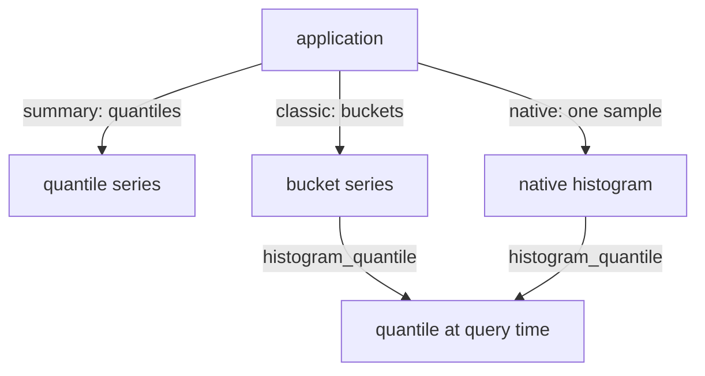

# Histograms, Summaries And Native Histograms

Prometheus has three ways to record how long things take: classic histograms, summaries and native histograms. They look similar in a dashboard, but they store different data, and the choice decides which queries are possible later. This lesson compares them on the points that matter for PromQL: whether results can be aggregated, how accurate a quantile is, and what a query looks like. The playground dataset has only classic histograms, so this lesson has no commands. The expressions shown here are for reading.

## Summaries: quantiles calculated in the application

A summary is a metric type where the application itself calculates quantiles over a sliding time window and exposes them. A summary named `http_request_duration_seconds` creates these series:

- `http_request_duration_seconds{quantile="0.5"}`, `{quantile="0.9"}` and `{quantile="0.99"}`: the ready-made quantile values in seconds.
- `http_request_duration_seconds_sum` and `http_request_duration_seconds_count`: the same two counters as in a histogram.

The query is then a plain selector, because Prometheus does no calculation:

```promql
http_request_duration_seconds{quantile="0.9"}
```

This is cheap for the server and can be very accurate, because the client sees every observation. Three limits follow from the design. The quantiles are chosen in the code (here 0.5, 0.9 and 0.99), and you cannot ask for the 0.95 quantile later. The sliding window is also fixed in the code. Most important, quantile values of several instances cannot be combined: the average or maximum of 0.9 quantiles is not the 0.9 quantile of the whole service. A summary is a good choice for one process, but not for a service on many instances.

The `_sum` and `_count` series of a summary can still be added across instances, so the mean duration works exactly as for a histogram.

## Classic histograms: counts, quantiles on the server

A classic histogram does not calculate quantiles in the application. It only increments counters, which is cheap for the client, and Prometheus calculates quantiles at query time with `histogram_quantile` from the buckets. This is why the quantile and the window are free choices at query time, and why bucket series can be summed across instances before the quantile.



The diagram shows where the quantile is calculated: in the application for a summary, and in the query for both kinds of histogram.

The price of the classic histogram is accuracy and series count. A quantile is an interpolation inside one bucket, so the error can reach the width of that bucket, and the application must choose its bounds in advance. If the real values move outside the planned range, the estimate degrades quickly. For example, if the true 0.95 quantile is 220 milliseconds and the bucket around it spans 200 to 300 milliseconds, the interpolated estimate can be close to 300 milliseconds. Each bucket is also a series per label combination, so a histogram with 12 bounds and many labels is expensive to store.

## A comparison

| Aspect | Summary | Classic histogram | Native histogram |
| --- | --- | --- | --- |
| Quantile calculated | In the application | On the server, at query time | On the server, at query time |
| Aggregate across instances | Not possible for quantiles | Yes, if the bounds are identical | Yes, always |
| Quantile accuracy | Configurable, usually very high | Limited by the width of the bucket | Limited by the resolution |
| Choose in advance | Quantiles and window | Bucket bounds | Resolution |
| Series per histogram | One per quantile, plus sum and count | One per bound, plus sum and count | One sample type; one series |

Use a summary only when you never need to combine instances and want exact quantiles. Use a histogram when you aggregate, or when you need the share of requests under a threshold. Prefer native histograms where the tools support them.

## Native histograms: one sample holds all buckets

A native histogram is a sample type in which one sample holds the count, the sum and a dynamic set of buckets. There are no `_bucket` series and no `le` label: a single series named `http_request_duration_seconds` holds the whole distribution at each timestamp. The buckets are exponential. A number called the schema defines the growth factor between neighbouring bucket bounds, and a higher schema means finer buckets. Schema 3 gives a growth of about 10 percent per bucket, which is the default factor of 1.1 in the client libraries. A special zero bucket counts observations at or very near zero so that noise near zero does not fill many tiny buckets. Only buckets that contain observations are stored.

Because the application does not fix the bounds, the bucket layout needs no planning, and the resolution is high everywhere. Histograms from different instances use the same bucket scheme and can always be merged. Native histograms are exposed in the Prometheus protobuf format, because the text format has no representation for them. In versions of Prometheus before 3.8 the feature needed `--enable-feature=native-histograms`, and the scrape of native histograms is controlled by the setting `scrape_native_histograms`. A classic histogram can also be stored as a native histogram with custom bucket bounds (a setting named `convert_classic_histograms_to_nhcb`), which keeps the bounds but needs fewer series. The playground Prometheus loads OpenMetrics text, which cannot carry native histograms, so it has none.

## What queries look like

The queries lose the `le` label and the `_bucket` suffix. A fleet quantile over native histograms reads:

```promql
histogram_quantile(0.9, sum(rate(http_request_duration_seconds[5m])))
```

Each part has a new job. `rate` works on native histograms and returns a histogram of the per-second rates. `sum` adds the histograms of all instances, and `sum by (job)` keeps the label `job`. No `le` appears, so there is nothing to keep in the aggregation. `histogram_quantile` treats each histogram sample as a separate histogram and returns one value per series. It interpolates exponentially inside standard buckets and linearly inside custom buckets and the zero bucket.

Other functions exist only for native histograms. `histogram_count` and `histogram_sum` return the count and the sum of a histogram sample, and the mean is the division of their rates. `histogram_avg` returns the mean directly, and it is equivalent to `histogram_sum` divided by `histogram_count`. `histogram_fraction(lower, upper, v)` returns the fraction of observations between two values:

```promql
histogram_fraction(0, 0.25, sum(rate(http_request_duration_seconds[5m])))
```

The result is an estimate that interpolates inside buckets, and the bounds do not need to match bucket boundaries. This is the native form of the share under a threshold, without the need for a bucket at exactly 0.25.

The three expressions above are for reading: the playground has no native histograms, so they cannot run there. What you take from this lesson is the mapping. A classic mean is `rate(_sum) / rate(_count)`, and a native mean is `histogram_avg(rate(...))`. A classic share is a bucket rate divided by the count rate, and a native share is `histogram_fraction`. A classic quantile needs `sum by (le)`, and a native quantile needs only `sum`.

You now know how the three types differ, which one can be aggregated, and how native histograms remove the `le` label from the queries. The last question is how to apply these points together on a real service.

## Common pitfalls

> [!WARNING]
> - **Averaging summary quantiles across instances.** The quantile values of a summary are final numbers and cannot be combined. Use a histogram when you need a service-wide quantile.
> - **Keeping `le` in a native histogram query.** Native histograms have no `le` label, so `sum by (le)` adds all series into one group, because no series has that label.
> - **Using classic and native expressions on the wrong data.** A selector for `_bucket` finds nothing when the metric is a native histogram, and a selector without the suffix finds nothing when the metric is a classic histogram. Check which representation the metric has.
> - **Expecting native histograms to be scraped by default.** Depending on the Prometheus version, scraping needs a flag or the setting `scrape_native_histograms`, and the exporter must offer the protobuf format.
