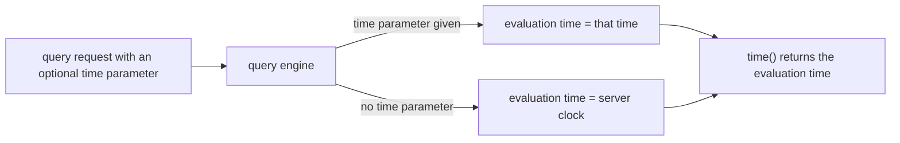
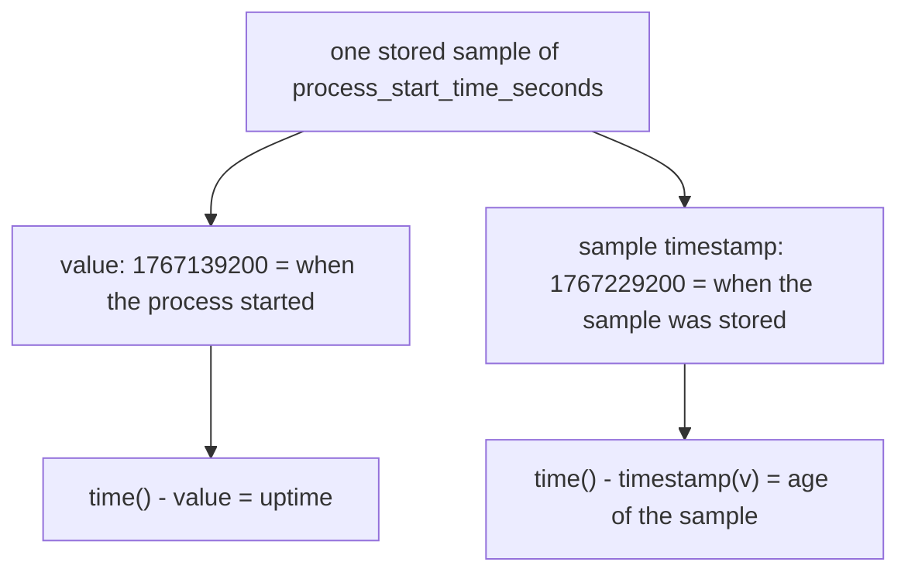

# time() And timestamp(): Two Different Clocks

To say how old something is, a query needs a "now" and a "then". PromQL offers two functions with similar names that supply times, and learners often mix them up. One of them, `time()`, gives the time of the evaluation. The other, `timestamp()`, gives the time of a stored sample. If you use the wrong one, the age you compute is wrong in a way that is hard to see. This part runs both functions against the same data until the difference is clear.

## time() returns the evaluation time

Start with the simplest query. Run it from the host. The helper evaluates the expression at the Unix time 1767229200, the time of the newest sample in the dataset:

<!-- astrona:playground:renew -->

```sh
kubectl -n starfleet exec deploy/shuttle -- python /tools/pq.py 'time()'
```

You should see:

```text
scalar 1767229200
```

The result is a scalar, a single number without labels. The number is the Unix time 1767229200, which is 2026-01-01T01:00:00Z. The function returns the number of seconds since 1970-01-01 UTC at which the expression is evaluated. It does not read a clock. The component that decides the evaluation time is the query engine inside Prometheus, and it takes the time from the `time` parameter of the query request. The helper sends that parameter when it is given a time.

Evaluate the same expression an hour earlier:

```sh
kubectl -n starfleet exec deploy/shuttle -- python /tools/pq.py 'time()' --time 1767225600
```

You should see:

```text
scalar 1767225600
```

The answer follows the `--time` option exactly. A request without a `time` parameter is the one case in which the engine uses the current time of the server. The helper sends no parameter when you give it `--now`. Run `time()` with `--now` yourself. The result is the Unix time at the moment of your run, a number that is far larger than 1767229200, because the dataset is old. This number depends on when you run the command, so the course cannot print it.



The diagram shows that `time()` never reads the clock directly. The query engine picks one evaluation time for the query, and `time()` returns it. In a range query the engine evaluates the expression once for every step, and `time()` returns the time of that step.

## timestamp() returns the time of a sample

Every sample that Prometheus stores has two parts: a value and a timestamp. The timestamp is the moment at which the sample was recorded. The function `timestamp(v)` takes an instant vector and returns, for each series, that stored time as a number of seconds. Try it on `up`:

```sh
kubectl -n starfleet exec deploy/shuttle -- python /tools/pq.py 'timestamp(up)'
```

You should see:

```text
{instance="bridge-0:8080", job="bridge"} 1767229200
{instance="bridge-1:8080", job="bridge"} 1767229200
{instance="probe-0:9100", job="probe"} 1767229200
{instance="shuttle-0:8080", job="shuttle"} 1767229200
```

There are four lines, not five. The series for `probe-1` stopped receiving samples at 1767228600, and the last section of this page explains why it is missing. The metric name `up` is gone from the output, because a function that computes a new number does not keep the name of its input. The labels `instance` and `job` stay.

Here every value is 1767229200, equal to `time()`. That is only because the newest sample is exactly at the evaluation time. Move the evaluation time 8 seconds later than a sample:

```sh
kubectl -n starfleet exec deploy/shuttle -- python /tools/pq.py 'timestamp(up)' --time 1767229193
```

You should see:

```text
{instance="bridge-0:8080", job="bridge"} 1767229185
{instance="bridge-1:8080", job="bridge"} 1767229185
{instance="probe-0:9100", job="probe"} 1767229185
{instance="shuttle-0:8080", job="shuttle"} 1767229185
```

The samples are 15 seconds apart, at 1767229170, 1767229185 and 1767229200. At the evaluation time 1767229193 the newest sample at or before that time is the one at 1767229185. A selector such as `up` takes that sample, and `timestamp()` reports its own stored time, 1767229185, and not the evaluation time. This is the sample that the selector uses. The next sample at 1767229200 is in the future of this evaluation, so the query cannot see it.

## The difference between the two is the freshness

Subtract one from the other and you get the age of the newest sample:

```sh
kubectl -n starfleet exec deploy/shuttle -- python /tools/pq.py 'time() - timestamp(up)' --time 1767229193
```

You should see:

```text
{instance="bridge-0:8080", job="bridge"} 8
{instance="bridge-1:8080", job="bridge"} 8
{instance="probe-0:9100", job="probe"} 8
{instance="shuttle-0:8080", job="shuttle"} 8
```

The value is 1767229193 minus 1767229185, which is 8 seconds. In a healthy system with a scrape every 15 seconds this number is always between 0 and 15, so a larger number means the series is late. This subtraction is the core of the freshness checks in this course.

## A timestamp value is not a sample timestamp

The second kind of time is a metric whose value is a time. The process exposes `process_start_time_seconds` and puts its start time into the value. Look at the raw series:

```sh
kubectl -n starfleet exec deploy/shuttle -- python /tools/pq.py 'process_start_time_seconds'
```

You should see:

```text
process_start_time_seconds{instance="bridge-0:8080", job="bridge"} 1767139200
process_start_time_seconds{instance="bridge-1:8080", job="bridge"} 1767227400
process_start_time_seconds{instance="probe-0:9100", job="probe"} 1767052800
process_start_time_seconds{instance="shuttle-0:8080", job="shuttle"} 1767225000
```

The value 1767139200 for `bridge-0` is the moment its process started, one day before the dataset begins. The sample that carries it was stored at 1767229200. Those are two different times, and they answer two different questions. The value says when the process started. `timestamp(process_start_time_seconds)` says when Prometheus stored this sample, which for the newest sample is 1767229200 for every series that exists.



The diagram shows that one sample feeds two different ages. Use the value for the age of an event. Use the sample timestamp for the freshness of the data.

## Where the lookback window ends

A selector in an instant query does not need a sample at the exact evaluation time. It takes the newest sample within the lookback delta, which is 5 minutes by default. The window is open at its start and closed at its end: a sample at exactly the evaluation time minus 300 seconds does not count. The last sample of `probe-1` is at 1767228600. Evaluate 290 seconds after it:

```sh
kubectl -n starfleet exec deploy/shuttle -- python /tools/pq.py 'time() - timestamp(up{instance="probe-1:9100"})' --time 1767228890
```

You should see:

```text
{instance="probe-1:9100", job="probe"} 290
```

The series still exists at this evaluation time, because its newest sample is 290 seconds old and that is inside the 5 minute window. The age is exactly 290. Now evaluate 300 seconds after the last sample:

```sh
kubectl -n starfleet exec deploy/shuttle -- python /tools/pq.py 'time() - timestamp(up{instance="probe-1:9100"})' --time 1767228900
```

You should see:

```text
(empty result)
```

The sample is exactly 300 seconds old, the left edge of the window, so the selector no longer returns it. The series is stale, and an expression built on `up{instance="probe-1:9100"}` has nothing to compute. This is why `timestamp(up)` at the default time showed only four series: the fifth series ended 600 seconds earlier.

You now know that `time()` is the evaluation time, that `timestamp(v)` is the stored time of the sample that a selector returns, and that a metric value can carry a time of its own. The difference `time() - timestamp(v)` tells you how fresh a series is. The open question is how to compute the age of a real event, such as a process start or a backup, from a timestamp-valued metric.

## Common pitfalls

> [!WARNING]
> - **Expecting `time()` to be the current time.** It is the evaluation time. With `--time` or in a range query it is a time in the past, and an age computed from it describes that moment.
> - **Using `timestamp()` on a timestamp-valued metric to find an event time.** `timestamp(process_start_time_seconds)` is the time of the sample. The start time is the value of the metric itself.
> - **Passing something other than a plain selector and expecting the sample time.** `timestamp()` is designed to be used directly on a selector such as `up` or `up{job="probe"}`. Apply other functions after it, not inside it.
> - **Forgetting the lookback window.** A series whose newest sample is 5 minutes old or older is invisible to an instant query, so no age is returned for it.
> - **Reading an empty result as "everything is fine".** An empty result can mean that nothing exceeded a limit, or that the series does not exist.
