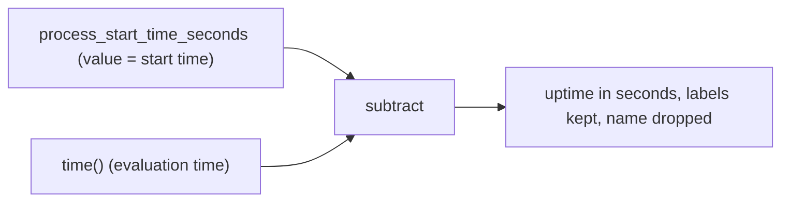

# The Age Of An Event: Uptime And Last Success

A dashboard rarely needs the Unix time of an event. It needs to know how long ago the event happened: the process started two hours ago, the last backup finished 40 minutes ago. PromQL computes this with one subtraction, because both numbers are already in seconds. This part applies that subtraction to two timestamp-valued metrics, shows what the output looks like, and shows how the same query behaves when a process restarts or a job stops.

## Why a metric holds a timestamp

Prometheus stores numbers. An event such as a process start is not a number that changes, so the process exposes the time of the event as the value of a gauge. A gauge is a metric whose value can go up and down. By convention the metric name ends in `_seconds` and the value is the Unix time of the event. The metric `process_start_time_seconds` is exposed by many exporters and client libraries and holds the start time of the process. The metric `backup_last_success_timestamp_seconds` in this dataset holds the time of the last successful backup. A job that finishes a backup writes the current Unix time into that gauge.

The value is not the age. The age grows every second, and a gauge that updated every second would cost a lot of storage. Instead the gauge changes only when the event happens, and the query computes the age at evaluation time. The component that does the subtraction is the PromQL engine in Prometheus, at the moment of the query.

## Uptime is the age of the start time

Look at the start times first. They are the same four series as before, with values in Unix seconds:

<!-- astrona:playground:renew -->

```sh
kubectl -n starfleet exec deploy/shuttle -- python /tools/pq.py 'time() - process_start_time_seconds'
```

You should see:

```text
{instance="bridge-0:8080", job="bridge"} 90000
{instance="bridge-1:8080", job="bridge"} 1800
{instance="probe-0:9100", job="probe"} 176400
{instance="shuttle-0:8080", job="shuttle"} 4200
```

The expression subtracts a vector from a scalar. `time()` is a scalar, and `process_start_time_seconds` is an instant vector, a set of series that each have one value at the evaluation time. PromQL applies the scalar to every element of the vector and returns a vector. The output drops the metric name, because the result is a new quantity, and keeps the labels `instance` and `job`. The evaluation time is 1767229200, so for `bridge-0` the result is 1767229200 minus 1767139200, which is 90000 seconds, or 25 hours.

The series of `probe-1` is not in the output. Its newest sample is 600 seconds old, which is older than the lookback window, so the selector returns nothing for it. Its uptime is not zero or unknown: the query has no value for it at all.



The diagram shows the two inputs of the subtraction and the result. The order matters: `time()` comes first, so a start in the past gives a positive number.

## A restart resets the uptime

The process `bridge-1` restarts at 1767227400. At the first sample after that, its start time moves from 1767218400 to 1767227400. Evaluate at the moment of the restart:

```sh
kubectl -n starfleet exec deploy/shuttle -- python /tools/pq.py 'time() - process_start_time_seconds' --time 1767227400
```

You should see:

```text
{instance="bridge-0:8080", job="bridge"} 88200
{instance="bridge-1:8080", job="bridge"} 0
{instance="probe-0:9100", job="probe"} 174600
{instance="probe-1:9100", job="probe"} 174600
{instance="shuttle-0:8080", job="shuttle"} 2400
```

The uptime of `bridge-1` is 0 and the others are large. This time `probe-1` is present, because at 1767227400 it still has fresh samples. One sample earlier, 15 seconds before the restart, the new start time was not yet visible:

```sh
kubectl -n starfleet exec deploy/shuttle -- python /tools/pq.py 'time() - process_start_time_seconds{instance="bridge-1:8080"}' --time 1767227385
```

You should see:

```text
{instance="bridge-1:8080", job="bridge"} 8985
```

The old start time 1767218400 gives 1767227385 minus 1767218400, which is 8985 seconds, about 2.5 hours. A drop of the uptime from thousands of seconds to a few seconds is the signature of a restart. A graph of the uptime is a sawtooth that climbs one second per second and falls to zero at every restart.

## The age of the last successful backup

Backups work the same way, with one difference: the process does not restart, the job runs now and then. Look at the raw gauge:

```sh
kubectl -n starfleet exec deploy/shuttle -- python /tools/pq.py 'backup_last_success_timestamp_seconds'
```

You should see:

```text
backup_last_success_timestamp_seconds{instance="probe-0:9100", job="probe"} 1767226800
backup_last_success_timestamp_seconds{instance="shuttle-0:8080", job="shuttle"} 1767228900
```

The value for `shuttle-0` is 1767228900, 300 seconds before the evaluation time. The value for `probe-0` is 1767226800, 2400 seconds before. Now subtract:

```sh
kubectl -n starfleet exec deploy/shuttle -- python /tools/pq.py 'time() - backup_last_success_timestamp_seconds'
```

You should see:

```text
{instance="probe-0:9100", job="probe"} 2400
{instance="shuttle-0:8080", job="shuttle"} 300
```

In the dataset the `probe-0` backup job stopped refreshing its gauge after 1767227400, so the value stays at 1767226800 and its age grows by one second for every second of evaluation time. At 1767228600 the age of `probe-0` is 1800, and 600 seconds later it is 2400. A stopped job leaves a rising age. This is the failure that this metric exists to expose.

The `shuttle-0` gauge is refreshed every 300 seconds, so its age is a sawtooth between 300 and 585 seconds in this dataset. Evaluate just before a refresh:

```sh
kubectl -n starfleet exec deploy/shuttle -- python /tools/pq.py 'time() - backup_last_success_timestamp_seconds{job="shuttle"}' --time 1767229185
```

You should see:

```text
{instance="shuttle-0:8080", job="shuttle"} 585
```

The gauge at that time is 1767228600 and the age is 585 seconds. At the next sample, 15 seconds later, the gauge jumps to 1767228900 and the age falls back to 300. A threshold for this job must therefore be larger than the largest value of the normal sawtooth, and that value is the refresh interval plus the delay of the gauge.

To get the oldest backup across all sources, aggregate the ages with `max`:

```sh
kubectl -n starfleet exec deploy/shuttle -- python /tools/pq.py 'max(time() - backup_last_success_timestamp_seconds)'
```

You should see:

```text
{} 2400
```

The aggregation removes all labels, so the result is one series with an empty label set. It does not say which source is old. Keep the labels when you need to know which one.

You now know how to turn a timestamp-valued gauge into the age of an event, and how restarts and stopped jobs show up as a reset or a rising age. The open question is how to turn an age into a clear yes or no for a given limit, in units that people read.

## Common pitfalls

> [!WARNING]
> - **Subtracting in the wrong order.** `process_start_time_seconds - time()` gives a negative number. Write `time() - metric`.
> - **Treating the gauge value as an age.** `backup_last_success_timestamp_seconds` is a point in time. Only the subtraction gives an age.
> - **Setting a limit below the normal sawtooth.** A job that runs every 300 seconds has an age of up to about 300 seconds in normal operation. A limit of 300 fires during healthy runs.
> - **Expecting a value for every instance.** A series whose newest sample is older than the lookback window produces no age. Here `probe-1` has no uptime and no backup age at the default time.
> - **Aggregating before you know the question.** `max(...)` hides which instance is old.
