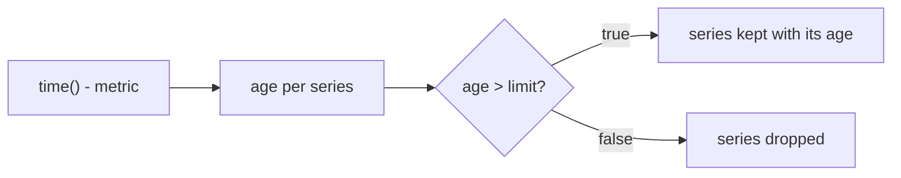

# Overdue Work: Thresholds And Unit Conversion

An age in seconds is exact, but it is hard to judge. Nobody decides that a backup is late because its age is 2400. People say it is 40 minutes old and that backups must be younger than 15 minutes. Turning an age into a statement about a limit needs two tools: a division to change the unit, and a comparison operator to keep only the series that break the limit. This part builds the overdue-work expression step by step and shows where the order of the operators changes the answer.

## A threshold in seconds

The simplest limit is written in the unit of the age, which is seconds. A backup older than 15 minutes is older than 900 seconds. Run the age expression with a comparison:

<!-- astrona:playground:renew -->

```sh
kubectl -n starfleet exec deploy/shuttle -- python /tools/pq.py 'time() - backup_last_success_timestamp_seconds > 900'
```

You should see:

```text
{instance="probe-0:9100", job="probe"} 2400
```

PromQL evaluates the subtraction first, because arithmetic operators bind tighter than comparison operators. Then the comparison runs between a vector and a scalar. By default a comparison of this kind is a filter: it keeps the elements for which the comparison is true, with their original value, and drops the others. The age of `shuttle-0` is 300, which is not above 900, so it disappears. The age of `probe-0` is 2400, so it stays, and it keeps the value 2400. The result is the list of overdue sources, and the value of each one is its age in seconds.



The diagram shows the filter. A series either passes with its age, or it leaves the result. This is also the shape of an alerting rule expression: Prometheus raises an alert for every series that the expression returns.

## Converting the unit

Seconds are right for the computation, and minutes or hours are right for people. To change the unit, divide by the number of seconds in it: 60 for minutes, 3600 for hours and 86400 for days. Write the subtraction in parentheses, so that the division applies to the age:

```sh
kubectl -n starfleet exec deploy/shuttle -- python /tools/pq.py '(time() - backup_last_success_timestamp_seconds) / 60'
```

You should see:

```text
{instance="probe-0:9100", job="probe"} 40
{instance="shuttle-0:8080", job="shuttle"} 5
```

The values are 2400 divided by 60, and 300 divided by 60. Both divide evenly in this dataset, so the output is whole numbers. In general an age divided by 3600 or 86400 is a fraction. The uptime of `bridge-0` is 90000 seconds, so in days it is approximately 1.04, and the exact digits that Prometheus prints for such a division can differ from what you compute by hand. Compare with your own output and do not expect a fixed number of decimals.

Now the limit can be written in the same unit as the result. Keep the sources whose backup is older than 15 minutes:

```sh
kubectl -n starfleet exec deploy/shuttle -- python /tools/pq.py '(time() - backup_last_success_timestamp_seconds) / 60 > 15'
```

You should see:

```text
{instance="probe-0:9100", job="probe"} 40
```

The result is the same series as with 900 seconds, but its value is now 40 minutes. Use the unit that matches the way people talk about the limit. The expression is the same either way, and only the number in the comparison and the divisor change.

## The order of operators changes the answer

Parentheses matter. Division binds tighter than subtraction. Without them, the expression below divides the backup time and not the age:

```sh
kubectl -n starfleet exec deploy/shuttle -- python /tools/pq.py 'time() - backup_last_success_timestamp_seconds / 60'
```

You should see:

```text
{instance="probe-0:9100", job="probe"} 1737775420
{instance="shuttle-0:8080", job="shuttle"} 1737775385
```

The query succeeds and returns large numbers that look like times, and nothing in the output says the expression is wrong. The engine computed 1767226800 divided by 60, which is 29453780, and subtracted that from 1767229200. A wrong unit conversion is silent, so always check the value against an age you can compute by hand.

The same rule applies to a comparison: `time() - metric > 900` is correct without parentheses, but `(time() - metric) / 60 > 15` needs them, because the division would otherwise bind to `metric` alone.

## Units inside the comparison

A duration such as `15m` is written in PromQL only where a duration is expected, for example in a range selector `[15m]` or after `offset`. It is not a number in arithmetic. In a comparison the limit is always a number of seconds, or a number in the unit you converted to. Write 900, not 15m.

## Keeping every series with the bool modifier

A filter drops the series that are fine. Sometimes you want every series with a 1 or a 0, for example for a dashboard table. The `bool` modifier changes the comparison from a filter into a calculation that returns 1 for true and 0 for false for every element:

```sh
kubectl -n starfleet exec deploy/shuttle -- python /tools/pq.py 'time() - backup_last_success_timestamp_seconds > bool 900'
```

You should see:

```text
{instance="probe-0:9100", job="probe"} 1
{instance="shuttle-0:8080", job="shuttle"} 0
```

The value is no longer an age, and the age is not visible. Use the filter form for alerts and the `bool` form for a status column.

## The same idea for a process that restarted

An overdue-work expression works for any age. To list the processes that started less than one hour ago, compare the uptime with 3600 seconds, using the other direction:

```sh
kubectl -n starfleet exec deploy/shuttle -- python /tools/pq.py 'time() - process_start_time_seconds < 3600'
```

You should see:

```text
{instance="bridge-1:8080", job="bridge"} 1800
```

Only `bridge-1` restarted within the last hour of the dataset, 1800 seconds before the evaluation time. A limit can be an upper bound on an age (the backup is too old) or a lower bound on an uptime (the process is too new).

## A limit needs a time context

Evaluate the overdue expression at an earlier time. At 1767228600 both `probe` sources have a backup older than 15 minutes:

```sh
kubectl -n starfleet exec deploy/shuttle -- python /tools/pq.py 'time() - backup_last_success_timestamp_seconds > 900' --time 1767228600
```

You should see:

```text
{instance="probe-0:9100", job="probe"} 1800
{instance="probe-1:9100", job="probe"} 1800
```

At the default time only `probe-0` is returned, because the series of `probe-1` has ended and the expression has nothing to subtract. The overdue expression finds an old value, not a missing one. A backup job that disappears completely, with its series, never appears in this result. Finding a missing series needs a different tool.

You now can turn an age into a statement about a limit: subtract for the age, divide for the unit, compare for the filter, and use parentheses to protect the order. The open question is what to do about series that have no sample at all, because they never show up as overdue.

## Common pitfalls

> [!WARNING]
> - **Missing parentheses before a division.** `time() - metric / 60` returns a huge number that looks plausible. Write `(time() - metric) / 60`.
> - **Writing a duration literal in arithmetic.** `15m` is not a number in a comparison. Use the number of seconds, or the converted unit.
> - **Mixing units.** A limit of 15 compared with an age in seconds returns every series. A limit of 900 compared with an age in minutes returns none.
> - **Using `bool` in an alert.** With `bool` every series is returned, with a value of 0 or 1, and an alert fires for all of them.
> - **Assuming a missing series is not overdue.** If the series is gone, the expression returns nothing and no alert fires.
