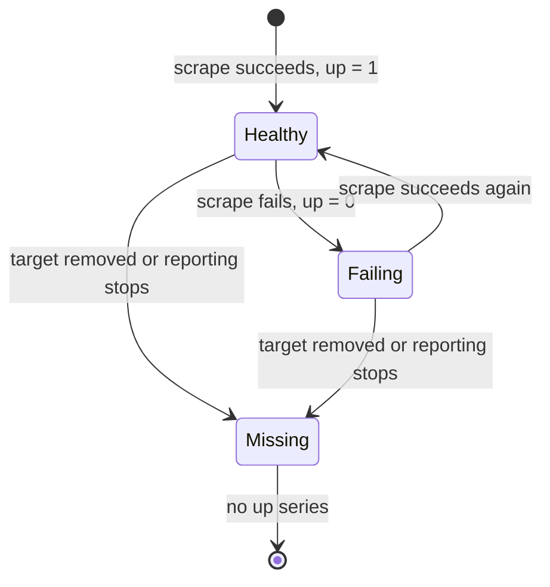

# up And What A Missing Series Means

Every alert about a service has one hidden assumption: the data that the alert reads exists. If a process stops reporting, a rule such as "error ratio above 5 percent" stops returning anything, and the alert does not fire. The first line of defence against that failure is the metric `up`. This part explains what `up` is, who writes it, what its two values mean, and why a missing `up` series is a different problem from `up` equal to 0.

## Who writes up

Prometheus scrapes a target by sending an HTTP request to it and reading the metrics in the response. After every scrape the Prometheus server itself, not the target, stores one extra sample for that target: the metric `up`, with the labels `job` and `instance` of the target. The value is 1 if the scrape succeeded and 0 if it failed, for example because the target did not answer or answered with an error. Because the server writes it, `up` exists even when the target is completely dead.

The dataset in the playground is not scraped: its samples were loaded as a block, and they follow the same rules that a real server would produce. Start with the plain series:

<!-- astrona:playground:renew -->

```sh
kubectl -n starfleet exec deploy/shuttle -- python /tools/pq.py 'up'
```

You should see:

```text
up{instance="bridge-0:8080", job="bridge"} 1
up{instance="bridge-1:8080", job="bridge"} 1
up{instance="probe-0:9100", job="probe"} 1
up{instance="shuttle-0:8080", job="shuttle"} 1
```

Four targets answer with 1 at the evaluation time 1767229200. The dataset defines a fifth target, `probe-1`, and it is not in the output. A target that is missing is the subject of the second half of this part. Count the targets of each job with an aggregation:

```sh
kubectl -n starfleet exec deploy/shuttle -- python /tools/pq.py 'sum by (job) (up)'
```

You should see:

```text
{job="bridge"} 2
{job="probe"} 1
{job="shuttle"} 1
```

The job `probe` has two instances in the dataset, but the sum is 1, because only `probe-0` has a value now. The sum of `up` is the number of healthy targets, and it cannot tell the difference between a target that is down and one that is gone.

## up equal to 0: known and failing

The instance `shuttle-0` fails its scrape between 1767228000 and 1767228585. Look at one moment inside that period, and keep only the failing series with a comparison filter:

```sh
kubectl -n starfleet exec deploy/shuttle -- python /tools/pq.py 'up == 0' --time 1767228300
```

You should see:

```text
up{instance="shuttle-0:8080", job="shuttle"} 0
```

A comparison filter keeps the metric name, so the line starts with `up`. The target is known: Prometheus has it in its configuration and scrapes it, and every scrape fails. An alert on `up == 0` fires for this target. At the default time the same expression has no result:

```sh
kubectl -n starfleet exec deploy/shuttle -- python /tools/pq.py 'up == 0'
```

You should see:

```text
(empty result)
```

At 1767229200 `shuttle-0` is healthy again, so the filter keeps nothing. An empty result here means that no target is failing.



The diagram shows three states of a target. Healthy and failing targets produce an `up` sample at every scrape. A missing target produces none, so `up == 0` cannot find it.

## Counting the empty result

A filter that finds nothing returns an empty vector. The function `count()` of an empty vector is also empty, and not 0:

```sh
kubectl -n starfleet exec deploy/shuttle -- python /tools/pq.py 'count(up == 0)'
```

You should see:

```text
(empty result)
```

This matters in alert rules and in dashboards that expect a number. To return 0 when the left side is empty, combine it with `or` and the function `vector()`, which builds a vector with one element and no labels:

```sh
kubectl -n starfleet exec deploy/shuttle -- python /tools/pq.py 'count(up == 0) or vector(0)'
```

You should see:

```text
{} 0
```

The operator `or` returns every element of its left side, and adds the elements of the right side that have no match on the left. The left side is empty, so the result is the right side: one element with an empty label set and the value 0.

## A missing series: unknown, not failing

The last sample of `probe-1` is at 1767228600. The lookback window of an instant query is 5 minutes, open at its left edge. At 290 seconds after the sample, the series is still visible:

```sh
kubectl -n starfleet exec deploy/shuttle -- python /tools/pq.py 'up{job="probe"}' --time 1767228890
```

You should see:

```text
up{instance="probe-0:9100", job="probe"} 1
up{instance="probe-1:9100", job="probe"} 1
```

At exactly 300 seconds after the sample, the sample lies on the left edge of the window and does not count:

```sh
kubectl -n starfleet exec deploy/shuttle -- python /tools/pq.py 'up{job="probe"}' --time 1767228900
```

You should see:

```text
up{instance="probe-0:9100", job="probe"} 1
```

The series of `probe-1` disappeared without ever reaching the value 0. Its last value was 1. The expression `up == 0` never matches it, and `sum(up)` simply gets smaller by 1.

In a real Prometheus server a target that is removed from the configuration, or a scrape that stops, usually ends with a staleness marker: a special sample that tells the query engine to treat the series as gone at once, without waiting for the lookback window. The dataset here has no staleness markers, so you can see the 5 minute window at work. The conclusion is the same in both cases. A series that stops exists in no query result, and the way to notice it is to test for its absence.

You now know that `up` is written by the server for every scrape, that 0 means a known failing target, and that a missing series is a separate state that comparisons cannot see. The open question is how to write an expression that returns something exactly when a series is missing.

## Common pitfalls

> [!WARNING]
> - **Alerting only on `up == 0`.** A target that is removed, renamed or no longer discovered stops producing `up` samples, and the alert never fires.
> - **Reading `sum(up)` as a count of existing targets.** It counts only targets that currently report 1.
> - **Expecting `count(up == 0)` to return 0.** It returns an empty result when nothing is down. Use `or vector(0)` if a number is required.
> - **Assuming a stopped series turns to 0.** The value stays 1 until the last sample, and after the lookback window the series is simply not there.
> - **Forgetting that a series stays visible for about 5 minutes.** A series with no new sample still appears in an instant query until its newest sample reaches the left edge of the window.
