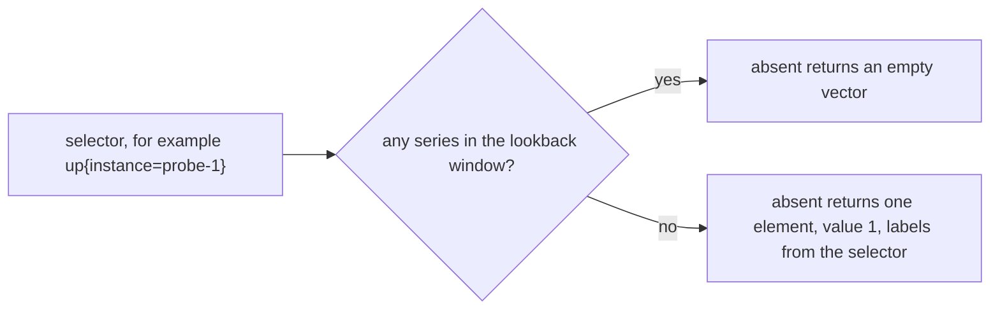

# absent() And absent_over_time()

A comparison returns nothing when the data is fine, and it also returns nothing when the data is gone. An alert needs an expression that is empty in the first case and returns a value in the second. PromQL provides two functions for it, `absent()` and `absent_over_time()`. They invert emptiness: they return one element when their input is empty. This part shows how each one decides, which labels the returned element carries, and how the two differ when a series ended a few minutes ago.

## absent() on an instant vector

The function `absent(v)` takes an instant vector. If the vector has at least one element, the result is an empty vector. If the vector has no element, the result is a vector with one element and the value 1. Try the first case, a job that still has one healthy instance:

<!-- astrona:playground:renew -->

```sh
kubectl -n starfleet exec deploy/shuttle -- python /tools/pq.py 'absent(up{job="probe"})'
```

You should see:

```text
(empty result)
```

The selector `up{job="probe"}` returns the series of `probe-0` at the default time, so the vector has an element and `absent()` returns nothing. The job `probe` has two instances in the dataset, but one is enough. An alert on `absent(up{job="probe"})` fires only when all instances of the job are gone. Now ask about the one instance that ended:

```sh
kubectl -n starfleet exec deploy/shuttle -- python /tools/pq.py 'absent(up{instance="probe-1:9100"})'
```

You should see:

```text
{instance="probe-1:9100"} 1
```

The selector matches no series at 1767229200, so `absent()` returns one element with the value 1. The element has the label `instance`. Prometheus built that label from the selector, which is the next topic.



The diagram shows the single decision that `absent()` makes. The component that decides is the query engine, at the evaluation time.

## Which labels the result gets

The function cannot return the labels of a series that does not exist, so it derives labels from the selector. The rule is: every label that the selector fixes with an equality matcher (`=`), once per label name, becomes a label of the result. The metric name is never added. A regular expression matcher (`=~`), an inequality matcher (`!=`) and a name that appears twice in the selector add nothing. Check it with two equality matchers:

```sh
kubectl -n starfleet exec deploy/shuttle -- python /tools/pq.py 'absent(up{job="probe", instance="probe-1:9100"})'
```

You should see:

```text
{instance="probe-1:9100", job="probe"} 1
```

Both labels are in the result. Replace one equality matcher with a regular expression:

```sh
kubectl -n starfleet exec deploy/shuttle -- python /tools/pq.py 'absent(up{job="probe", instance=~"probe-1.*"})'
```

You should see:

```text
{job="probe"} 1
```

Only `job` remains. The result carries the labels that you can rely on, and an alert that routes on `instance` will not get that label from the regular expression form. When the input is an expression and not a selector, nothing can be derived:

```sh
kubectl -n starfleet exec deploy/shuttle -- python /tools/pq.py 'absent(sum(up{instance="probe-1:9100"}))'
```

You should see:

```text
{} 1
```

The aggregation `sum()` already removed the labels, and `sum` of an empty vector is empty, so `absent()` sees no element and returns one with no labels. For alerts, write `absent()` around a plain selector with the labels that tell people what is missing.

## absent_over_time() on a range vector

The function `absent_over_time(v[range])` takes a range vector, the samples of each series inside a time range. It returns one element with the value 1 if the range vector has no elements, and nothing if any series has at least one sample in the range. The labels follow the same rule as `absent()`. The difference is the time span: `absent()` looks at the lookback window of 5 minutes, and `absent_over_time()` looks at the range that you write. A range gives you control over how long a series must be gone before the result appears. Test the 5 minute range on the ended series:

```sh
kubectl -n starfleet exec deploy/shuttle -- python /tools/pq.py 'absent_over_time(up{instance="probe-1:9100"}[5m])'
```

You should see:

```text
{instance="probe-1:9100"} 1
```

The range `[5m]` at 1767229200 covers the samples after 1767228900 up to 1767229200. The last sample of `probe-1` is at 1767228600, outside the range, so the range vector is empty. Now extend the range to 10 minutes:

```sh
kubectl -n starfleet exec deploy/shuttle -- python /tools/pq.py 'absent_over_time(up{instance="probe-1:9100"}[10m])'
```

You should see:

```text
{instance="probe-1:9100"} 1
```

The result is still 1, although 10 minutes ago looks like it should include the sample. It does not: in Prometheus 3 a range selector is open at its left edge, so `[10m]` at 1767229200 covers the times after 1767228600 and the sample at exactly 1767228600 is excluded. Use `[11m]` to include it:

```sh
kubectl -n starfleet exec deploy/shuttle -- python /tools/pq.py 'absent_over_time(up{instance="probe-1:9100"}[11m])'
```

You should see:

```text
(empty result)
```

The sample at 1767228600 lies inside the range 1767228540 to 1767229200, so the series is not absent over 11 minutes.

## Choosing between the two

Use `absent()` when 5 minutes of silence, the lookback window, is the right delay. Use `absent_over_time()` when you want a longer delay, so that a target that misses a few scrapes or restarts does not raise an alert. The two functions detect a series that does not exist at all. They do not detect a series that exists with a bad value, and they do not detect one instance out of several when the selector is broader than that instance. A selector `up{job="probe"}` stays non-empty while `probe-0` reports, even if `probe-1` is gone. To watch every instance you must either name each instance in its own expression, or use the comparison between past and present that the next part shows.

You now can write an expression that returns 1 exactly when a named series is missing, and you know which labels it carries and how the range changes the delay. The open question is how to detect a restart, a stale series and a series that vanished when you do not know its name in advance.

## Common pitfalls

> [!WARNING]
> - **Using a broad selector.** `absent(up{job="probe"})` stays empty while any instance of the job reports. A single missing instance goes unnoticed.
> - **Expecting labels from a regular expression matcher.** Only equality matchers produce labels, so an alert may lose the `instance` label that its route uses.
> - **Counting the left edge of a range.** A sample exactly at the evaluation time minus the range is excluded. A range of exactly the age of the last sample still reports it as absent.
> - **Wrapping an aggregation in `absent()`.** The result has no labels, so nobody can tell what is missing.
> - **Using `absent()` for a bad value.** It tests that a series exists, not that its value is acceptable.
