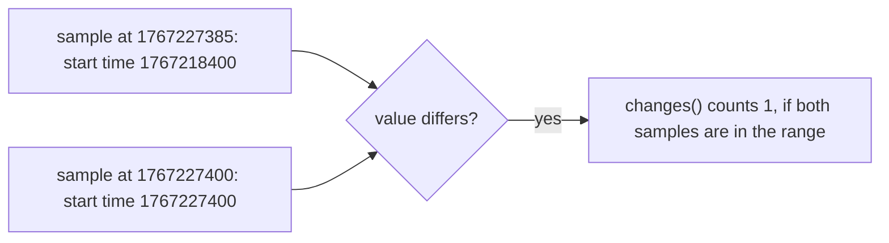

# Restarts, Stale Series And Gaps

The tests so far need a name: you write the series that must exist. Real systems also fail in ways that you cannot name in advance. A process restarts and loses its state. A series is still visible, but its newest sample is old. A series that was there 10 minutes ago is gone. A series lost some of its samples. This part gives one expression for each of these cases, built from `changes()`, `timestamp()`, `offset` with `unless`, and `count_over_time()`.

## Detecting a restart with changes()

A process exposes its start time in `process_start_time_seconds`. While the process runs, the value does not change. When it restarts, the value jumps to the new start time. The function `changes(v[range])` counts how many times the value of each series differs from the previous sample inside the range. Apply it over the whole hour of the dataset:

<!-- astrona:playground:renew -->

```sh
kubectl -n starfleet exec deploy/shuttle -- python /tools/pq.py 'changes(process_start_time_seconds[1h])'
```

You should see:

```text
{instance="bridge-0:8080", job="bridge"} 0
{instance="bridge-1:8080", job="bridge"} 1
{instance="probe-0:9100", job="probe"} 0
{instance="probe-1:9100", job="probe"} 0
{instance="shuttle-0:8080", job="shuttle"} 0
```

Only `bridge-1` has a change: one restart, at 1767227400. Five lines appear, including `probe-1`. A range function works on the samples that exist inside the range, and `probe-1` still has samples in the last hour, so it is part of the result even though a plain selector would no longer return it. Keep only the processes that restarted:

```sh
kubectl -n starfleet exec deploy/shuttle -- python /tools/pq.py 'changes(process_start_time_seconds[1h]) > 0'
```

You should see:

```text
{instance="bridge-1:8080", job="bridge"} 1
```

The range matters. The restart shows in the data as a different value between the sample at 1767227385 and the sample at 1767227400. A range of 30 minutes at 1767229200 starts after 1767227400 and excludes the sample at exactly that time, so the change is outside the range:

```sh
kubectl -n starfleet exec deploy/shuttle -- python /tools/pq.py 'changes(process_start_time_seconds[30m])'
```

You should see:

```text
{instance="bridge-0:8080", job="bridge"} 0
{instance="bridge-1:8080", job="bridge"} 0
{instance="probe-0:9100", job="probe"} 0
{instance="probe-1:9100", job="probe"} 0
{instance="shuttle-0:8080", job="shuttle"} 0
```

The query reports no restart, although one happened 30 minutes ago. The range needs to reach back past the previous sample, for example `[31m]`. When you pick a range, make it longer than the period that you want to cover.



The diagram shows what `changes()` compares: two neighbouring samples. Both samples must lie in the range for the change to count.

## A stale series that is still visible

A series stays visible to an instant query for 5 minutes after its last sample. During that time its value is the old value, and nothing in the value shows that it is old. The function `timestamp()` does show it. Compute the age of the newest sample for every `up` series, 290 seconds after the last sample of `probe-1`:

```sh
kubectl -n starfleet exec deploy/shuttle -- python /tools/pq.py 'time() - timestamp(up)' --time 1767228890
```

You should see:

```text
{instance="bridge-0:8080", job="bridge"} 5
{instance="bridge-1:8080", job="bridge"} 5
{instance="probe-0:9100", job="probe"} 5
{instance="probe-1:9100", job="probe"} 290
{instance="shuttle-0:8080", job="shuttle"} 5
```

Four series are 5 seconds old, because their newest sample is at 1767228885. The series `probe-1` is 290 seconds old: it is still returned by the lookback, and it is stale. Select the series that are older than a few scrape intervals, here 60 seconds:

```sh
kubectl -n starfleet exec deploy/shuttle -- python /tools/pq.py 'time() - timestamp(up) > 60' --time 1767228890
```

You should see:

```text
{instance="probe-1:9100", job="probe"} 290
```

This expression catches a silent target about 4 minutes before `absent()` can, because `absent()` waits until the series leaves the lookback window. It is empty at the default time, since by then `probe-1` has left the window entirely. A complete watch therefore has two parts: the age of the newest sample while the series is visible, and an absence test after it is gone.

## A series that vanished, without naming it

To find series that existed earlier and do not exist now, compare the same selector at two times. The modifier `offset 10m` shifts the evaluation of a selector 10 minutes into the past. The operator `unless` returns the elements of its left side that have no element with the same labels on its right side:

```sh
kubectl -n starfleet exec deploy/shuttle -- python /tools/pq.py 'up offset 10m unless up'
```

You should see:

```text
up{instance="probe-1:9100", job="probe"} 1
```

The left side is `up` as it was at 1767228600, when `probe-1` still had its last sample. The right side is `up` at 1767229200, where `probe-1` is gone. Every other series is on both sides and is removed by `unless`. The result has the value that the old sample had. This expression finds every vanished series with no name written in it. The offset is the grace period: a series that returns within it does not appear.

## Gaps and failed scrapes

A failed scrape is not a gap. When a scrape fails, Prometheus still stores a sample for `up` with the value 0. The instance `shuttle-0` is an example: its value is 0 for 10 minutes, and it has a sample at every 15 seconds. The function `changes(up[1h])` counts its flaps: two for `shuttle-0`, one from 1 to 0 and one from 0 to 1.

A gap is a missing sample while the series continues. For `probe-1` the series ends, and for a series with a gap it would resume. Count the samples of each series in the last 15 minutes. A scrape every 15 seconds produces 60 samples:

```sh
kubectl -n starfleet exec deploy/shuttle -- python /tools/pq.py 'count_over_time(up[15m])'
```

You should see:

```text
{instance="bridge-0:8080", job="bridge"} 60
{instance="bridge-1:8080", job="bridge"} 60
{instance="probe-0:9100", job="probe"} 60
{instance="probe-1:9100", job="probe"} 20
{instance="shuttle-0:8080", job="shuttle"} 60
```

The range `(1767228300, 1767229200]` holds 60 samples for a series that never lost one. The series `probe-1` has 20, because it stopped at 1767228600. The expression `count_over_time(up[15m]) < 60` returns only that series. The same test works for a real gap, and it needs the expected number of samples, which is the range divided by the scrape interval.

You now have four expressions for situations where no name is known: `changes()` for restarts, `time() - timestamp()` for stale series, `offset` with `unless` for series that vanished, and `count_over_time()` for lost samples. The question left is how to practise them on data where you know the answer.

## Common pitfalls

> [!WARNING]
> - **Choosing a range that ends right at the event.** `changes(...[30m])` at 1767229200 misses a change at exactly 1767227400. Make the range longer than the period you need.
> - **Expecting a series that stopped to be in `changes()`.** It is in the result while it has samples in the range, and it leaves when the range no longer has any.
> - **Reading a visible series as fresh.** A series can stay visible for up to 5 minutes without a new sample. Check `time() - timestamp(v)`.
> - **Mixing a failed scrape with a gap.** A failed scrape has a sample with the value 0. A gap has no sample.
> - **Choosing an offset shorter than the delay you tolerate.** A series that is missing for a few scrapes appears in `unless` results when the offset is short.
